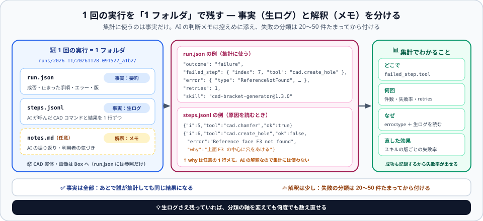
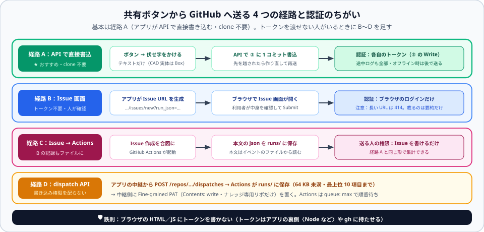
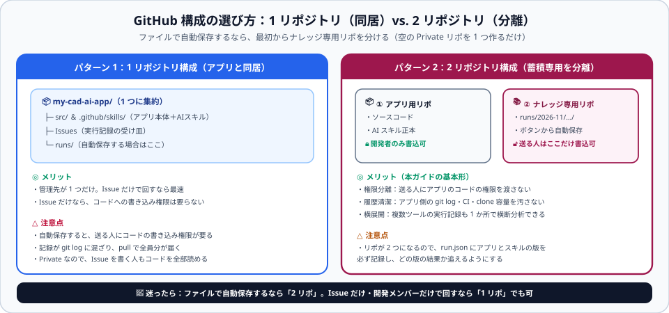
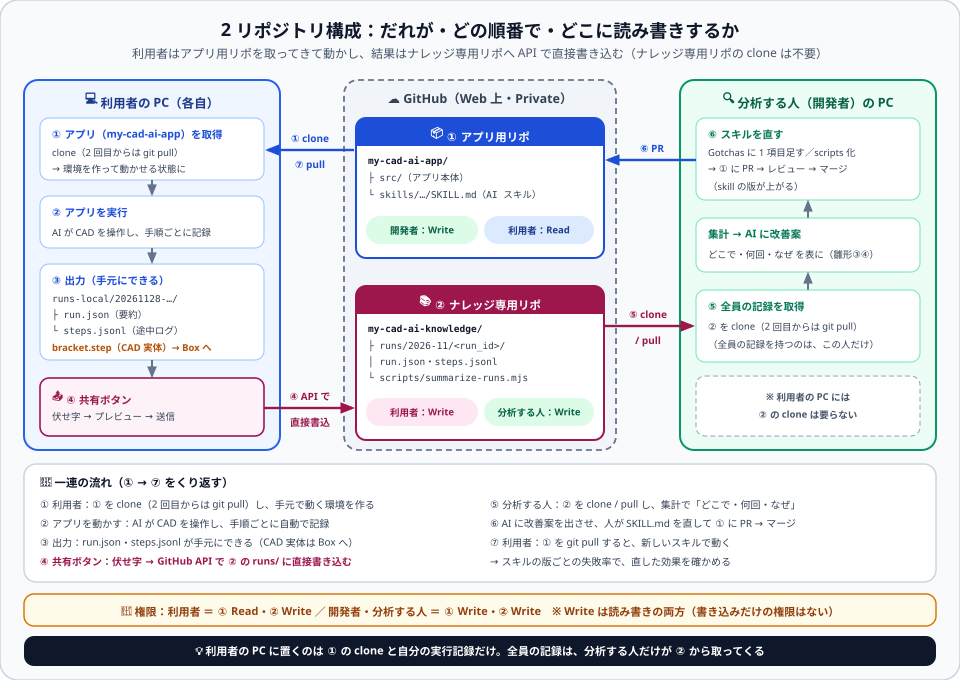
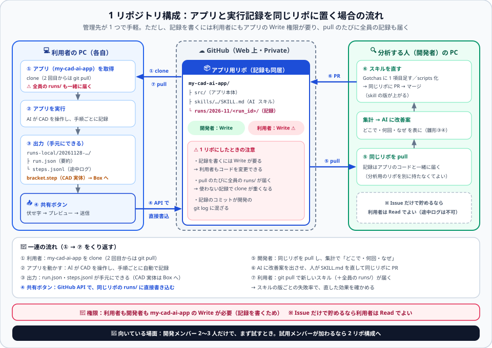
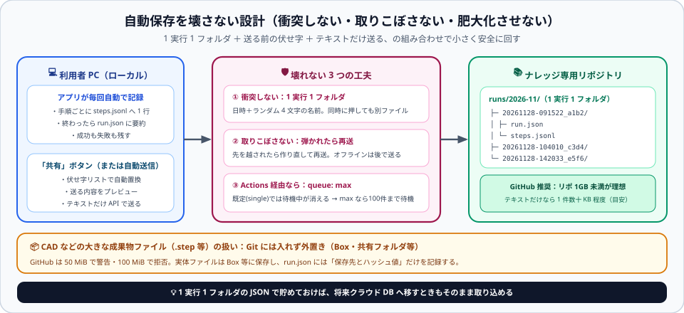

# 02. GitHub で作る実践構成 — 記録の形・送り方・置き場所

この章では、**「共有」ボタンを押すと、その実行の結果と途中経過のログが GitHub に溜まっていく**仕組みを組み立てます。  
決めることは 3 つだけです。

1. **何を残すか**：1 回の実行を 1 フォルダにまとめる（→ 1 章）
2. **どう送るか**：基本は「アプリが API で直接書き込む」（clone 不要、→ 2 章）
3. **どこに置くか**：ナレッジ専用のリポジトリを 1 つ作る（→ 3 章）

---

## 1. 何を残すか：1 回の実行 = 1 フォルダ



```text
runs/2026-11/20261128-091522_a1b2/
├─ run.json      ← その実行の要約（成否・止まった手順・エラー・版）
├─ steps.jsonl   ← 途中経過の生ログ（AI が呼んだ CAD コマンドと結果を 1 行ずつ）
└─ notes.md      ← 任意：AI の振り返り・利用者の気づき
```

| ファイル | 中身 | 書くのは | 集計に使う？ |
|---|---|---|---|
| `run.json` | 成否、止まった手順、エラーの種類と原文、リトライ回数、アプリ・スキルの版 | アプリが自動で | ◎ 主役 |
| `steps.jsonl` | 手順ごとのツール名・引数・結果・エラー・所要時間（＋任意で AI の一言） | アプリが自動で | ○ 原因を読むとき |
| `notes.md` | AI の振り返り、利用者のコメント | AI・人（任意） | △ 参考 |

中身の具体例とアプリに組み込むコードは [03 章の雛形①②](03_analyze-to-skills.md) にあります。

### 「どこで・何回・なぜ」を分かるようにする 3 つの項目

| 知りたいこと | 見る項目 |
|---|---|
| **どこで**失敗した？ | `failed_step`（何番目の、どのツールで止まったか） |
| **何回**失敗した？ | 件数と失敗率（成功も記録するので分母がある）、`retries`（やり直した回数） |
| **なぜ**失敗した？ | `error.type` と `error.message`（CAD から返ったエラーの原文そのまま） |

### 生ログを主役に、AI の解釈は控えめに

> [!TIP]
> **迷ったら「事実は全部、解釈は少し」**
> - 集計に使うのは `run.json` と `steps.jsonl` の**事実だけ**にします。こうしておけば、後から誰が集計しても同じ結果になります。
> - AI に判断メモを書かせるなら、**1 手順 1 行（何をしようとしたか）** 程度で十分です。長い振り返りは、分析するときに生ログから AI にまとめさせれば足ります。
> - 「単位ミス」「座標ずれ」のような**失敗の分類は、記録するときには付けません**。20〜50 件たまってから、まとめて付けます。生ログさえ残っていれば、分類の軸を変えても何度でも数え直せます。

### 成功も失敗も、全部残す

共有ボタンを押したものだけを集めると、目立つ失敗ばかりが集まり、失敗率も出せません。

- アプリは**毎回の実行を手元に自動で記録**しておく
- 共有は「**成功も失敗も押す**」と決めておく（開発メンバーは「毎回自動で送る」設定にしてもよい）

---

## 2. どう送るか：共有ボタンから GitHub への 4 つの経路



**守ること**：ブラウザ側の HTML／JavaScript に GitHub のトークンを書かないこと。

| 経路 | 動き方 | 認証 | 途中ログ | 向いている人 |
|---|---|---|---|---|
| **A：アプリが API で直接書き込む（おすすめ）** | ボタン → アプリが伏せ字をかけ、GitHub API でナレッジ専用リポの `runs/` に 1 コミットで書き込む | 各自のトークン（ナレッジ専用リポだけに絞った Fine-grained PAT、または `gh` のログイン） | ◎ 全部送れる | ナレッジ専用リポの Write 権限を渡せる人（開発・試用メンバー） |
| B：Issue 画面を開く | アプリが `run.json` を入れた Issue 作成 URL を開く → 人が確認して Submit | ブラウザのログインだけ（トークン不要） | ✕ URL に載る要約だけ | トークンを用意しない人 |
| C：Issue → Actions で保存 | B の Issue が作られたら、Actions が `run.json` を `runs/` に保存 | B と同じ | ✕ 要約だけ | B の記録も A と同じ形で集計したいとき |
| D：dispatch → Actions で保存 | アプリの中継が `repository_dispatch` API を呼び、Actions が保存 | 中継側に共通の Fine-grained PAT（`Contents: write`）を置く | ○ 64 KB 未満まで | 利用者ごとに権限を渡さず、送る内容を GitHub 側でも確かめたいとき |

> [!NOTE]
> **用語**：**Fine-grained PAT** は、対象のリポジトリと権限を絞って発行できる GitHub のトークンです。**GitHub Actions** は、GitHub 上で決まった処理を自動で動かす仕組みです。

### 経路 A（おすすめ）のポイント

- **clone は要らない**：利用者が使うのは自分の実行記録だけです。ナレッジ専用リポを手元に持つ必要はなく、API で書き込むだけで済みます。全員の記録を取ってくるのは、分析する人だけです（3 章の図）。
- **git も Actions も要らない**：アプリから GitHub API を呼ぶだけです。Actions の利用時間も使いません。
- **1 回の送信 = 1 コミット**：`run.json` と `steps.jsonl` を 1 つのコミットでまとめて書くので、半分だけ届くことがありません。
- **衝突しない**：誰かが先に書き込んでいたら更新が断られるので、最新の状態から作り直して送り直します。1 実行 1 フォルダなので、何度やり直しても他の人の記録は消えません。
- **取りこぼさない**：ネットにつながらないときは手元に残し、あとでまとめて送ります。
- コードは [03 章の雛形②](03_analyze-to-skills.md) にあります。

> [!TIP]
> **すでに clone して使っているなら**、アプリから `git pull --rebase` → `git push` で送る形でもかまいません。ただし、`pull` のたびに全員の記録が手元に届きます。

### 経路 B〜D を使うときの注意

- **B**：Issue Form の入力欄は `id` を使って URL から事前入力できます。ただし URL が長すぎると `414 URI Too Long` になるので、載せるのは `run.json` の要約だけです。
- **C**：Issue は、そのリポジトリを読める人なら誰でも作れます。Actions では本文を**コマンドに直接埋め込まない**でください（雛形⑥はイベントのファイルから読むので安全です）。
- **D**：`client_payload` は**最上位 10 項目まで・64 KB 未満**です。`{ "run": …, "steps": … }` のように 2 項目にまとめて送ります。
- B〜D で Actions を使うときは、`concurrency` に `queue: max` を付けます（4 章）。

---

## 3. どこに置くか：1 リポか 2 リポか



**結論：ファイルで自動保存するなら、最初からナレッジ専用リポを分けます（2 リポ構成）。** 空の Private リポを 1 つ作るだけなので、手間はほとんど増えません。

| | 1 リポ（アプリと同居） | 2 リポ（ナレッジ専用を分ける） |
|---|---|---|
| **構成** | `my-cad-ai-app/` に Issue（や `runs/`）も置く | ① `my-cad-ai-app/`（コード・スキル）<br/>② `my-cad-ai-knowledge/`（`runs/`） |
| **権限** | ファイルで自動保存すると、送る人に**アプリのコードへの書き込み権限**が要る。Issue だけでも、Private リポなので Issue を書く人は**コードを全部読める** | 送る人には ② の Write だけ渡せばよい（① は Read のまま） |
| **手元に届くもの** | `git pull` のたびに、全員の `runs/` も届く | 利用者の手元は ① だけ。全員の記録は、分析する人だけが ② から取ってくる |
| **履歴** | 自動コミットが開発の `git log` に混ざる | アプリ側の `git log`・CI・clone の容量が汚れない |
| **向いている場面** | Issue だけで、開発メンバーだけで回すとき | ファイルで自動保存するとき（本ガイドの基本形）。試用メンバーが加わるとき。複数ツールの記録を横断して見たいとき |

### 2 リポ構成の流れ（本ガイドの基本形）



1. **取得**：利用者は ① アプリ用リポを clone し、手元で動く環境を作ります（2 回目からは `git pull`）。
2. **実行**：アプリを動かすと、AI が CAD を操作し、手順ごとに自動で記録します。
3. **出力**：手元に `run.json`・`steps.jsonl` ができます。CAD の実体ファイルは Box などへ置きます。
4. **共有**：共有ボタンで、伏せ字をかけてから GitHub API で ② ナレッジ専用リポの `runs/` に直接書き込みます（② の clone は不要）。
5. **分析**：分析する人だけが ② を clone／pull し、集計スクリプトで「どこで・何回・なぜ」を数えます。
6. **改善**：AI に改善案を出させ、人が `SKILL.md` を直して ① に PR を出し、レビューしてマージします。
7. **反映**：利用者が ① を `git pull` すると、新しいスキルで動きます。あとはスキルの版ごとの失敗率で、直した効果を確かめます。

**だれにどの権限を渡すか**

| 人 | ① アプリ用リポ | ② ナレッジ専用リポ | 手元に置くもの |
|---|---|---|---|
| 利用者（試用メンバーを含む） | **Read**（clone して動かす） | **Write**（記録を書き込む） | ① の clone と、自分の実行記録だけ |
| 開発者・分析する人 | **Write**（スキルを直す） | **Write**（記録を読む・不要な記録を消す） | ① と ② の clone |

> [!NOTE]
> GitHub のリポジトリ権限は Read／Triage／Write／Maintain／Admin などで、**Write は「読む」と「書く」の両方**を含みます。「書き込みだけで読めない」権限はないので、② に書ける人は他の人の記録も読めます。チーム内で共有する前提なら問題ありません。読ませたくない場合は、経路 D（共通トークンを中継側に置く）を検討します。

### 1 リポ構成の流れ（比較用）



流れは同じですが、記録の書き込み先がアプリ用リポそのものになります。そのため、**利用者にもアプリの Write 権限が要り**（コードを変更できてしまう）、**`git pull` のたびに全員の記録が届き**、**記録のコミットが開発の履歴に混ざります**。開発メンバー 2〜3 人だけでまず試すなら手軽ですが、試用メンバーが加わるなら 2 リポ構成に分けます。

> [!NOTE]
> この先、記録の置き場を DB やクラウドに移すときも、利用者 → 保存先 → 分析する人という流れは同じです。段階ごとの図は [04. この先の発展](04_evolution-db-cloud.md) を見てください。

> [!TIP]
> **2 リポにしたら版を必ず記録**：`run.json` に `app_version`（アプリの版やコミット ID）と `skill`（スキル名と版）を入れておきます。「どの版で失敗したか」「直した後に失敗率が下がったか」を後から追えます。

---

## 4. 自動保存を壊さない 4 つの工夫



1. **1 実行 1 フォルダ**：フォルダ名を「日時＋ランダム 4 文字」にすれば、同時に送っても衝突しません。1 件だけ消したいときもフォルダごと消せば済みます。
2. **送る前に伏せ字とプレビュー**：顧客名・図番などの伏せ字リストと、API キーらしき文字列を自動で置き換えます。送る内容を画面で見せてから送ります。
3. **テキストだけ送る**：CAD の実体（`.step` 等）や画像は Git に入れず、Box などへ置きます。`run.json` には保存先とハッシュ値だけを書きます。
   - GitHub は 1 ファイル **50 MiB で警告・100 MiB で拒否**、リポジトリは **1 GB 未満が理想**です。
   - テキストだけなら 1 件あたり数十 KB 程度（目安）なので、数千件たまっても届きにくい大きさです。
   - 詳しい運用は [大容量データは Git の外に置く](../agent-skill/05_large-files-outside-git.md) を参照してください。
4. **Actions を使うなら `queue: max`**：`concurrency` の既定（`queue: single`）では、待っている実行が新しい実行に置き換えられて消えてしまいます。`queue: max` なら最大 100 件まで待てます。
   - 待機の順番は厳密には保証されませんが、1 実行 1 フォルダなら問題ありません。
   - Actions 標準の `GITHUB_TOKEN` で push しても別のワークフローは起動しないので、無限ループにもなりません。

---

## 5. 機密情報の扱い

1. **送り先を絞る**：送り先は Private のナレッジ専用リポだけにし、メンバーも絞ります。
2. **伏せ字とプレビューを必ず通す**：このガイドは原因を調べるために依頼文も途中ログも残す方針なので、そのぶん送る前の確認を省かないでください。
3. **GitHub に出せない情報は Box などへ**：社内ルールで GitHub に出せないものは、Box などに置いて参照だけを書きます。

> [!NOTE]
> [agent-skill/01](../agent-skill/01_skill-management-loop.md) のスキル利用ログは「依頼文を残さない」方針です。あちらはスキルの**使われ方を数える**のが目的だからです。本ガイドは**失敗の原因を調べる**のが目的なので、依頼文と途中ログを残し、送り先と伏せ字で守ります。

---

◀ 前の章：[01. 開発初期のライトな蓄積方法 5 選](01_lightweight-options.md) ／ ▶ 次の章：[03. 貯めた記録から改善点を見つける＆コピペ雛形集](03_analyze-to-skills.md)
