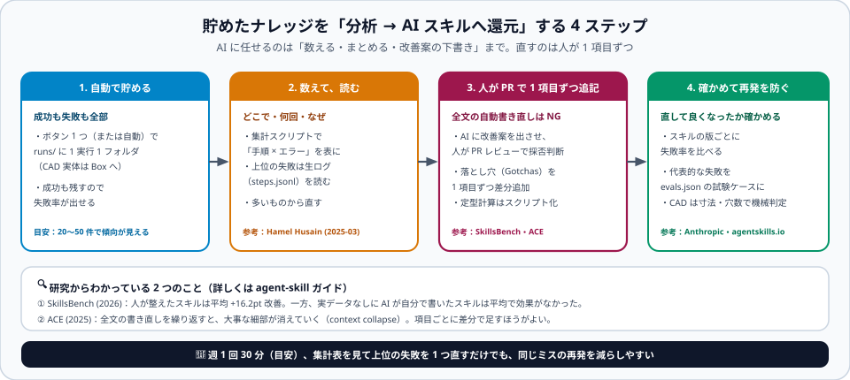

# 03. 貯めた記録から改善点を見つける — 分析の手順 ＆ コピペ雛形集

記録は「貯めただけ」では AI は賢くなりません。  
この章では、GitHub に溜まった実行記録から **どこで・何回・なぜ失敗しているか** を数え、ローカル AI のスキル・ルールを直すまでの手順と、そのまま使える雛形をまとめます。

---

## 1. 分析 → 改善の 4 ステップ



| ステップ | やること | ポイント |
|---|---|---|
| **1. 自動で貯める** | 成功も失敗も、ボタン 1 つ（または自動送信）で `runs/` に送る | 成功も残すので、失敗率が出せる |
| **2. 数えて、読む** | 20〜50 件たまったら集計スクリプト（雛形③）で「どこで・何回・なぜ」を表にする。上位の失敗は `steps.jsonl` を実際に読み、原因を一言メモする | 一般的なスコアより、**自分のアプリで多い失敗**から直す。表だけで決めず、生ログを読む |
| **3. 直す（人が 1 項目ずつ）** | 集計表と上位の失敗ログを AI に渡して改善案を出させる（雛形④）。**採用は人が PR で決め**、スキルの「落とし穴（Gotchas）」に 1 項目ずつ足す。毎回同じ計算で間違えるなら `scripts/` に補助スクリプトを置く | 全文を書き直させると、大事な例外が消えやすい |
| **4. 確かめる** | スキルの版ごとに失敗率を比べる。代表的な失敗は `evals/evals.json` に試験ケースとして残す | CAD は「穴の数・径・位置・外形寸法」を CAD 側に問い合わせて機械的に判定すると楽 |

**ペースの目安**：週 1 回 30 分。集計表を見て、上位の失敗を 1 つ直すだけでも効きます。

> [!NOTE]
> **20〜50 件は「傾向が見え始める」目安です。** Anthropic も、評価用のテストケースは実際の失敗から 20〜50 件集めれば始めるのに十分だとしています。数百件そろうまで待つ必要はありません。

> [!IMPORTANT]
> **スキルが効かなくなる 2 つの落とし穴**
> 1. **AI に勝手に書き換えさせ続けない**：実データなしに AI が自分で書いたスキルは、平均で効果がなかったという研究があります（SkillsBench）。AI に任せるのは「数える・まとめる・改善案の下書き」までにして、採用は人が PR で決めます。
> 2. **「全部まとめ直して」と頼まない**：全文の書き直しを繰り返すと細部が消えていきます（ACE）。Gotchas に 1 項目ずつ足していきます。

---

## 2. そのまま使える雛形集（6 種）

| 雛形 | 何に使うか | 置き場所 |
|---|---|---|
| ① 実行記録の形 | 1 実行 1 フォルダの中身 | アプリが書く |
| ② 記録＆共有モジュール | 毎回の自動記録と、共有ボタン（経路 A：API で直接書き込み） | アプリの中（Node.js） |
| ③ 集計スクリプト | どこで・何回・なぜを表にする | ナレッジ専用リポの `scripts/` |
| ④ 分析プロンプト | 改善案を AI に出させる | AI に貼る |
| ⑤ Issue Form | 経路 B（トークンを用意しない人向け） | ナレッジ専用リポの `.github/ISSUE_TEMPLATE/` |
| ⑥ Actions | 経路 C・D（Issue や dispatch で届いた記録を `runs/` に保存） | ナレッジ専用リポの `.github/workflows/` |

最初に要るのは **①〜④ だけ**です。⑤⑥ は、トークンを用意しない人が加わってから足します。

---

### 雛形①：実行記録の形（`run.json` ＋ `steps.jsonl`）

保存先の例：`runs/2026-11/20261128-091522_a1b2/`

**`run.json`**（その実行の要約。集計に使う）

```json
{
  "schema_version": 1,
  "run_id": "20261128-091522_a1b2",
  "started_at": "2026-11-28T09:15:22+09:00",
  "duration_sec": 48,
  "app_version": "0.2.0+abc1234",
  "skill": "cad-bracket-generator@1.3.0",
  "model": "model-name",
  "task_category": "bracket_hole",
  "request": "L 字ブラケットの中央に φ20 の貫通穴をあけて",
  "outcome": "failure",
  "steps_total": 9,
  "failed_step": { "index": 7, "tool": "cad.create_hole" },
  "error": { "type": "ReferenceNotFound", "message": "Reference face F3 not found" },
  "retries": 1,
  "artifacts": [
    { "kind": "step", "storage": "box", "path": "poc-cad/2026-11/20261128-091522_a1b2.step", "sha256": "（任意）" }
  ]
}
```

- `outcome` は `success`・`failure`・`partial`（部分的に成功）の 3 つに固定します。
- 成功のときは `failed_step` と `error` を `null` にします。
- `artifacts`（CAD 実体の置き場所）は、Box などに保存したときだけ書きます。

**`steps.jsonl`**（途中経過の生ログ。1 行 1 手順）

```jsonl
{"i":5,"at":"2026-11-28T09:15:51+09:00","tool":"cad.chamfer","args":{"edges":["E12"],"size_mm":2},"ok":true,"ms":820}
{"i":6,"at":"2026-11-28T09:15:53+09:00","tool":"cad.create_hole","args":{"face":"F3","diameter_mm":20,"through":true},"ok":false,"error":"Reference face F3 not found","error_type":"ReferenceNotFound","ms":310,"why":"上面 F3 の中心に穴をあける"}
{"i":7,"at":"2026-11-28T09:15:58+09:00","tool":"cad.create_hole","args":{"face":"F3","diameter_mm":20,"through":true},"ok":false,"error":"Reference face F3 not found","error_type":"ReferenceNotFound","ms":295,"retry_of":6}
```

- `error` と `error_type` は、CAD から返ったエラーの原文と種類をそのまま入れます。
- `why` は任意の 1 行メモ（AI の解釈）です。読むときの手がかりにするだけで、集計には使いません。
- `notes.md`（任意）には、利用者の気づきや AI の振り返りを自由に書きます。

---

### 雛形②：アプリに入れる記録＆共有モジュール（経路 A）

保存先の例：アプリの `src/knowledge-log.mjs`（Node.js 20 以降、追加ライブラリ不要）。  
**ナレッジ専用リポの clone は要りません。** 利用者ごとに、次のどちらかを用意します。

- ナレッジ専用リポだけに絞った Fine-grained PAT（権限は **Contents：Read and write**）を、環境変数 `KNOWLEDGE_TOKEN` に設定する
- または、`gh auth login` 済みなら何もしなくてよい（`gh` のトークンを使う）

送る人には、ナレッジ専用リポの **Write** 権限を付けておきます。

```js
// knowledge-log.mjs — アプリに入れる「自動記録」と「共有ボタン」のモジュール（Node.js 20 以降・追加ライブラリ不要）
// 共有は GitHub API でナレッジ専用リポに直接書き込む（clone 不要）。送る人にはナレッジ専用リポの Write 権限が必要。
import { execFileSync } from "node:child_process";
import { randomBytes } from "node:crypto";
import { appendFileSync, existsSync, mkdirSync, readdirSync, readFileSync, writeFileSync } from "node:fs";
import path from "node:path";

const LOCAL_RUNS_DIR = process.env.LOCAL_RUNS_DIR ?? "./runs-local";           // 手元の記録置き場
const KNOWLEDGE_REPO = process.env.KNOWLEDGE_REPO ?? "my-org/cad-ai-knowledge";   // ナレッジ専用リポ（owner/name）
const API = process.env.GITHUB_API_URL ?? "https://api.github.com";
const MASK_WORDS = ["顧客A社", "図番-1234"];                                    // チームで決めた伏せ字リスト
const jstIso = (d = new Date()) => new Date(d.getTime() + 9 * 3600e3).toISOString().slice(0, 19) + "+09:00";

// ── 1. 自動記録：実行を始めたら startRun、AI が CAD を操作するたびに step、終わったら finish ──
export function startRun({ request, taskCategory, skill, appVersion, model }) {
  const started = new Date();
  const jst = jstIso(started);                                                  // 例：2026-11-28T09:15:22+09:00
  const runId = jst.slice(0, 10).replaceAll("-", "") + "-" + jst.slice(11, 19).replaceAll(":", "")
    + "_" + randomBytes(2).toString("hex");                                     // 例：20261128-091522_a1b2
  const dir = path.join(LOCAL_RUNS_DIR, runId);
  mkdirSync(dir, { recursive: true });
  const steps = [];

  return {
    runId,
    dir,
    // entry の例：{ tool: "cad.create_hole", args: {...}, ok: false, error: "…", error_type: "ReferenceNotFound", ms: 310, why: "…" }
    step(entry) {
      const s = { i: steps.length + 1, at: jstIso(), ...entry };
      steps.push(s);
      appendFileSync(path.join(dir, "steps.jsonl"), JSON.stringify(s) + "\n");
    },
    // outcome は "success" / "failure" / "partial" のどれか
    finish(outcome) {
      const failed = outcome === "success" ? null : steps.findLast((s) => s.ok === false);
      const run = {
        schema_version: 1,
        run_id: runId,
        started_at: jst,
        duration_sec: Math.round((Date.now() - started.getTime()) / 1000),
        app_version: appVersion,
        skill,
        model,
        task_category: taskCategory,
        request,
        outcome,
        steps_total: steps.length,
        failed_step: failed ? { index: failed.i, tool: failed.tool } : null,
        error: failed ? { type: failed.error_type ?? "unknown", message: failed.error } : null,
        retries: steps.filter((s) => s.retry_of).length,
      };
      writeFileSync(path.join(dir, "run.json"), JSON.stringify(run, null, 2) + "\n");
      return run;
    },
  };
}

// ── 2. 共有ボタン：1 実行 1 フォルダを、GitHub API でナレッジ専用リポに 1 コミットで書き込む（clone 不要）──
function mask(text) {
  let t = text.replace(/\b(sk|ghp|gho|github_pat)[-_][A-Za-z0-9_-]{16,}/g, "[MASKED]");  // API キーらしき文字列
  for (const w of MASK_WORDS) t = t.split(w).join("[MASKED]");
  return t;
}

// トークン：ナレッジ専用リポだけに絞った Fine-grained PAT（Contents：Read and write）を KNOWLEDGE_TOKEN に置く。
// 未設定なら、gh にログイン済みの人は gh のトークンを使う。
function getToken() {
  return process.env.KNOWLEDGE_TOKEN ?? execFileSync("gh", ["auth", "token"]).toString().trim();
}

async function api(token, method, url, body) {
  const res = await fetch(API + "/repos/" + KNOWLEDGE_REPO + url, {
    method,
    headers: { Authorization: "Bearer " + token, Accept: "application/vnd.github+json" },
    body: body && JSON.stringify(body),
  });
  if (!res.ok) throw new Error(method + " " + url + " -> " + res.status);
  return res.json();
}

export async function shareRun(runId) {
  const src = path.join(LOCAL_RUNS_DIR, runId);
  if (existsSync(path.join(src, ".shared"))) return "already-shared";
  const dir = "runs/" + runId.slice(0, 4) + "-" + runId.slice(4, 6) + "/" + runId;   // runs/2026-11/<runId>
  const files = readdirSync(src)
    .filter((name) => /\.(json|jsonl|md)$/.test(name))                             // CAD 実体や画像は送らない（Box などへ）
    .map((name) => ({ path: dir + "/" + name, mode: "100644", type: "blob",
                      content: mask(readFileSync(path.join(src, name), "utf8")) }));
  const token = getToken();
  for (let i = 1; i <= 3; i++) {
    try {
      const head = (await api(token, "GET", "/git/ref/heads/main")).object.sha;          // いまの最新コミット
      const base = (await api(token, "GET", "/git/commits/" + head)).tree.sha;
      const tree = (await api(token, "POST", "/git/trees", { base_tree: base, tree: files })).sha;   // 最新 ＋ このフォルダ
      const commit = (await api(token, "POST", "/git/commits", { message: "run: " + runId, tree, parents: [head] })).sha;
      await api(token, "PATCH", "/git/refs/heads/main", { sha: commit });               // 先に誰かが書いていたら失敗 → やり直す
      writeFileSync(path.join(src, ".shared"), new Date().toISOString());
      return "sent";
    } catch {
      if (i === 3) return "saved-locally";   // オフラインなど：手元に残り、shareAllPending() で後から送れる
      await new Promise((r) => setTimeout(r, 1000 * i + Math.random() * 1000));    // 少し待ってやり直す
    }
  }
}

// まだ送れていない記録をまとめて送る（アプリの起動時などに呼ぶ）
export async function shareAllPending() {
  for (const runId of readdirSync(LOCAL_RUNS_DIR)) {
    const dir = path.join(LOCAL_RUNS_DIR, runId);
    if (existsSync(path.join(dir, "run.json")) && !existsSync(path.join(dir, ".shared"))) await shareRun(runId);
  }
}
```

**使い方（アプリ側）**

```js
import { startRun, shareRun, shareAllPending } from "./knowledge-log.mjs";

const run = startRun({ request, taskCategory: "bracket_hole", skill: "cad-bracket-generator@1.3.0",
                       appVersion: "0.2.0+abc1234", model: "model-name" });
// AI が CAD のツールを呼ぶたびに 1 行記録する
run.step({ tool: "cad.create_hole", args, ok: false, error: e.message, error_type: e.name, ms: 310 });
const summary = run.finish("failure");   // ← この内容を画面にプレビュー表示する

// 「共有」ボタンが押されたら（開発メンバーは finish の直後に自動で呼んでもよい）
const result = await shareRun(run.runId); // "sent" / "saved-locally"（あとで送る）/ "already-shared"

// アプリの起動時などに、送れていなかった記録をまとめて送る
await shareAllPending();
```

> [!TIP]
> **画面に出す 3 つ**：送る前のプレビュー（`run.json` の中身）、「伏せ字を確認した」チェック、送信結果（送信済み／手元に保存）。これだけで「押せば溜まる」と安心して使えます。

---

### 雛形③：集計スクリプト（どこで・何回・なぜ）

保存先：ナレッジ専用リポの `scripts/summarize-runs.mjs`  
使い方：`node scripts/summarize-runs.mjs > summary.md`（Node.js 20 以降）

```js
// summarize-runs.mjs — runs/ の run.json を集めて「どこで・何回・なぜ」を Markdown の表にする（Node.js 20 以降）
// 使い方（ナレッジ専用リポで）：node scripts/summarize-runs.mjs > summary.md
import { readdirSync, readFileSync } from "node:fs";
import path from "node:path";

const root = process.argv[2] ?? "runs";
const runs = readdirSync(root, { recursive: true })
  .filter((p) => path.basename(p) === "run.json")
  .map((p) => JSON.parse(readFileSync(path.join(root, p), "utf8")));
const isFail = (r) => r.outcome !== "success";
const pct = (a, b) => (b ? Math.round((a / b) * 100) + "%" : "-");

// 失敗を key ごとに数え、多い順に「件数」と「例（run_id）」を出す
function countTable(title, keyOf, list) {
  const m = new Map();
  for (const r of list) {
    const k = keyOf(r) ?? "(不明)";
    const v = m.get(k) ?? { n: 0, ids: [] };
    v.n++;
    if (v.ids.length < 3) v.ids.push(r.run_id);
    m.set(k, v);
  }
  console.log("\n## " + title + "\n\n| 項目 | 件数 | 例（run_id） |\n|---|---|---|");
  for (const [k, v] of [...m].sort((a, b) => b[1].n - a[1].n).slice(0, 10)) {
    console.log("| " + k + " | " + v.n + " | " + v.ids.join(", ") + " |");
  }
}

// 全実行を key ごとに分け、失敗率を出す
function rateTable(title, keyOf) {
  const m = new Map();
  for (const r of runs) {
    const k = keyOf(r) ?? "(不明)";
    const v = m.get(k) ?? { n: 0, f: 0 };
    v.n++;
    if (isFail(r)) v.f++;
    m.set(k, v);
  }
  console.log("\n## " + title + "\n\n| 項目 | 実行 | 失敗 | 失敗率 |\n|---|---|---|---|");
  for (const [k, v] of [...m].sort((a, b) => b[1].f - a[1].f)) {
    console.log("| " + k + " | " + v.n + " | " + v.f + " | " + pct(v.f, v.n) + " |");
  }
}

const fails = runs.filter(isFail);
console.log("# 実行記録のまとめ（全 " + runs.length + " 件）\n");
console.log("- 失敗・部分成功：" + fails.length + " 件（失敗率 " + pct(fails.length, runs.length) + "）");
console.log("- リトライの合計：" + runs.reduce((s, r) => s + (r.retries ?? 0), 0) + " 回");
countTable("どこで・なぜ失敗したか（止まった手順 × エラーの種類）",
  (r) => (r.failed_step ? r.failed_step.tool + " × " + (r.error?.type ?? "?") : null), fails);
countTable("なぜ失敗したか（エラーの種類）", (r) => r.error?.type, fails);
rateTable("作業の種類ごとの失敗率", (r) => r.task_category);
rateTable("スキルの版ごとの失敗率（直した効果の確認）", (r) => r.skill);
```

**出力の例**

```text
# 実行記録のまとめ（全 32 件）

- 失敗・部分成功：12 件（失敗率 38%）
- リトライの合計：9 回

## どこで・なぜ失敗したか（止まった手順 × エラーの種類）

| 項目 | 件数 | 例（run_id） |
|---|---|---|
| cad.create_hole × ReferenceNotFound | 6 | 20261128-091522_a1b2, 20261129-140210_c3d4, … |
| cad.extrude × InvalidUnit | 3 | 20261130-101533_e5f6, … |
```

---

### 雛形④：改善案を出させる分析プロンプト

雛形③の `summary.md` と、表の「例（run_id）」に出た記録のフォルダを AI に渡します。

```text
添付の「実行記録のまとめ（summary.md）」、上位の失敗の生ログ（runs/.../run.json と steps.jsonl）、現在の SKILL.md を読んで、改善点を整理してください。

【やってほしいこと】
1. まとめの表から、失敗の多い「止まった手順 × エラーの種類」を上位 3 つ選んでください。
2. それぞれについて steps.jsonl を読み、なぜ失敗したかを 2〜3 行で説明してください。推測の場合は「推測」と書いてください。
3. 失敗をいくつかの分類（例：単位の指定漏れ、面の番号ずれ、手順の順序）にまとめ、分類ごとの件数を表にしてください。
4. 上位 3 つの対策を出してください。
   - 文章で防げるもの → SKILL.md の「Gotchas（落とし穴）」に足す 1〜2 行の追記案
   - 毎回同じ計算・確認で起きるもの → scripts/ に置く補助スクリプトの案
5. 代表的な失敗 3 件を、evals/evals.json に入れる試験ケース案にしてください（判定は、寸法・穴の数など機械的に確かめられる条件で）。

【守ってほしいこと】
- SKILL.md を丸ごと書き直さず、追記・修正の差分だけを出してください。
- すべての提案に、根拠にした run_id を添えてください（採用は人が PR で決めます）。
```

---

### 雛形⑤：Issue Form（経路 B：トークンを用意しない人向け）

保存先：ナレッジ専用リポの `.github/ISSUE_TEMPLATE/ai-run.yml`

```yaml
name: AI 実行記録
description: アプリの「共有」ボタンから開く、実行記録の共有画面です
labels: ["ai-run"]
body:
  - type: markdown
    attributes:
      value: 送信する前に、顧客名・図番・機密の寸法が入っていないか確認してください。
  - type: textarea
    id: run_json
    attributes:
      label: 実行記録（アプリが自動で入力します）
      render: json
    validations:
      required: true
  - type: textarea
    id: comment
    attributes:
      label: 気づき・補足（任意）
      placeholder: "例：面取りの前に穴をあけると成功した"
```

アプリは次の URL をブラウザで開きます（`run_json` に `run.json` の中身を入れる）。

```text
https://github.com/my-org/cad-ai-knowledge/issues/new?template=ai-run.yml&title=run%3A+20261128-091522_a1b2&run_json=<URL エンコードした run.json>
```

- `render: json` を付けた欄は、送信すると本文の中で JSON のコードブロックになります。雛形⑥はそこを読み取ります。
- 途中ログ（`steps.jsonl`）は URL に載らないので、経路 B で届くのは要約だけです。

---

### 雛形⑥：Actions（経路 C・D の記録を `runs/` に保存）

保存先：ナレッジ専用リポの**デフォルトブランチ**の `.github/workflows/save-run.yml`

```yaml
# 経路 C（Issue で届いた記録）と経路 D（repository_dispatch）を、runs/ に 1 実行 1 フォルダで保存する
name: Save AI run

on:
  issues:
    types: [opened]
  repository_dispatch:
    types: [ai_run]

# 同時に届いても待機列で順番に処理する（既定の single だと、待っている実行が置き換えられて消える）
concurrency:
  group: save-ai-run
  queue: max

permissions:
  contents: write

jobs:
  save:
    if: github.event_name == 'repository_dispatch' || contains(github.event.issue.labels.*.name, 'ai-run')
    runs-on: ubuntu-latest
    steps:
      - uses: actions/checkout@v5

      # Issue の本文は誰でも書ける入力なので、Actions の式でコマンドに埋め込まず、イベントのファイルから読む
      - name: Write run.json (and steps.jsonl)
        run: |
          node -e '
            const fs = require("node:fs");
            const crypto = require("node:crypto");
            const ev = JSON.parse(fs.readFileSync(process.env.GITHUB_EVENT_PATH, "utf8"));
            let run, steps = null, source;
            if (ev.client_payload) {                                   // 経路 D：{ "run": {...}, "steps": [...] }
              run = ev.client_payload.run;
              steps = ev.client_payload.steps;
              source = { via: "dispatch" };
            } else {                                                   // 経路 C：Issue 本文の json ブロック
              const m = (ev.issue.body || "").match(/```json\s*([\s\S]*?)```/);
              if (!m) { console.log("json ブロックがないのでスキップ"); process.exit(0); }
              run = JSON.parse(m[1]);
              source = { via: "issue", issue: ev.issue.number };
            }
            if (!run || !["success", "failure", "partial"].includes(run.outcome)) {
              console.error("outcome（success / failure / partial）がありません"); process.exit(1);
            }
            const jst = new Date(Date.now() + 9 * 3600e3).toISOString();         // 日本時間でフォルダを決める
            const newId = jst.slice(0, 10).replace(/-/g, "") + "-" + jst.slice(11, 19).replace(/:/g, "") + "_" + crypto.randomBytes(2).toString("hex");
            const id = /^[0-9A-Za-z_-]{1,64}$/.test(run.run_id || "") ? run.run_id : newId;   // フォルダ名に使えない ID は作り直す
            const dir = "runs/" + jst.slice(0, 7) + "/" + id;
            fs.mkdirSync(dir, { recursive: true });
            const record = { ...run, run_id: id, received_at: new Date().toISOString(), source };  // 受信側の項目は後ろに置き、上書きさせない
            fs.writeFileSync(dir + "/run.json", JSON.stringify(record, null, 2) + "\n");
            if (Array.isArray(steps)) fs.writeFileSync(dir + "/steps.jsonl", steps.map((s) => JSON.stringify(s)).join("\n") + "\n");
            console.log("saved:", dir);
          '

      - name: Commit and push
        run: |
          git config user.name "github-actions[bot]"
          git config user.email "41898282+github-actions[bot]@users.noreply.github.com"
          git add runs/
          git diff --staged --quiet || (git commit -m "run: add record" && git push)
```

> **経路 D で送る側の注意**：`client_payload` は最上位 10 項目まで・64 KB 未満です。`{ "run": {…}, "steps": […] }` の 2 項目にまとめ、途中ログが長いときは末尾を切り詰めて送ります。トークンはナレッジ専用リポだけに絞った Fine-grained PAT（`Contents: write`）か GitHub App を使い、ブラウザ側の HTML には書かずに中継プログラムに持たせます。

---

◀ 前の章：[02. GitHub で作る実践構成](02_github-architecture.md) ／ 📖 [出典一覧（sources.md）](sources.md) ／ 🏠 [トップ（README）へ戻る](README.md)
