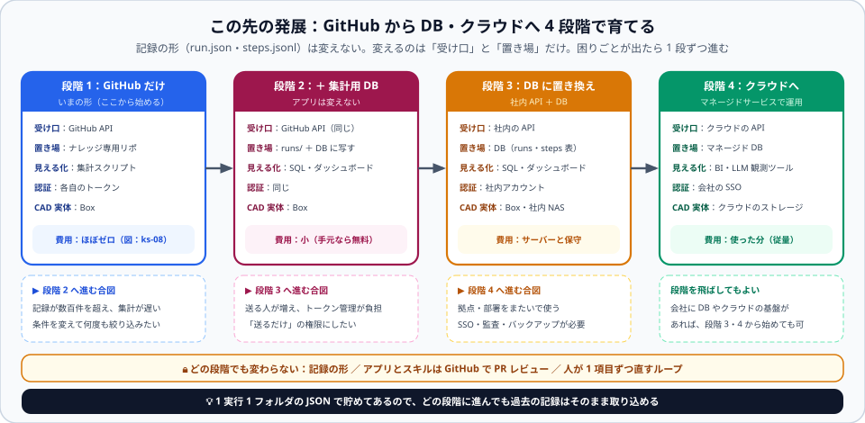
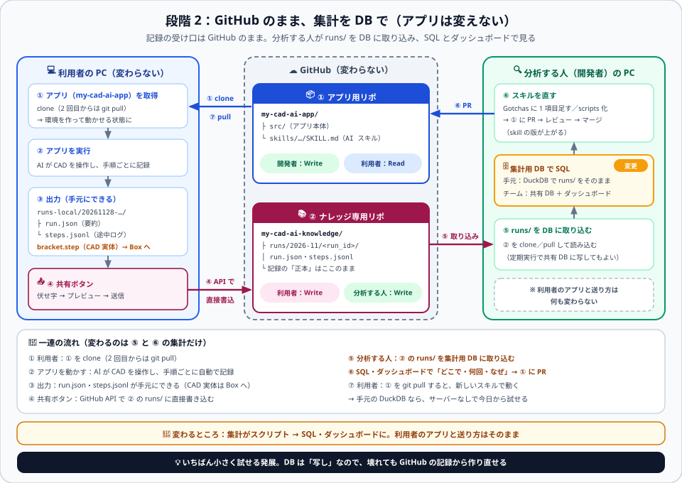
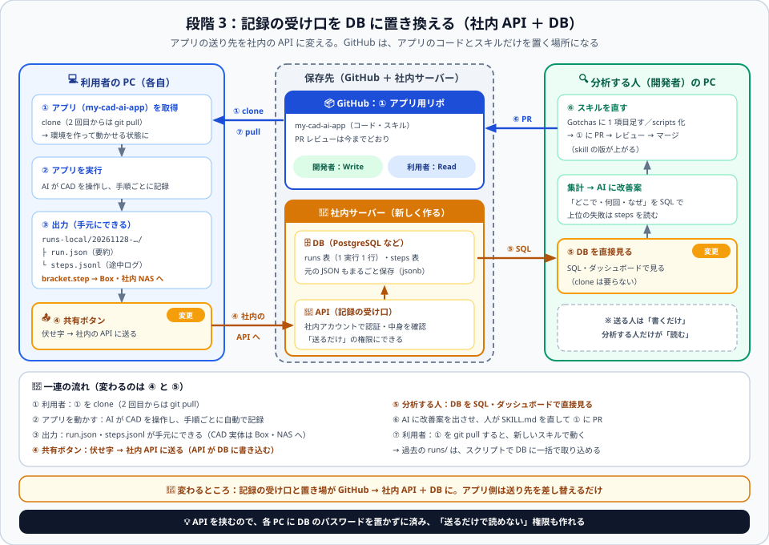
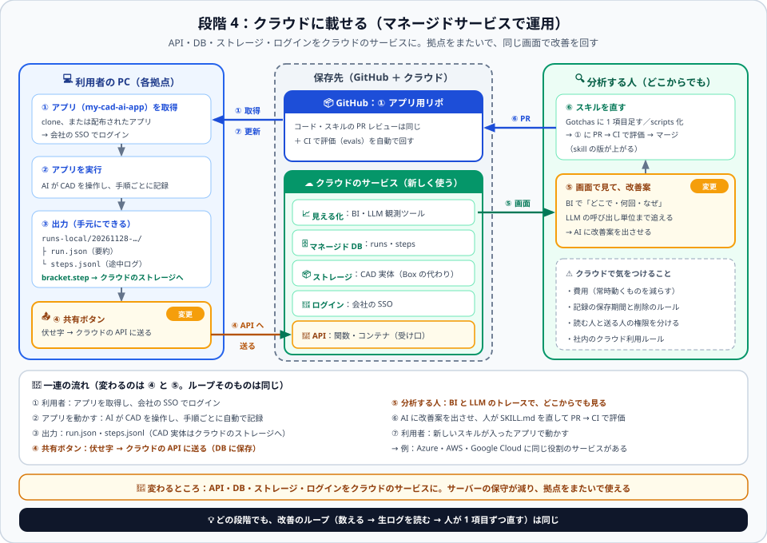

# 04. この先の発展 — GitHub から DB・クラウドへ育てる

GitHub で回し始めると、やがて記録が増え、使う人も増えます。この章では、そこから **DB（データベース）やクラウドへ段階的に育てる道筋** を示します。

大事なのは 1 つだけです。**記録の形（`run.json`・`steps.jsonl`）は変えない。** 変えるのは「記録の受け口（どこに送るか）」と「置き場（どこに貯めるか）」だけです。こうしておけば、どの段階に進んでも過去の記録はそのまま取り込めます。

> [!TIP]
> [動的ガイド](interactive-guide.html) の STEP 6 では、ボタンで段階 1〜4 を切り替えて、図と説明を見比べられます。



---

## 1. 4 つの段階

| | 段階 1：GitHub だけ | 段階 2：＋ 集計用 DB | 段階 3：DB に置き換え | 段階 4：クラウドへ |
|---|---|---|---|---|
| **記録の受け口** | GitHub API | GitHub API（同じ） | 社内の API | クラウドの API |
| **記録の置き場** | ナレッジ専用リポの `runs/` | `runs/` ＋ DB に写す | DB（`runs` 表・`steps` 表） | マネージド DB |
| **見える化** | 集計スクリプト | SQL・ダッシュボード | SQL・ダッシュボード | BI・LLM 観測ツール |
| **認証** | 各自のトークン | 同じ | 社内アカウント | 会社の SSO |
| **CAD 実体** | Box | Box | Box・社内 NAS | クラウドのストレージ |
| **アプリの変更** | — | なし | 送り先を差し替える | 送り先とログインを差し替える |
| **図** | [ks-08](assets/ks-08-two-repo-flow.svg) | [ks-11](assets/ks-11-stage2-analysis-db.svg) | [ks-12](assets/ks-12-stage3-own-db.svg) | [ks-13](assets/ks-13-stage4-cloud.svg) |

### 次の段階へ進む合図

| 進む先 | 合図（どれか 1 つでも当てはまったら） |
|---|---|
| 段階 1 → 2 | 記録が数百件を超えて集計が遅い。条件を変えて何度も絞り込みたい。グラフで見たい |
| 段階 2 → 3 | 送る人が増えて、トークンや権限の管理が負担。「送るだけで、他の人の記録は読めない」権限にしたい。GitHub の書き込み上限に近づいてきた |
| 段階 3 → 4 | 拠点や部署をまたいで使う。SSO・監査ログ・バックアップを会社の基準で求められる。サーバーの保守を減らしたい |

> [!NOTE]
> **GitHub の書き込み上限の目安**：書き込み系の API は、1 分に 80 回・1 時間に 500 回程度までが目安です。経路 A の共有は 1 回で 3 回ほど書き込むので、1 人あたり 1 時間に 150 回程度までと考えておけば安全です（出典は [sources.md](sources.md)）。

---

## 2. どの段階でも変わらないもの

- **記録の形**：`run.json`（要約）と `steps.jsonl`（途中ログ）。「事実は全部、解釈は少し」の方針もそのままです。
- **アプリとスキルは GitHub**：① アプリ用リポでの PR レビューと、スキルの「落とし穴」を 1 項目ずつ足すやり方は、どの段階でも同じです。
- **改善のループ**：数える → 上位の失敗の生ログを読む → AI に改善案を出させる → 人が 1 項目ずつ直す → 版ごとの失敗率で確かめる。

---

## 3. 段階 2：GitHub のまま、集計を DB で（アプリは変えない）



利用者のアプリも送り方も変えずに、**分析する人の側だけ**を強くする段階です。いちばん小さく試せる発展です。

- **手元で試す（サーバー不要）**：DuckDB という手元で動く DB を使えば、`runs/` の JSON ファイルをそのまま SQL で集計できます。
- **チームで見る**：定期実行（GitHub Actions など）で `runs/` を共有の DB に写し、ダッシュボードで「止まった手順 × エラーの種類」や「版ごとの失敗率」を常に表示します。
- DB は `runs/` の「写し」です。壊れても、GitHub の記録から何度でも作り直せます。

**DuckDB での集計の例**（ナレッジ専用リポのフォルダで実行。03 章の集計スクリプトと同じ結果になります）

```sql
-- どこで・なぜ失敗したか（止まった手順 × エラーの種類）
SELECT failed_step.tool AS tool, error.type AS error_type, count(*) AS n
FROM read_json_auto('runs/*/*/run.json')
WHERE outcome <> 'success'
GROUP BY ALL
ORDER BY n DESC;

-- スキルの版ごとの失敗率（直した効果の確認）
SELECT skill, count(*) AS runs, count(*) FILTER (WHERE outcome <> 'success') AS fails,
       round(100.0 * fails / runs) AS fail_pct
FROM read_json_auto('runs/*/*/run.json')
GROUP BY skill ORDER BY skill;
```

---

## 4. 段階 3：記録の受け口を DB に置き換える（社内 API ＋ DB）



アプリの送り先を、GitHub から**社内の API サーバー**に変えます。API が中身を確かめてから DB に書き込みます。GitHub は、アプリのコードとスキルだけを置く場所になります。

**なぜ DB に直接書かず、API を挟むのか**

- **パスワードを配らないため**：各 PC に DB のパスワードを置かずに済みます。
- **送るだけの権限を作れる**：API は「記録を受け取る」ことしかしないので、送る人は他の人の記録を読めません。GitHub の Write では作れなかった権限です（02 章）。
- **受け取る側で確かめられる**：中身の確認や伏せ字の再チェックを、受け取る側でもまとめて行えます。

**DB の表の例**（PostgreSQL の場合）

```sql
CREATE TABLE runs (
  run_id        text PRIMARY KEY,
  started_at    timestamptz,
  outcome       text,      -- success / failure / partial
  task_category text,
  skill         text,
  failed_tool   text,
  error_type    text,
  retries       int,
  record        jsonb      -- run.json をまるごと保存
);

CREATE TABLE steps (
  run_id  text REFERENCES runs(run_id),
  i       int,
  record  jsonb,           -- steps.jsonl の 1 行をまるごと保存
  PRIMARY KEY (run_id, i)
);
```

- よく集計する項目（`outcome`・`failed_tool`・`error_type` など）は列に出し、元の JSON も `jsonb` 型でまるごと残します。後から別の項目で数えたくなっても困りません。

**アプリ側の変更は、送り先の差し替えだけ**（03 章の雛形②の送信部分を置き換える）

```js
// 段階 3 以降：送り先を社内（またはクラウド）の API に変える。記録の形はそのまま
async function sendToApi(token, run, steps) {
  const res = await fetch(process.env.RUNS_API_URL + "/runs", {
    method: "POST",
    headers: { Authorization: "Bearer " + token, "Content-Type": "application/json" },
    body: JSON.stringify({ run, steps }),
  });
  if (!res.ok) throw new Error("POST /runs -> " + res.status);
}
```

**過去の記録の移し方**：集計スクリプトと同じように `runs/` を読み、1 件ずつ API に送れば取り込めます。`run_id` が同じものは取り込まない（重複させない）ようにしておくと、何度実行しても安全です。

---

## 5. 段階 4：クラウドに載せる



社内サーバーで動かしていた部分を、クラウドの**マネージドサービス**（保守をクラウド側に任せられるサービス）に置き換えます。

| 役割 | 段階 3（社内サーバー） | 段階 4（クラウド） | 例（Azure の場合） |
|---|---|---|---|
| 記録の受け口 | API サーバー | 関数・コンテナで動く API | Azure Functions など |
| 記録の置き場 | DB | マネージド DB | Azure Database for PostgreSQL など |
| CAD 実体 | Box・社内 NAS | オブジェクトストレージ | Azure Blob Storage など |
| ログイン | 社内アカウント | 会社の SSO | Microsoft Entra ID など |
| 見える化 | SQL・ダッシュボード | BI ツール・LLM 観測ツール | Power BI など |

- AWS や Google Cloud にも、同じ役割のサービスがあります。会社で使っているクラウドに合わせて選びます。
- **LLM 観測ツール**を使うと、AI が「どの指示で・どのツールを・どう呼んだか」を、呼び出しごとのトレースとして画面で追えます。`steps.jsonl` を、より細かく自動で残せるようにしたものと考えるとわかりやすいです。
- **GitHub 側の発展**：スキルを直す PR では、CI（自動テスト）で評価ケース（`evals/evals.json`）を自動で回すと、直したことで別の作業が壊れていないかを毎回確かめられます。

**クラウドで気をつけること**

- **費用**：常に動き続けるものを減らします（使ったときだけ動く関数などを選ぶ）。
- **保存期間**：記録をいつまで残し、いつ消すかを決めます。
- **権限**：読む人（分析する人）と送る人（利用者）の権限を分けます。
- **社内ルール**：クラウドに置いてよい情報の範囲を、社内のルールで確認します。

---

## 6. まとめ：段階の選び方

- **迷ったら、困りごとが出たときに 1 段だけ進みます。** 段階 1 のまま十分なら、無理に進む必要はありません。
- **段階は飛ばしてもかまいません。** 会社にすでに DB やクラウドの基盤があれば、段階 3・4 から始めても大丈夫です。その場合も、記録の形と改善のループは本ガイドのとおりです。
- **どの段階でも、効くのは「数える → 生ログを読む → 人が 1 項目ずつ直す」のループです。** 仕組みを大きくすることより、このループを毎週回すことを優先してください。

---

◀ 前の章：[03. 貯めた記録から改善点を見つける＆コピペ雛形集](03_analyze-to-skills.md) ／ 📖 [出典一覧（sources.md）](sources.md) ／ 🏠 [トップ（README）へ戻る](README.md)
