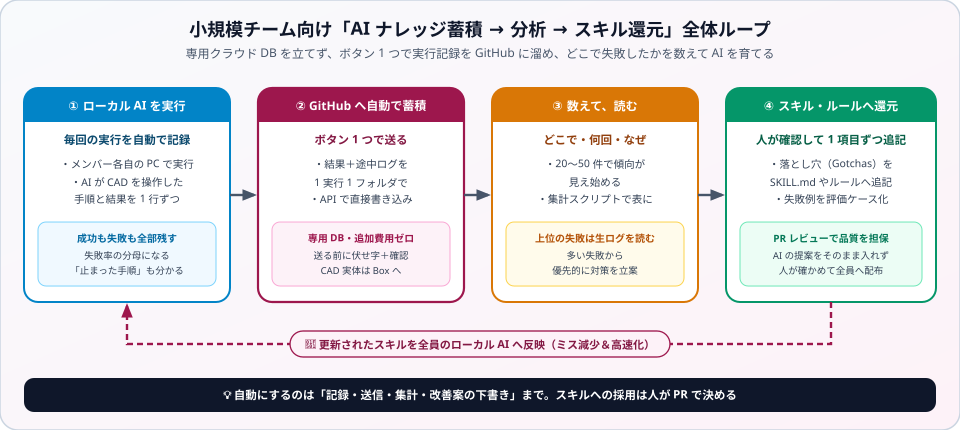

# ナレッジシェア（Knowledge Share）実践ガイド — ボタン 1 つで GitHub に実行記録を溜めて AI を育てる

**「いきなり高価なクラウド DB や監視基盤を立てる前に、今ある GitHub で小さく始めよう。」**  
2〜3 人の立ち上げ初期プロジェクトで、ローカルの AI アプリ（例：AI による CAD 操作ツール）を動かしたときの **結果と途中経過のログ** を、**共有ボタン 1 つで GitHub に溜めていき**、**どこで・何回・なぜ失敗しているか** を数えて AI のスキル・ルールを直すための実践ガイドです。



> [!TIP]
> **まず触ってわかる！ブラウザで開く動的ガイド（ビルド・外部通信不要）**
> - **[ナレッジシェア わかる動的ガイド（interactive-guide.html）](interactive-guide.html)**（図も表示する場合はこのフォルダごと利用してください）
>   - 5 つの蓄積方法の比較、共有ボタン → GitHub の動きのシミュレーション、1 リポ／2 リポ診断、そのまま使える雛形のワンクリックコピーを収録！
>
> **30 秒でわかる要点（4 つの設計原則）**
> 1. **ボタン 1 つで溜まる仕組みにする**：アプリが毎回の実行（結果・途中ログ）を自動で記録し、共有ボタンで GitHub API からナレッジ専用リポへ直接書き込む（利用者の PC に clone は不要）。ブラウザにトークンは書かない。
> 2. **生ログが主役、AI の解釈は控えめに**：集計に使うのは事実（止まった手順・エラーの原文・回数）だけ。AI の判断メモは 1 手順 1 行くらいにし、失敗の分類は後から付ける。
> 3. **20〜50 件で「どこで・何回・なぜ」を数える**：集計スクリプトで表にし、上位の失敗は生ログを読んで原因をつかむ。
> 4. **直すのは人が 1 項目ずつ**：AI に改善案を出させ、採用は人が PR で決める。スキルの「落とし穴」に 1 項目ずつ足す。CAD の実体ファイルは Git の外（Box 等）へ。

---

## 今週やること（最短ルート）

1. **ナレッジ専用の Private リポを作る**（例：`my-cad-ai-knowledge`）。送る人に Write 権限を付け、各自がトークンを用意する（clone は不要）。
2. **アプリに記録＆共有モジュールを入れる**（[03 章の雛形②](03_analyze-to-skills.md)。数十行）。
3. **成功も失敗も「共有」を押す**。開発メンバーは毎回自動で送る設定にしてもよい。
4. **20 件くらいたまったら集計する**（雛形③）→ 表を AI に渡して改善案を出させる（雛形④）→ 人が PR で 1 項目ずつ直す。

---

## どこから読むか（目的別マップ）

| 知りたいこと | 読むファイル | 主な内容 |
|---|---|---|
| **まず触って比較・動きのシミュレーション・雛形コピーを試したい** | [interactive-guide.html](interactive-guide.html) | 5 方式比較、共有ボタンの動き、1 リポ／2 リポ診断、雛形コピー |
| **なぜ GitHub から始めるのか、世の中の例を知りたい** | [00. 全体像と世の中の取り組み](00_concept-and-landscape.md) | クラウド DB との違い、GitHub を保存先にする実例、エラー分析の考え方 |
| **開発初期にライトに始められる選択肢を比べたい** | [01. 開発初期のライトな蓄積方法 5 選](01_lightweight-options.md) | Issue・リポジトリ自動保存・PR・共有フォルダ・クラウド DB の比較と成長ステップ |
| **何を残し、どう送り、どこに置くかを決めたい** | [02. GitHub 実践構成（記録の形・送り方・置き場所）](02_github-architecture.md) | 1 実行 1 フォルダの記録、共有ボタンからの 4 経路、1 リポ vs 2 リポの構成と流れ・権限、壊さない工夫、機密の扱い |
| **貯めた記録から改善点を見つける手順と雛形がほしい** | [03. 貯めた記録から改善点を見つける＆コピペ雛形集](03_analyze-to-skills.md) | 4 ステップ、記録の形・記録＆共有モジュール・集計スクリプト・分析プロンプト・Issue Form・Actions |
| **出典を確認したい** | [sources.md](sources.md) | GitHub 公式ドキュメント・実例・研究の一覧 |

---

## 収録ベクター図解（SVG 全 9 枚）

| 図 | テーマ | 主な収録章 |
|---|---|---|
| [ks-01](assets/ks-01-knowledge-flywheel.svg) | **全体ループ**：自動で記録 → GitHub に蓄積 → 数えて読む → スキルへ還元 | README / 00 |
| [ks-02](assets/ks-02-storage-options-matrix.svg) | **5 案比較**：開発初期の蓄積方法 5 選と成長ステップ | 01 |
| [ks-07](assets/ks-07-run-record-shape.svg) | **記録の形**：1 実行 1 フォルダ、事実（生ログ）と解釈（メモ）を分ける | 02 |
| [ks-03](assets/ks-03-github-intake-patterns.svg) | **4 つの経路**：共有ボタンから GitHub へ送る方法と認証のちがい | 02 |
| [ks-04](assets/ks-04-one-vs-two-repos.svg) | **リポ構成比較**：1 リポジトリ（同居）vs. 2 リポジトリ（分離） | 02 |
| [ks-08](assets/ks-08-two-repo-flow.svg) | **2 リポの流れ**：アプリを取得 → 実行 → 出力 → API で記録を書き込み → 分析 → スキル修正 → 反映（だれがどの権限か） | 02 |
| [ks-09](assets/ks-09-one-repo-flow.svg) | **1 リポの流れ**：同じ流れを 1 リポで行う場合と、その注意点 | 02 |
| [ks-05](assets/ks-05-safe-auto-save.svg) | **壊さない工夫**：1 実行 1 フォルダ・先を越されたら作り直して再送・テキストだけ送る | 02 |
| [ks-06](assets/ks-06-error-analysis-to-skill.svg) | **分析 → 改善**：自動で貯める → 数えて読む → 人が 1 項目ずつ直す → 確かめる | 03 |

---

## 関連ガイド（このリポジトリ内）

- [agent-skill/01_skill-management-loop.md](../agent-skill/01_skill-management-loop.md) — スキルのライフサイクル、評価ファイル（`evals.json`）、自動改善ループの研究
- [agent-skill/05_large-files-outside-git.md](../agent-skill/05_large-files-outside-git.md) — 3D CAD など大容量ファイルを Box に置き、目録だけを GitHub で管理する方法
- [real-lite-mock/README.md](../real-lite-mock/README.md) — 開発初期に単一 HTML＋AI CLI＋MCP で素早く動く試作品を作る手法

---

## フォルダ構成

```text
knowledge-share/
├─ README.md                        ← この全体案内
├─ 00_concept-and-landscape.md      ← 全体像・世の中の事例
├─ 01_lightweight-options.md        ← 開発初期のライトな蓄積方法 5 選と成長ステップ
├─ 02_github-architecture.md        ← 記録の形・送り方（4 経路）・1 リポ vs 2 リポの構成と流れ・壊さない工夫
├─ 03_analyze-to-skills.md          ← 分析の 4 ステップ・コピペ雛形 6 種
├─ sources.md                       ← 出典一覧
├─ interactive-guide.html           ← 5 案比較・共有の動き・1/2 リポ診断・雛形コピー
└─ assets/                          ← 説明用ベクター図解（SVG 全 9 枚）
```
