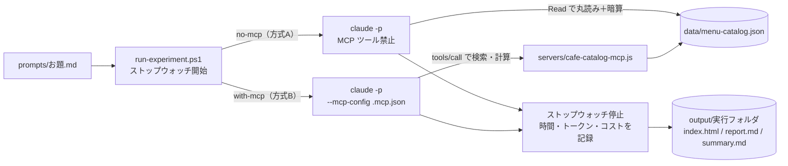

# mcp-guide — MCP（Model Context Protocol）を「使う／使わない」で比べて学ぶ

このフォルダ（`agent-study/mcp-guide`）は、隣の [agent-guide](../agent-guide/) と同じ構成で、**MCP**（Model Context Protocol：AI に専用の道具やデータ窓口をつなぐ共通規格）を基礎から実践・設計パターンまで学ぶための作業場です。

- **基礎からの読み物**：[docs/00_mcp-guide.md](docs/00_mcp-guide.md)（Claude Code 編）、[docs/01_copilot-mcp-guide.md](docs/01_copilot-mcp-guide.md)（GitHub Copilot / VS Code 編）
- **定番パターン5選と CLI・スキルとの使い分け**：[docs/02_mcp-patterns.md](docs/02_mcp-patterns.md)（一次情報の出典メモ10件は [info/](info/README.md)）
- **そのままコピーして使えるサンプル集**：[samples/](samples/README.md)（最小約60行のサーバーから、ファサード型、サブエージェント限定、Resources / Prompts 実装まで）

そしてこの README では、ルートに置いた**架空カフェ「Kame Cafe」のメニュー・アレルギー・原価計算 MCP サーバー**（[servers/cafe-catalog-mcp.js](servers/cafe-catalog-mcp.js)）を使って、

1. **Claude なしでも1秒で体験**：MCP の裏側で流れる JSON-RPC メッセージを自分の目で確かめる
2. **方式 A（`no-mcp`）と方式 B（`with-mcp`）の比較実験**：同じお題の Web ページを作らせ、**数値（アレルギー判定・セット割引・税計算・原価率）の正確さ・時間・トークン消費**を比べる

手順を説明します。

| 方式 | モード名 | やり方 |
|---|---|---|
| A | **`no-mcp`**（生データ丸読み） | MCP を使わず、AI 自身に生データ [data/menu-catalog.json](data/menu-catalog.json) を読ませ、アレルゲン除外判定やセット割引・原価率計算もすべて AI の頭（暗算）でやらせる |
| B | **`with-mcp`**（専用 MCP 利用） | 生データは読ませず、専用 MCP サーバー `cafe-catalog` の3つのツール（`search_menu`、`check_allergens`、`calculate_set_price`）で正確に絞り込み・計算させた結果を使ってページを作らせる |

---

## 1. フォルダ構成

```text
mcp-guide/
├─ README.md                  ← この手順書
├─ .mcp.json                  ← Claude Code 用の MCP 設定ファイル（方式 B で使用）
├─ .vscode/mcp.json           ← VS Code（GitHub Copilot）用の MCP 設定ファイル
├─ servers/
│   └─ cafe-catalog-mcp.js    ← ★実験用 MCP サーバー（Node.js 標準機能のみで動作・外部パッケージ不要）
├─ data/
│   └─ menu-catalog.json      ← カフェ全16商品の価格・原価・アレルギー・コンタミ・割引ルール
├─ prompts/                   ← お題（A・B で同じ文面を渡す）
│   ├─ 01-allergen-menu.md    … アレルギー安心ガイド＆おすすめペアリング Web ページ
│   └─ 02-seasonal-fair.md    … 秋の収穫祭フェア 特設 LP＆店長向け原価レポート
├─ scripts/
│   ├─ test-mcp-server.js     ← Claude なしで MCP サーバーの JSON-RPC 通信を1秒で検証するスクリプト
│   └─ run-experiment.ps1     ← Claude Code で A・B を実行し、時間・トークン・コストを記録するスクリプト
├─ output/                    ← ★成果物の置き場（実行するたびにフォルダが増える）
│   └─ summary.md             … 全実行の一覧表（自動で1行ずつ追記）
├─ docs/                      ← 読み物3本＋図解 SVG（assets/*.svg）
├─ info/                      ← docs/02 を書くために集めた一次情報の出典メモ（10件、鮮度つき）
└─ samples/                   ← パターン別の MCP サーバー＆設定ファイル見本（01〜05）
```

---

## 2. まずは1秒体験：MCP サーバーと直接会話してみる（Claude 不要）

Claude Code や VS Code を起動する前に、「MCP サーバーって結局何をしているの？」を一番手っ取り早く理解する方法があります。Node.js だけで動くテストスクリプト [scripts/test-mcp-server.js](scripts/test-mcp-server.js) を実行してみてください。

```powershell
cd C:\git_home\agent-study\mcp-guide
node scripts\test-mcp-server.js
```

すると 0.1 秒ほどで、AI アプリ（Client）と MCP サーバー（`servers/cafe-catalog-mcp.js`）の間で行われる **3ステップの会話（JSON-RPC 2.0）** が画面にそのまま表示されます。

1. **`initialize`**（あいさつ）：「私の仕様バージョンは `2025-11-25` です」「私は `tools` と `resources` が使えます」
2. **`tools/list`**（お品書きの取得）：「どんな道具がありますか？」「`search_menu`、`check_allergens`、`calculate_set_price` の3つがあります」
3. **`tools/call`**（道具の実行）：
   - 「小麦・卵・乳（微量混入含む）を一切含まない安全なメニューを教えて」→ **安全な6品と、除外された10品の理由**が JSON で返る
   - 「`FD-001` と `DR-001` をイートインで頼んだときのセット価格と原価率を計算して」→ **セット割引 `-150円` 適用後の税抜 `1,210円`、税込 `1,331円`、原価率 `31.0%`**（目標35%以下で合格）が1ミリも狂わず返る

また、`samples/` にある他のサンプルサーバーも同じスクリプトでテストできます。

```powershell
node scripts\test-mcp-server.js samples\01-minimal-stdio\server.js
node scripts\test-mcp-server.js samples\02-knowledge-search\glossary-mcp.js
node scripts\test-mcp-server.js samples\03-workflow-facade\catering-plan-mcp.js
node scripts\test-mcp-server.js samples\05-resources-and-prompts\full-feature-mcp.js
```

---

## 3. 比較実験を実行する（Claude Code で計測つき）

次に、Claude Code を使って同じお題を **方式 A（`no-mcp`）→ 方式 B（`with-mcp`）** の順で実行し、出来栄え・数値の正確さ・時間・コストを比べます。

### お題1：アレルギー安心ガイド＆おすすめペアリング Web ページ

```powershell
# 方式 A：MCP なし（生データを AI が自分で読んで判定・暗算する）
powershell -ExecutionPolicy Bypass -File scripts\run-experiment.ps1 -Prompt prompts\01-allergen-menu.md -Mode no-mcp -Model sonnet -Open

# 方式 B：MCP あり（cafe-catalog サーバーのツールで正確に抽出・計算する）
powershell -ExecutionPolicy Bypass -File scripts\run-experiment.ps1 -Prompt prompts\01-allergen-menu.md -Mode with-mcp -Model sonnet -Open
```

### お題2：秋の収穫祭フェア 特設 LP＆店長向け原価レポート

```powershell
# 方式 A：MCP なし
powershell -ExecutionPolicy Bypass -File scripts\run-experiment.ps1 -Prompt prompts\02-seasonal-fair.md -Mode no-mcp -Model sonnet -Open

# 方式 B：MCP あり
powershell -ExecutionPolicy Bypass -File scripts\run-experiment.ps1 -Prompt prompts\02-seasonal-fair.md -Mode with-mcp -Model sonnet -Open
```



---

## 4. 比べるポイント（なぜこの実験で MCP の向き・不向きが分かるのか）

### 4.1 数値とビジネスルールの正確さ（お題1・お題2の正解早見表）

完成した `index.html` を開き、次の計算結果が合っているかを比べてみてください。方式 A（生データ丸読み＋AI の暗算）では、コンタミネーション（微量混入）の見落としや、セット割引後の原価率の計算ズレが起きることがあります。方式 B（MCP）では、サーバー側のプログラムが計算するため **100% 同じ正解値** になります。

#### お題1の正解値（小麦・卵・乳をコンタミ含め一切含まないメニュー：全6品）
- 合格する6品：`DR-001`、`DR-005`、`DR-007`、`FD-001`、`SW-001`、`SW-003`（`DR-002` は小麦コンタミ、`DR-003` は乳コンタミ、`FD-004` は小麦・乳コンタミがあるため、厳密条件では**除外されるのが正解**）
- ペアリング3組の正解値（セット割引 -150円 適用後）：
  | セット | 組み合わせ | 割引後税抜 | イートイン税込(10%) | テイクアウト税込(8%) | 合計カロリー | 原価合計 | 原価率 |
  |---|---|---|---|---|---|---|---|
  | セットA | `FD-001` + `DR-001` | 1,210円 | 1,331円 | 1,306円 | 422 kcal | 375円 | **31.0%** |
  | セットB | `SW-003` + `DR-007` | 1,150円 | 1,265円 | 1,242円 | 500 kcal | 380円 | **33.0%** |
  | セットC | `SW-001` + `DR-005` | 1,030円 | 1,133円 | 1,112円 | 328 kcal | 305円 | **29.6%** |

#### お題2の正解値（秋ペアリング3コースの原価率判定）
| コース | 組み合わせ | 割引後税抜 | イートイン税込(10%) | 合計カロリー | 原価合計 | 原価率 | 目標（35.0%以下）判定 |
|---|---|---|---|---|---|---|---|
| コース1 | `FD-005` + `DR-006` | 1,350円 | 1,485円 | 795 kcal | 480円 | **35.6%** | **基準超過（×）** |
| コース2 | `FD-004` + `DR-007` | 1,520円 | 1,672円 | 625 kcal | 525円 | **34.5%** | **合格（○）** |
| コース3 | `SW-004` + `DR-001` | 1,510円 | 1,661円 | 592 kcal | 505円 | **33.4%** | **合格（○）** |

※ お題2のプロンプトには「コース3が超えるかも？」という引っ掛けが書いてありますが、実際に150円引き後の税抜価格に対して計算すると、実は**基準（35.0%）をわずかに超えるのはコース1**（35.6%）です。AI の思い込みではなく MCP ツールの計算結果を信じられるかが試されます。

### 4.2 トークンとターン数の違い

`output/summary.md` で、方式 A と方式 B の入力トークン・ターン数を比較します。
- データが小さいうちは方式 A（Read 1回）の方がターン数が少なく速いこともあります。
- 一方で、カタログが数千件に増えたり、計算ルールが複雑になったりするほど、必要な数件だけをサーバー側で絞り込んで確定値を返す方式 B（MCP）が有利になります（詳しくは [docs/02_mcp-patterns.md](docs/02_mcp-patterns.md)）。

---

## 5. 対話モードや VS Code（GitHub Copilot）で試す場合

- **Claude Code**（対話モード）：**この `mcp-guide` フォルダで** `claude` を起動します（`.mcp.json` は起動したフォルダのものが読まれ、`servers/...` の相対パスもこのフォルダが基準です）。初回は「このプロジェクトの MCP サーバーを使ってよいか」の確認が出るので承認してください。`/mcp` と打つと `cafe-catalog` が認識されていることを確認できます。そのまま「小麦・卵・乳（コンタミ含む）が入っていないメニューを MCP で調べて教えて」と話しかけてみてください。
- **VS Code**（GitHub Copilot Agent Mode）：VS Code でこのフォルダを開くと `.vscode/mcp.json` が自動で認識されます。Copilot Chat を **Agent** モードにして同じように質問してみてください（詳しい手順は [docs/01_copilot-mcp-guide.md](docs/01_copilot-mcp-guide.md)）。
