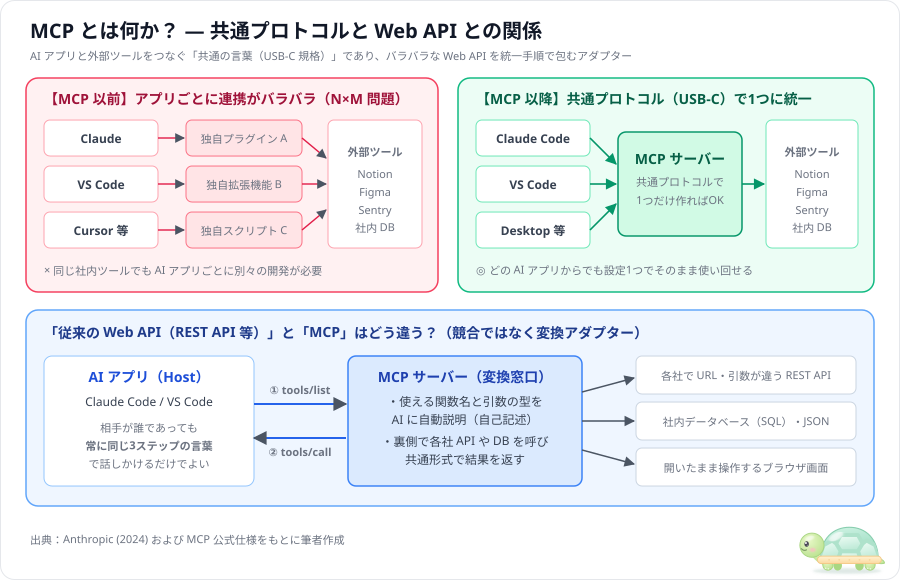
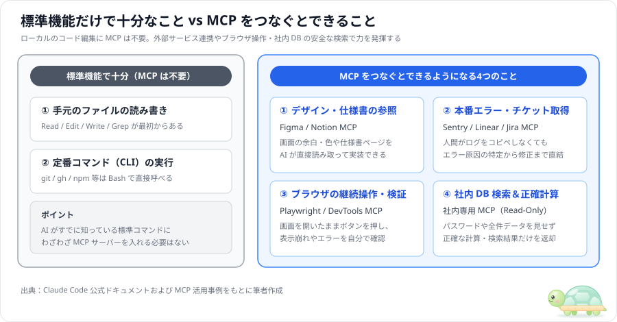
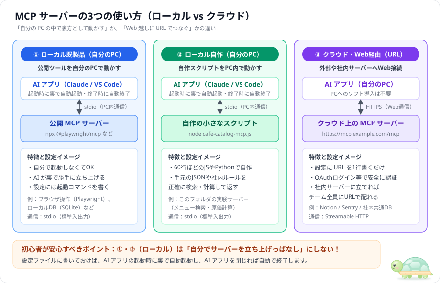
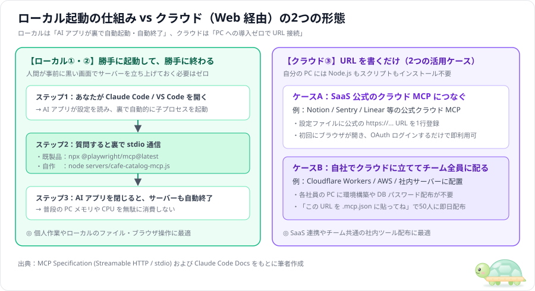
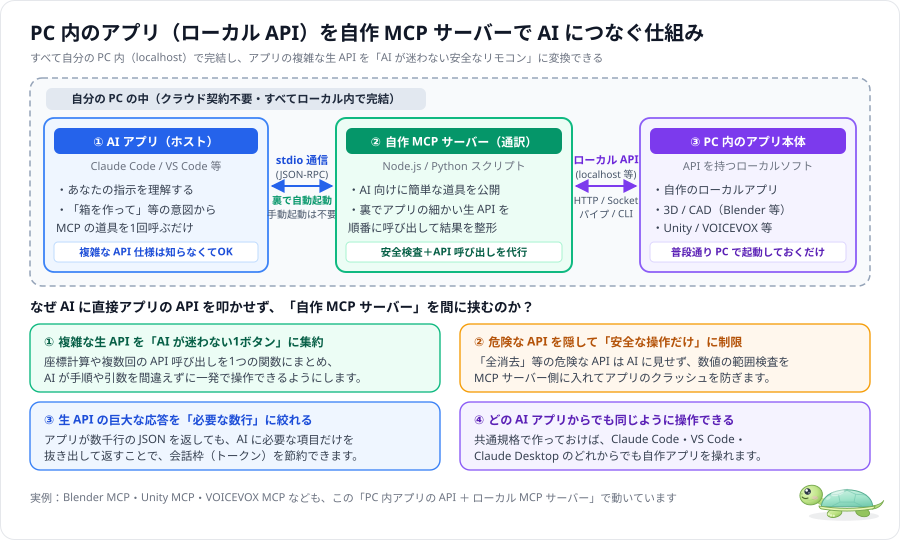
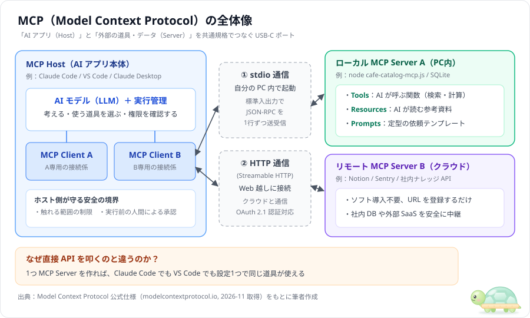
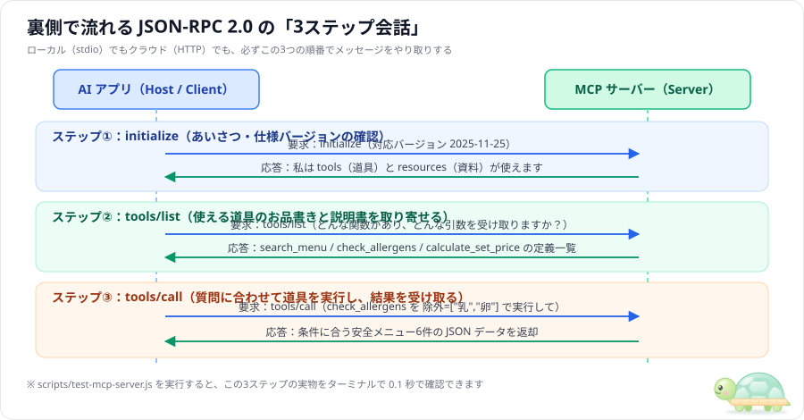
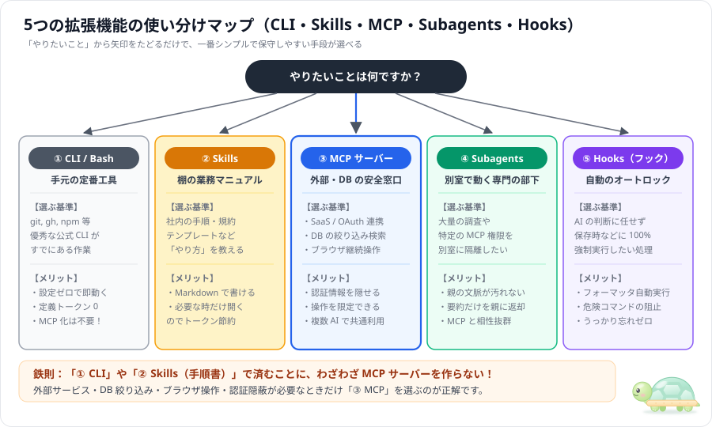
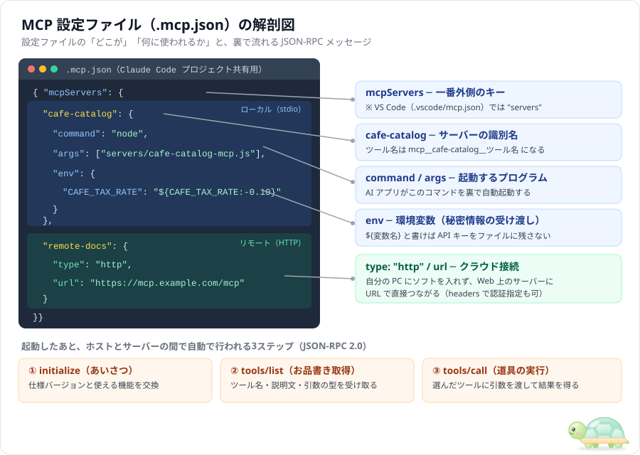
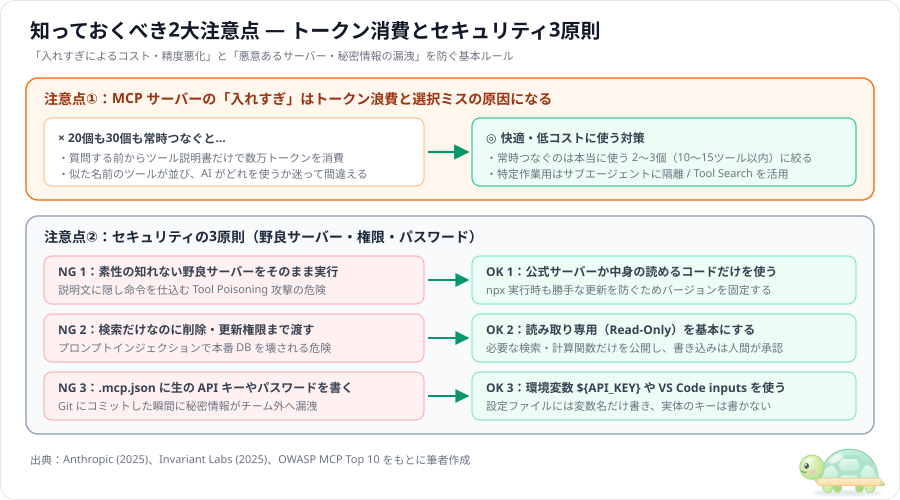

# MCP（Model Context Protocol）入門 — ベクター図解でわかる仕組みと3つの使い方

> 「MCP って結局なに？Web API とどう違う？ローカルとクラウドでどう使い分ける？」という疑問に、**ベクター図解（SVG）を中心**に最短で答える入門ガイドです。
> 対象は Claude Code（2026年11月時点）。最新仕様は [Claude Code 公式ドキュメント](https://code.claude.com/docs/en/mcp)および [MCP 公式仕様](https://modelcontextprotocol.io/specification/)を参照してください。出典一覧は [info/](../info/README.md)、動くサンプルは [samples/](../samples/README.md) にあります。

---

## 30秒でわかる！この記事の4つの結論

| 疑問 | 結論 |
|---|---|
| **① MCP とは？** | AI アプリ（Claude Code / VS Code）と外部ツールをつなぐ「**AI 用の USB-C 規格**」（通信の共通ルール）です。 |
| **② Web API との違いは？** | Web API の競合ではなく、各社でバラバラな API や DB を「**どの AI からでも同じ手順で呼べる形に包む変換アダプター**」です。 |
| **③ 自分でサーバーを起動しっぱなしにする？** | **不要です**。ローカル利用でも、AI アプリが必要なときだけ裏で自動起動し、終われば自動で閉じます。 |
| **④ どうやって使うの？** | **①公開ツールを PC 内で動かす**、**②自作スクリプトを PC 内で動かす**、**③クラウドの URL につなぐ** の3通りです。 |

---

## 目次

1. [そもそも MCP とは何か？（Web API との関係・いつ使うか）](#1-そもそも-mcp-とは何かweb-api-との関係いつ使うか)
2. [MCP サーバーの「3つの使い方」（ローカル vs クラウド）](#2-mcp-サーバーの3つの使い方ローカル-vs-クラウド)
3. [全体構造と「3つの機能」・裏側の通信ステップ](#3-全体構造と3つの機能裏側の通信ステップ)
4. [CLI・Skills・Subagents・Hooks との使い分け](#4-cliskillssubagentshooks-との使い分け)
5. [設定ファイル（`.mcp.json`）とコマンド操作](#5-設定ファイルmcpjsonとコマンド操作)
6. [実践：60行の最小サーバーと 0.1秒テスト](#6-実践60行の最小サーバーと-01秒テスト)
7. [知っておくべき2大注意点（トークン消費とセキュリティ）](#7-知っておくべき2大注意点トークン消費とセキュリティ)
8. [参考文献](#8-参考文献)

---

## 1. そもそも MCP とは何か？（Web API との関係・いつ使うか）

### 1.1 なぜ作られたのか・従来の Web API と何が違うのか



- **共通プロトコルによる統一**：MCP のルールに従った窓口（**MCP サーバー**）を1つ用意すれば、Claude Code でも VS Code（Copilot）でも設定1つでそのまま使い回せます（[Anthropic, 2024](https://www.anthropic.com/news/model-context-protocol)）。
- **自己記述性**（自分の使い方を自分で説明できる性質）：従来の REST API は人間が仕様書を読む必要がありましたが、MCP サーバーはつないだ瞬間に `tools/list` で「使える関数名・説明・引数の型」を AI に自動で教えます。
- **安全な隔離**：秘密の API キーや DB パスワードを AI のプロンプトに見せず、サーバーの裏側に隠したまま安全に検索・計算だけを実行させられます。

---

### 1.2 標準機能（Bash / Read）で十分なこと vs MCP を使う場面



- **ローカル作業に MCP は不要**：手元のファイル編集（`Read` / `Edit`）や `git`・`npm` の実行（`Bash`）は、最初から AI アプリに備わっています。
- **MCP が輝く4つの場面**：① **Figma / Notion** 等のデザイン・仕様書参照、② **Sentry / Linear** 等の本番エラー・チケット取得、③ **Playwright** 等の開いたままのブラウザ操作、④ **社内 DB** の安全な絞り込みと正確な計算です。

---

## 2. MCP サーバーの「3つの使い方」（ローカル vs クラウド）

### 2.1 どこで動かすかによる3パターンの比較



| 項目 | ① ローカル既製品 | ② ローカル自作 | ③ クラウド・Web 経由 |
|---|---|---|---|
| **動く場所** | **自分の PC 内** | **自分の PC 内** | **クラウド / 社内サーバー** |
| **事前の手動起動** | **不要**（AI が裏で自動起動） | **不要**（AI が裏で自動起動） | **不要**（常時稼働済み） |
| **設定に書くもの** | `npx @playwright/mcp` 等 | `node cafe-catalog-mcp.js` 等 | `https://...`（接続先 URL） |
| **通信方式** | **stdio**（標準入出力） | **stdio**（標準入出力） | **Streamable HTTP** |

---

### 2.2 ローカルの自動起動サイクルと、クラウドの2つの活用ケース



- **ローカル（①・②）の設定例**：`.mcp.json` に起動コマンドを書くだけで、AI アプリが裏で勝手に立ち上げ、終了時に自動で閉じます。
  ```json
  {
    "mcpServers": {
      "playwright": { "command": "npx", "args": ["@playwright/mcp@latest"] },
      "cafe-catalog": { "command": "node", "args": ["servers/cafe-catalog-mcp.js"] }
    }
  }
  ```
- **クラウド（③）の設定例**：自分の PC へのソフト導入は一切不要で、`type: "http"` と `url` を指定するだけです（[samples/02-knowledge-search/](../samples/02-knowledge-search/) 参照）。
  ```json
  {
    "mcpServers": {
      "team-knowledge": { "type": "http", "url": "https://mcp.example.com/mcp" }
    }
  }
  ```

---

### 2.3 自分の PC 内のアプリ（ローカル API）を自作 MCP サーバーで操る場合

「自分の PC 内で動いているアプリケーション（自作ソフト、3D/CAD ソフトの Blender、Unity、音声合成の VOICEVOX など）が API を提供していて、それを AI が使いやすいように自作で MCP サーバーを立てる場合はどうなるの？」というケースは、**ローカル自作（パターン②）の最も代表的な活用法**です。



- **すべて自分の PC 内（ローカル）で完結する**：インターネットやクラウドサーバーは一切不要です。AI アプリ ──(`stdio`)──▶ 自作 MCP サーバー ──(`http://localhost:...` やソケット通信)──▶ PC 内のアプリ本体、という3段リレーが PC の中だけで動きます。
- **起動の手間もかからない**：PC 内の対象アプリ（Blender や自作アプリ）だけ普段通り起動しておけば、仲介役の「自作 MCP サーバー」は AI アプリが裏で勝手に起動・終了してくれます。
- **なぜ AI に直接アプリの API を叩かせず、自作 MCP サーバーを挟むのか？**
  1. **AI が迷わない「1つのボタン」にまとめられる**：アプリの生 API は「座標計算 → 生成 API → 色変更 API → 再描画 API」のように細かく分かれています。これを MCP サーバー側で `create_box(size, color)` という1つの道具（Tool）に束ねることで、AI が手順ミスをしなくなります（[samples/03-workflow-facade/](../samples/03-workflow-facade/) がこの見本です）。
  2. **危険な操作を物理的に隠せる**：アプリ側の「全データ初期化」などの危険な API は MCP サーバーに登録せず、数値の範囲チェックを入れることでアプリのクラッシュを防げます。
  3. **どの AI アプリからでも操れるようになる**：一度この変換スクリプトを作れば、Claude Code でも VS Code（Copilot）でも同じように自分のアプリを操作できます。

---

## 3. 全体構造と「3つの機能」・裏側の通信ステップ

### 3.1 Host・Client・Server の全体構造と3つの機能



| サーバーが提供する3機能 | 役割 | 誰が呼ぶか | 現場での重要度 |
|---|---|---|---|
| **① Tools**（ツール） | AI が呼ぶ**関数**（検索・計算・操作） | **AI が自動で判断** | **★最重要（9割以上がこれ）** |
| **② Resources**（リソース） | AI が読む**参考資料**（`@` で添付） | 人間 / アプリ | 補助的（定型資料の参照用） |
| **③ Prompts**（プロンプト） | 依頼の**定型文**（`/mcp__...` で選択） | 人間 | 補助的（[samples/05](../samples/05-resources-and-prompts/) 参照） |

---

### 3.2 裏側で流れる JSON-RPC 2.0 の「3ステップ会話」



- **どんなサーバーでも会話は3ステップだけ**：① `initialize`（あいさつ）→ ② `tools/list`（使える道具と引数の型を取得）→ ③ `tools/call`（関数の実行と結果返却）の順に JSON メッセージが流れます。

---

## 4. CLI・Skills・Subagents・Hooks との使い分け



- **迷ったらまず CLI と Skills を検討する**：`git` や `gh` など既存コマンドで済むなら **① CLI**、社内規約や手順書なら **② Skills**（`SKILL.md`）の方が圧倒的に軽くて保守も簡単です（[info/09](../info/09_anthropic_agent-skills-vs-mcp.md)）。
- **外部連携・認証隠蔽・DB 絞り込みのときだけ ③ MCP を選ぶ**：さらに大量出力や強い権限を隔離したいときは **④ Subagents** と組み合わせます。

---

## 5. 設定ファイル（`.mcp.json`）とコマンド操作



| スコープ名 | 保存場所 | 共有範囲 | 主な用途 |
|---|---|---|---|
| **`project`** | リポジトリ直下の **`.mcp.json`** | **チーム全員**（Git 共有） | プロジェクト共通ツール・実験サーバー |
| **`local`**（既定） | `~/.claude.json`（プロジェクト枠） | 自分 × このプロジェクト | 個人トークンを含む設定・試作 |
| **`user`** | `~/.claude.json`（全体共通枠） | 自分 × 全プロジェクト | どこでも使う汎用ツール |

```powershell
# プロジェクト共有（.mcp.json）にローカルサーバーを追加
claude mcp add --scope project cafe-catalog -- node servers/cafe-catalog-mcp.js

# 登録一覧の確認（対話画面の中では /mcp と入力）
claude mcp list
```

---

## 6. 実践：60行の最小サーバーと 0.1秒テスト

ローカル自作サーバー（[samples/01-minimal-stdio/server.js](../samples/01-minimal-stdio/server.js)）は、外部パッケージ不要・Node.js 標準機能だけで約60行で書けます。やることは **3つの `req.method` に JSON を返すだけ**です。

```javascript
#!/usr/bin/env node
const readline = require('node:readline');
const rl = readline.createInterface({ input: process.stdin, terminal: false });

rl.on('line', (line) => {
  if (!line.trim()) return;
  const req = JSON.parse(line);

  if (req.method === 'initialize') {
    send(req.id, { protocolVersion: '2025-11-25', capabilities: { tools: {} }, serverInfo: { name: 'dice', version: '1.0.0' } });
  } else if (req.method === 'tools/list') {
    send(req.id, { tools: [{ name: 'roll_dice', description: 'サイコロを振る', inputSchema: { type: 'object', properties: { sides: { type: 'number' } }, required: ['sides'] } }] });
  } else if (req.method === 'tools/call') {
    const sides = req.params.arguments.sides || 6;
    send(req.id, { content: [{ type: 'text', text: `出目: ${Math.floor(Math.random() * sides) + 1}` }] });
  }
});

function send(id, result) {
  // ★鉄則：stdio 通信では stdout に JSON だけを書く（デバッグ表示は console.error を使う）
  process.stdout.write(JSON.stringify({ jsonrpc: '2.0', id, result }) + '\n');
}
```

Claude Code を起動しなくても、付属のテストスクリプトで **0.1秒で通信を確認**できます。

```powershell
cd C:\git_home\agent-study\mcp-guide
node scripts\test-mcp-server.js
```

---

## 7. 知っておくべき2大注意点（トークン消費とセキュリティ）



- **入れすぎない**：常時つなぐサーバーは **2〜3個**（10〜15ツール以内）に絞り、残りはサブエージェントに分離するか Claude Code 標準の **MCP Tool Search**（遅延読み込み）に任せます（詳しくは [docs/02](02_mcp-patterns.md)）。
- **安全の3原則**：①出所の確かなコードだけを使う（**Tool Poisoning** 対策）、②基本は**読み取り専用**（Read-Only）にする、③パスワードや API キーは **`${環境変数}`** で渡してファイルに直書きしない、の3点を徹底してください。

---

## 8. 参考文献

詳しい要約と原文引用は [info/](../info/README.md) にまとめています。

| # | 出典 | 時期 | 本書での引用箇所 |
|---|---|---|---|
| 1 | Anthropic「[Introducing the Model Context Protocol](https://www.anthropic.com/news/model-context-protocol)」 | 2024-11 | MCP の目的、Host / Client / Server 構造 |
| 2 | Model Context Protocol「[Specification](https://modelcontextprotocol.io/specification/)」 | 2026-11 取得 | Tools / Resources / Prompts、stdio・HTTP、JSON-RPC |
| 3 | Claude Code Docs「[Connect Claude Code to tools via MCP](https://code.claude.com/docs/en/mcp)」 | 2026-11 取得 | `.mcp.json`、3スコープ、MCP Tool Search |
| 4 | Anthropic「[Code execution with MCP](https://www.anthropic.com/engineering/code-execution-with-mcp)」 | 2025-11 | ツール定義のトークン消費とオンデマンド読込 |
| 5 | Anthropic「[Equipping agents for the real world with Agent Skills](https://www.anthropic.com/engineering/equipping-agents-for-the-real-world-with-agent-skills)」 | 2025-10 | MCP と Skills・CLI の役割分担 |
| 6 | Invariant Labs「[MCP Security Notification: Tool Poisoning Attacks](https://invariantlabs.ai/blog/mcp-security-notification-tool-poisoning-attacks)」 | 2025-04 | Tool Poisoning 攻撃とセキュリティ対策 |
