# MCP（Model Context Protocol）入門 — ベクター図解でわかる仕組みと3つの使い方

> 「MCP って結局なに？Web API とどう違う？ローカルとクラウドでどう使い分ける？」という疑問に、**ベクター図解（SVG）を中心**に最短で答える入門ガイドです。
> 対象は Claude Code（2026年11月時点）。最新仕様は [Claude Code 公式ドキュメント](https://code.claude.com/docs/en/mcp)および [MCP 公式仕様](https://modelcontextprotocol.io/specification/)を参照してください。出典一覧は [info/](../info/README.md)、動くサンプルは [samples/](../samples/README.md)、安全に使うための注意点と職場のルールは [03](03_mcp-security-and-rules.md) にあります。

---

## 30秒でわかる！この記事の7つの結論

| 疑問 | 結論 |
|---|---|
| **① MCP とは？** | AI アプリ（Claude Code / VS Code）と外部ツールをつなぐ「**AI 用の USB-C 規格**」（通信の共通ルール）です。 |
| **② Web API との違いは？** | Web API の競合ではなく、各社でバラバラな API や DB を「**どの AI からでも同じ手順で呼べる形に包む変換アダプター**」です。中では同じ API を呼んでいます（[1.4 節](#14-普通の-api-と何が違うのか同じ作業で比べる)）。 |
| **③ MCP サーバーは何をしている？** | 「道具の一覧」を見せ、呼ばれたら**その先のファイル・Web API・DB を読み書きして**、結果を決まった形で返す小さなプログラムです。その先のアプリは MCP を知らなくて構いません（[1.3 節](#13-mcp-サーバーの中身何を受け取り何をして何を返すのか)）。 |
| **④ 自分でサーバーを起動しっぱなしにする？** | **不要です**。ローカル利用でも、AI アプリの起動時（セッション開始時）に裏で自動起動し、AI アプリを閉じれば自動で終了します。 |
| **⑤ どうやって使うの？** | **①公開ツールを PC 内で動かす**、**②自作スクリプトを PC 内で動かす**、**③クラウドの URL につなぐ** の3通りです。 |
| **⑥ AI・MCP・アプリの関係は？** | 道具を「選ぶ」のは LLM、実際に「呼ぶ」のは AI アプリ（ホスト）です。MCP はホストと MCP サーバーの間の約束で、その先の DB やアプリの操作はサーバーの中身しだいです（[0 章](#0-まず全体像人ai-アプリllmmcp-サーバーその先のアプリ)）。 |
| **⑦ 安全に使うには？** | 入れる前に出所・説明文・権限を点検し、組織・AI アプリ・サーバー・人の 4 層で守ります。職場では承認済みのものだけを使います（[03](03_mcp-security-and-rules.md)）。 |

---

## 目次

0. [まず全体像：人・AI アプリ・LLM・MCP サーバー・その先のアプリ](#0-まず全体像人ai-アプリllmmcp-サーバーその先のアプリ)
1. [そもそも MCP とは何か？（Web API との関係・いつ使うか）](#1-そもそも-mcp-とは何かweb-api-との関係いつ使うか)
   - 1.3 [MCP サーバーの中身：何を受け取り、何をして、何を返すのか](#13-mcp-サーバーの中身何を受け取り何をして何を返すのか)
   - 1.4 [普通の API と何が違うのか（同じ作業で比べる）](#14-普通の-api-と何が違うのか同じ作業で比べる)
2. [MCP サーバーの「3つの使い方」（ローカル vs クラウド）](#2-mcp-サーバーの3つの使い方ローカル-vs-クラウド)
   - 2.4 [現場での使い方の組み合わせ（AI 側 × MCP 側）](#24-現場での使い方の組み合わせai-側--mcp-側)
   - 2.5 [どこで動き、どこでデータが外に出るか](#25-どこで動きどこでデータが外に出るか)
3. [全体構造と「3つの機能」・裏側の通信ステップ](#3-全体構造と3つの機能裏側の通信ステップ)
4. [CLI・Skills・Subagents・Hooks との使い分け](#4-cliskillssubagentshooks-との使い分け)
5. [設定ファイル（`.mcp.json`）とコマンド操作](#5-設定ファイルmcpjsonとコマンド操作)
6. [実践：60行の最小サーバーと 0.1秒テスト](#6-実践60行の最小サーバーと-01秒テスト)
   - 6.1 [既存のアプリに MCP の口を付ける 5 ステップ](#61-既存のアプリに-mcp-の口を付ける-5-ステップ)
7. [知っておくべき2大注意点（トークン消費とセキュリティ）](#7-知っておくべき2大注意点トークン消費とセキュリティ)（詳しくは [03 安全に使うための注意点と対策](03_mcp-security-and-rules.md)）
8. [参考文献](#8-参考文献)

---

## 0. まず全体像：人・AI アプリ・LLM・MCP サーバー・その先のアプリ

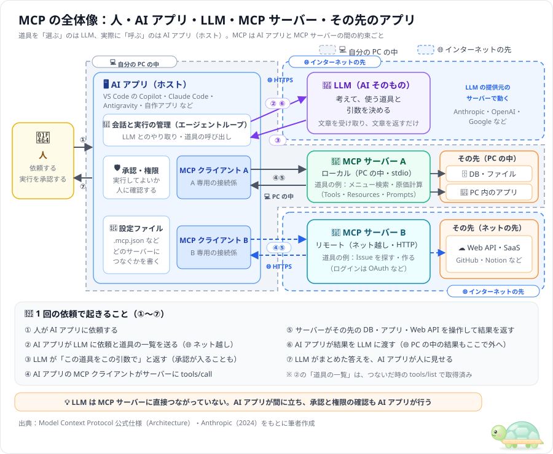

MCP を使うときには、5 つの登場人物がいます。特に **AI アプリ**（あなたが操作するソフト）と **LLM**（AI そのもの）は別物です。図の**灰色の枠は自分の PC の中**、**青い枠はインターネットの先**を表しています。

| 登場人物 | 役割 | 例 |
|---|---|---|
| **人（利用者）** | 依頼する。実行してよいかを承認する | あなた |
| **AI アプリ（ホスト）** | あなたが操作するソフト。会話を管理し、LLM と MCP サーバーの間に立つ。中に、サーバーごとの接続係（**MCP クライアント**）を持つ。PC の中で動く | VS Code の GitHub Copilot、Claude Code、Claude Desktop、Antigravity、自作アプリ |
| **LLM（AI そのもの）** | 文章を受け取り、どの道具をどの引数で使うかを決めて返す。**自分では道具を呼ばない** | Claude・GPT・Gemini などのモデル。多くは提供元のサーバー（インターネットの先）で動く |
| **MCP サーバー** | 道具（Tools）・参考資料（Resources）・定型文（Prompts）を出す窓口。ローカル（PC の中）とリモート（インターネットの先）がある | ローカル：このガイドの cafe-catalog／リモート：GitHub の MCP |
| **その先のアプリ・データ** | MCP サーバーが実際に操作する相手 | DB、ファイル、Web API・SaaS、PC 内のアプリ（CAD など） |

**1 回の依頼で起きること**

1. 人が AI アプリに依頼する（例：「小麦を含まないメニューを出して」）
2. AI アプリが LLM に「依頼 ＋ 使える道具の一覧」を送る（🌐 ネット越し。道具の一覧は、つないだときの `tools/list` で取得済み）
3. LLM が「`search_menu` をこの引数で使いたい」と返す（ここで人の承認が入ることもある）
4. AI アプリの MCP クライアントが、MCP サーバーに `tools/call` を送る
5. MCP サーバーが、その先の DB・アプリ・Web API を操作して結果を返す
6. AI アプリが結果を LLM に渡す（🌐 ネット越し。PC の中で動いた道具の結果も、ここで外に出る。必要なら 3〜6 をくり返す）
7. LLM がまとめた答えを、AI アプリが人に見せる

> [!IMPORTANT]
> **ここだけ押さえれば迷いません**
> - **道具を選ぶのは LLM、実際に呼ぶのは AI アプリ（ホスト）**です。LLM が MCP サーバーに直接つながっているわけではありません（例外は、クラウドの API 側から MCP サーバーを呼ぶ機能。[2.4 節](#24-現場での使い方の組み合わせai-側--mcp-側)の D）。
> - **MCP が決めているのは「AI アプリ ↔ MCP サーバー」の間の約束だけ**です。サーバーの先（API・DB・アプリ）をどう操作するかは、それぞれのサーバーの作り次第です。
> - **ローカルの MCP サーバーでも、道具の結果は LLM に送られます**。LLM がクラウドにあれば、結果も社外に出ます（[2.5 節](#25-どこで動きどこでデータが外に出るか)）。

---

## 1. そもそも MCP とは何か？（Web API との関係・いつ使うか）

### 1.1 なぜ作られたのか・従来の Web API と何が違うのか

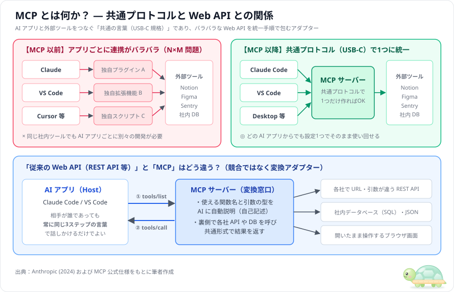

- **共通プロトコルによる統一**：MCP のルールに従った窓口（**MCP サーバー**）を1つ用意すれば、Claude Code でも VS Code（Copilot）でも設定1つでそのまま使い回せます（[Anthropic, 2024](https://www.anthropic.com/news/model-context-protocol)）。
- **自己記述性**（自分の使い方を自分で説明できる性質）：従来の REST API は人間が仕様書を読む必要がありましたが、MCP サーバーはつないだ瞬間に `tools/list` で「使える関数名・説明・引数の型」を AI に自動で教えます。
- **安全な隔離**：秘密の API キーや DB パスワードを AI のプロンプトに見せず、サーバーの裏側に隠したまま安全に検索・計算だけを実行させられます。

---

### 1.2 標準機能（Bash / Read）で十分なこと vs MCP を使う場面

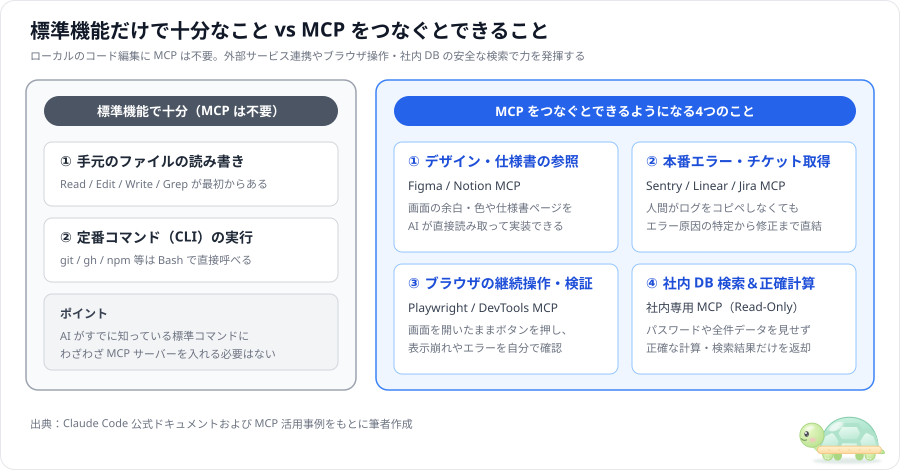

- **ローカル作業に MCP は不要**：手元のファイル編集（`Read` / `Edit`）や `git`・`npm` の実行（`Bash`）は、最初から AI アプリに備わっています。
- **MCP が輝く4つの場面**：① **Figma / Notion** 等のデザイン・仕様書参照、② **Sentry / Linear** 等の本番エラー・チケット取得、③ **Playwright** 等の開いたままのブラウザ操作、④ **社内 DB** の安全な絞り込みと正確な計算です。

---

### 1.3 MCP サーバーの中身：何を受け取り、何をして、何を返すのか

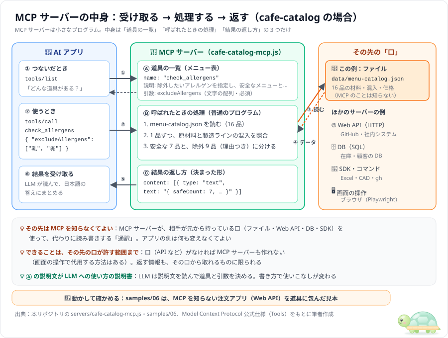

MCP サーバーは特別な装置ではなく、**小さなプログラム**です。このガイドのカフェ用サーバー（[servers/cafe-catalog-mcp.js](../servers/cafe-catalog-mcp.js)）を開けてみると、やっていることは 3 つだけです。

**Ⓐ 道具の一覧を見せる（`tools/list` への返事）**：名前・説明・引数の形を返します。LLM はこの説明を読んで、どの道具をどの引数で使うかを決めます。

```json
{
  "name": "check_allergens",
  "description": "除外したいアレルゲン（例：[\"乳\", \"卵\", \"小麦\"]）を指定し、該当アレルゲンを含まない安全なメニュー一覧と、除外されたメニューの理由を正確に判定して返します。",
  "inputSchema": {
    "type": "object",
    "properties": {
      "excludeAllergens": { "type": "array", "items": { "type": "string" }, "description": "除外したいアレルゲン名の配列" },
      "strictCrossContamination": { "type": "boolean", "description": "true（既定）なら製造ラインの微量混入がある商品も除外する" }
    },
    "required": ["excludeAllergens"]
  }
}
```

**Ⓑ 呼ばれたら処理する（`tools/call` を受けたとき）**：中身は MCP と関係のない、普通のプログラムです。この例では、その先のデータ（[data/menu-catalog.json](../data/menu-catalog.json)）を読み、16 品を 1 件ずつ照合しています（抜粋）。

```javascript
for (const item of catalog.items) {                       // menu-catalog.json の 16 品
  const hitDirect = item.allergens.filter((a) => excludeList.includes(a));          // 原材料に入っているか
  const hitCross = item.crossContamination.filter((a) => excludeList.includes(a));  // 製造ラインで混ざるか
  if (hitDirect.length === 0 && hitCross.length === 0) safeItems.push(item);       // 安全
  else excludedItems.push({ id: item.id, matchedDirectAllergens: hitDirect, matchedCrossContamination: hitCross });
}
```

**Ⓒ 結果を決まった形で返す**：「乳・卵を除外して」と呼ばれたときの実際の結果です（抜粋）。

```json
{
  "safeCount": 7,
  "excludedCount": 9,
  "excludedItems": [
    { "id": "DR-003", "name": "宇治抹茶ソイラテ（黒蜜仕立て）", "matchedDirectAllergens": [], "matchedCrossContamination": ["乳"] },
    { "id": "DR-004", "name": "焦がしキャラメル・マキアート", "matchedDirectAllergens": ["乳"], "matchedCrossContamination": [] }
  ]
}
```

DR-003 は、原材料には乳が入っていません（大豆だけ）。それでも、製造ラインで乳が混ざるので除外されています。AI が暗算で見落としやすいところを、プログラムが確実に拾っています。

**よくある疑問**

| 疑問 | 答え |
|---|---|
| **その先のアプリは、なぜ情報を返せるの？** | アプリやデータが**元から持っている口**（ファイル・Web API・DB・SDK）を、MCP サーバーが呼んでいるからです。アプリの側は MCP を知らなくて構いません。カフェの例ではファイル、[samples/06](../samples/06-wrap-existing-app/) では注文アプリの Web API を呼んでいます。 |
| **MCP サーバーは何を返せばいいの？** | 2 つだけです。**道具の一覧**（名前・説明・引数の形）と、呼ばれたときの**結果**（文章や JSON）。やり取りの形は MCP の仕様で決まっています（3.2 節の JSON-RPC）。中身はその先の口から取れるものなら自由です。 |
| **MCP サーバーには何ができるの？** | その先の口が許すことだけです。読む（検索・取得）、計算する、書く（登録・更新）、操作する（アプリやブラウザを動かす）。口がなければ MCP サーバーも作れません（画面の操作で代用する方法はあります）。 |

---

### 1.4 普通の API と何が違うのか（同じ作業で比べる）

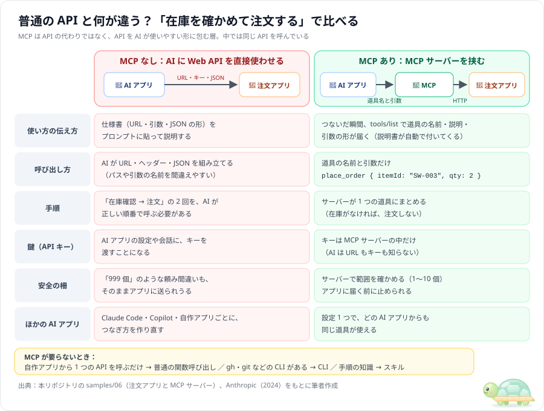

MCP は Web API の代わりではありません。**MCP サーバーの中では、同じ Web API を呼んでいます**。違うのは「AI から見た使いやすさ」と「安全の作りやすさ」です。[samples/06](../samples/06-wrap-existing-app/) の注文アプリ（在庫確認と注文の Web API）で比べると、次のようになります。

| 比べる点 | MCP なし（AI に Web API を直接使わせる） | MCP あり（MCP サーバーを挟む） |
|---|---|---|
| **使い方の伝え方** | API の仕様書をプロンプトに貼って説明する | つないだ瞬間に `tools/list` で説明書が届く |
| **呼び出し方** | AI が URL・ヘッダー・JSON を組み立てる | 道具の名前と引数だけ（`place_order { itemId, qty }`） |
| **手順** | 「在庫確認 → 注文」を AI が正しい順で呼ぶ | サーバーが 1 つの道具にまとめる（在庫がなければ注文しない） |
| **鍵（API キー）** | AI アプリの設定や会話に渡すことになる | キーはサーバーの中だけ。AI は URL もキーも知らない |
| **安全の柵** | 「999 個」のような頼み間違いも送られうる | サーバーで範囲を確かめ、アプリに届く前に止める |
| **ほかの AI アプリ** | Claude Code・Copilot・自作アプリごとに作り直し | 設定 1 つで、どの AI アプリからも同じ道具が使える |

実際に動かすと、AI アプリ（の代わりのスクリプト）・MCP サーバー・注文アプリの往復が 1 本ずつ見えます。

```powershell
node samples\06-wrap-existing-app\run-demo.js
```

```text
[AI アプリ → MCP サーバー] tools/call place_order {"itemId":"SW-003","qty":2}（ちょうど頼む）
      [MCP サーバー → 注文アプリ] GET /api/stock?id=SW-003
      [注文アプリ → MCP サーバー] 200 {"itemId":"SW-003","name":"紅はるかと米粉のスイートポテトタルト","count":2}
      [MCP サーバー → 注文アプリ] POST /api/orders {"itemId":"SW-003","qty":2}
      [注文アプリ → MCP サーバー] 201 {"orderId":1001,"itemId":"SW-003","qty":2,"remaining":0}
[MCP サーバー → AI アプリ] 注文しました：注文番号 1001（紅はるかと米粉のスイートポテトタルト × 2）。残りの在庫は 0 個です。
```

> [!TIP]
> **MCP が要らないとき**もあります。自作アプリから 1 つの API を呼ぶだけなら、普通の関数呼び出し（ツール呼び出し）で十分です。`gh` や `git` のような CLI があるなら CLI を、手順の知識だけならスキルを使います（4 章）。MCP が生きるのは、**いくつもの AI アプリから同じ道具を使い回したいとき**や、**鍵を隠し、作業単位にまとめ、柵を付けたいとき**です。

---

## 2. MCP サーバーの「3つの使い方」（ローカル vs クラウド）

### 2.1 どこで動かすかによる3パターンの比較

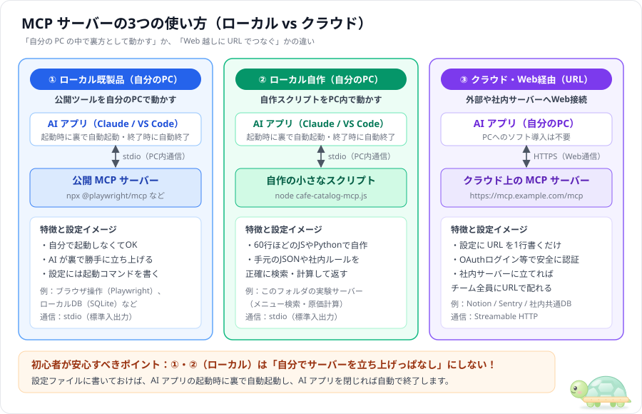

| 項目 | ① ローカル既製品 | ② ローカル自作 | ③ クラウド・Web 経由 |
|---|---|---|---|
| **動く場所** | **自分の PC 内** | **自分の PC 内** | **クラウド / 社内サーバー** |
| **事前の手動起動** | **不要**（AI が裏で自動起動） | **不要**（AI が裏で自動起動） | **不要**（常時稼働済み） |
| **設定に書くもの** | `npx @playwright/mcp` 等 | `node cafe-catalog-mcp.js` 等 | `https://...`（接続先 URL） |
| **通信方式** | **stdio**（標準入出力） | **stdio**（標準入出力） | **Streamable HTTP** |

---

### 2.2 ローカルの自動起動サイクルと、クラウドの2つの活用ケース

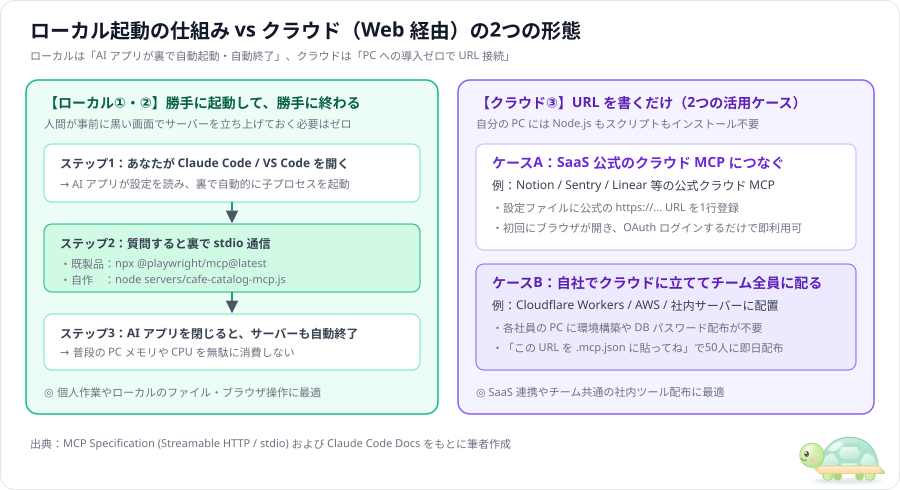

- **ローカル（①・②）の設定例**：`.mcp.json` に起動コマンドを書くだけで、AI アプリが起動時に裏で立ち上げ、AI アプリの終了時に自動で閉じます（1回の質問ごとに起動・終了するわけではなく、セッション中は動き続けます）。
  ```json
  {
    "mcpServers": {
      "playwright": { "command": "npx", "args": ["@playwright/mcp@latest"] },
      "cafe-catalog": { "command": "node", "args": ["servers/cafe-catalog-mcp.js"] }
    }
  }
  ```
- **クラウド（③）の設定例**：自分の PC へのソフト導入は一切不要で、`type: "http"` と `url` を指定するだけです（[samples/02-knowledge-search/](../samples/02-knowledge-search/) 参照）。
  ```json
  {
    "mcpServers": {
      "team-knowledge": { "type": "http", "url": "https://mcp.example.com/mcp" }
    }
  }
  ```

---

### 2.3 自分の PC 内のアプリ（ローカル API）を自作 MCP サーバーで操る場合

「自分の PC 内で動いているアプリケーション（自作ソフト、3D/CAD ソフトの Blender、Unity、音声合成の VOICEVOX など）が API を提供していて、それを AI が使いやすいように自作で MCP サーバーを立てる場合はどうなるの？」というケースは、**ローカル自作（パターン②）の最も代表的な活用法**です。

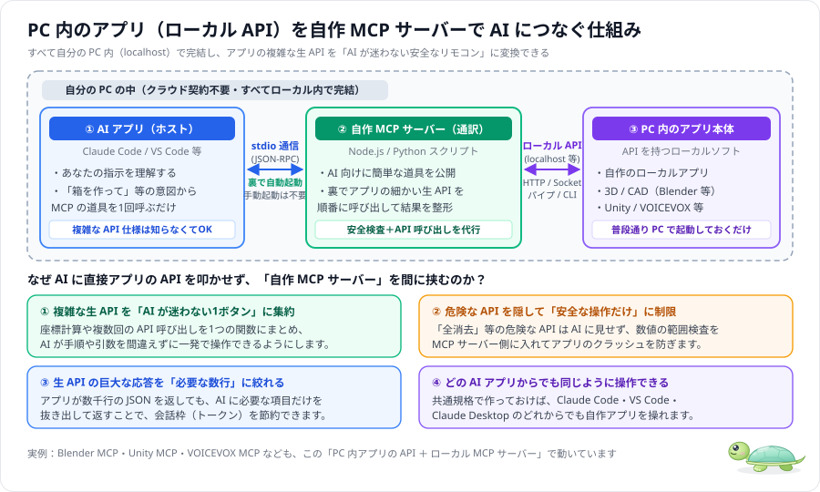

- **すべて自分の PC 内（ローカル）で完結する**：インターネットやクラウドサーバーは一切不要です。AI アプリ ──(`stdio`)──▶ 自作 MCP サーバー ──(`http://localhost:...` やソケット通信)──▶ PC 内のアプリ本体、という3段リレーが PC の中だけで動きます。
- **起動の手間もかからない**：PC 内の対象アプリ（Blender や自作アプリ）だけ普段通り起動しておけば、仲介役の「自作 MCP サーバー」は AI アプリが裏で勝手に起動・終了してくれます。
- **なぜ AI に直接アプリの API を叩かせず、自作 MCP サーバーを挟むのか？**
  1. **AI が迷わない「1つのボタン」にまとめられる**：アプリの生 API は「座標計算 → 生成 API → 色変更 API → 再描画 API」のように細かく分かれています。これを MCP サーバー側で `create_box(size, color)` という1つの道具（Tool）に束ねることで、AI が手順ミスをしなくなります（[samples/03-workflow-facade/](../samples/03-workflow-facade/) がこの見本です）。
  2. **危険な操作を物理的に隠せる**：アプリ側の「全データ初期化」などの危険な API は MCP サーバーに登録せず、数値の範囲チェックを入れることでアプリのクラッシュを防げます。
  3. **どの AI アプリからでも操れるようになる**：一度この変換スクリプトを作れば、Claude Code でも VS Code（Copilot）でも同じように自分のアプリを操作できます。

---

### 2.4 現場での使い方の組み合わせ（AI 側 × MCP 側）

実際に使う場面は、**AI 側が 2 通り**、**MCP 側が 2 通り**の組み合わせで考えると整理できます。

- **AI 側**：① 既製の AI ツール（Claude Code や GitHub Copilot などの CLI・IDE）をそのまま使う ／ ② 自作アプリから LLM の API（Claude API など）を呼ぶ
- **MCP 側**：① ローカル（自分の PC の中で動く・stdio）／ ② リモート（ネット越しのサーバーにつなぐ・HTTP）

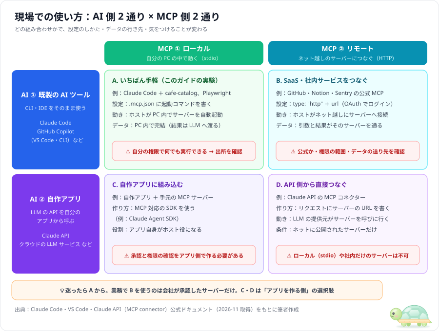

| 組み合わせ | 例 | 設定・作り方 | 気をつけること |
|---|---|---|---|
| **A. 既製ツール × ローカル**（いちばん手軽） | Claude Code ＋ このガイドの cafe-catalog、Playwright | `.mcp.json` に起動コマンドを書く。AI アプリが PC 内で自動起動する | サーバーは**自分の権限で何でも実行できる**ので、出所を確認する |
| **B. 既製ツール × リモート**（SaaS・社内サービス） | GitHub・Notion・Sentry などの公式 MCP、社内の MCP サーバー | `"type": "http"` と `url` を書き、OAuth でログインする | **公式か、権限の範囲、データの送り先**を確認する。業務では会社が承認したものだけ |
| **C. 自作アプリ × ローカル** | 自作アプリが MCP クライアントになり、手元の MCP サーバーを起動して使う | MCP に対応した SDK（例：Claude Agent SDK）を使う。アプリ自身がホスト役になる | 承認画面や権限の確認を、**アプリ側で作る**必要がある |
| **D. 自作アプリ × リモート**（API 側からつなぐ） | Claude API の MCP コネクター | リクエストにサーバーの URL（と必要ならトークン）を書く。**LLM の提供元のサーバーが MCP サーバーを呼びに行く** | **インターネットに公開されたサーバーだけ**。ローカルの stdio や社内だけのサーバーには届かない。トークンは自分で取得して渡す |

> [!TIP]
> - **迷ったら A から**始めます。このガイドの実験（cafe-catalog）は A です。
> - 業務で **B** を使うときは、会社が承認したサーバーだけにします（[03 の 4 章](03_mcp-security-and-rules.md)）。
> - **C・D は「アプリを作る側」**の選択肢です。自作アプリでは、MCP を使わず普通のツール呼び出し（関数呼び出し）で十分なことも多いので、「ほかの AI アプリからも使い回したいか」で決めます。

---

### 2.5 どこで動き、どこでデータが外に出るか

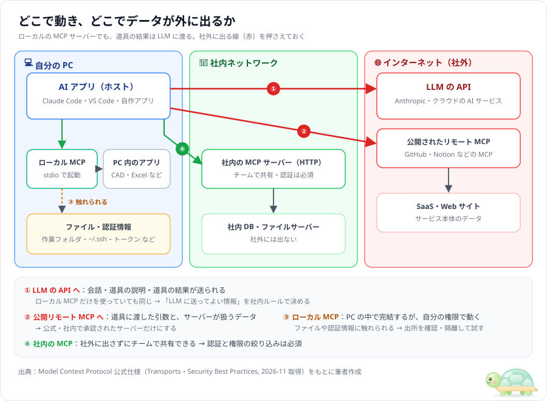

- **① LLM の API へ**：会話、道具の説明、**道具の結果**が送られます。ローカルの MCP サーバーだけを使っていても同じです。「LLM に送ってよい情報」を社内ルールで決めておきます。
- **② 公開されたリモート MCP へ**：道具に渡した引数と、そのサーバーが扱うデータが社外に出ます。公式・承認済みのサーバーだけにします。
- **③ ローカル MCP**：PC の中で完結しますが、自分の権限で動くので、作業フォルダや認証情報（`~/.ssh`・トークンなど）に触れられます。出所を確認し、知らないものは隔離した環境で試します。
- **④ 社内の MCP サーバー**：社外に出さずにチームで共有できます。ただし、認証と権限の絞り込みは必須です。

---

## 3. 全体構造と「3つの機能」・裏側の通信ステップ

### 3.1 Host・Client・Server の全体構造と3つの機能

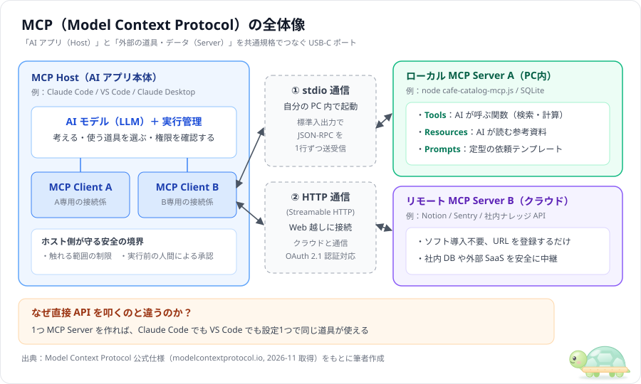

| サーバーが提供する3機能 | 役割 | 誰が呼ぶか | 現場での重要度 |
|---|---|---|---|
| **① Tools**（ツール） | AI が呼ぶ**関数**（検索・計算・操作） | **AI が自動で判断** | **★最重要（9割以上がこれ）** |
| **② Resources**（リソース） | AI が読む**参考資料**（`@` で添付） | 人間 / アプリ | 補助的（定型資料の参照用） |
| **③ Prompts**（プロンプト） | 依頼の**定型文**（`/mcp__...` で選択） | 人間 | 補助的（[samples/05](../samples/05-resources-and-prompts/) 参照） |

---

### 3.2 裏側で流れる JSON-RPC 2.0 の「3ステップ会話」

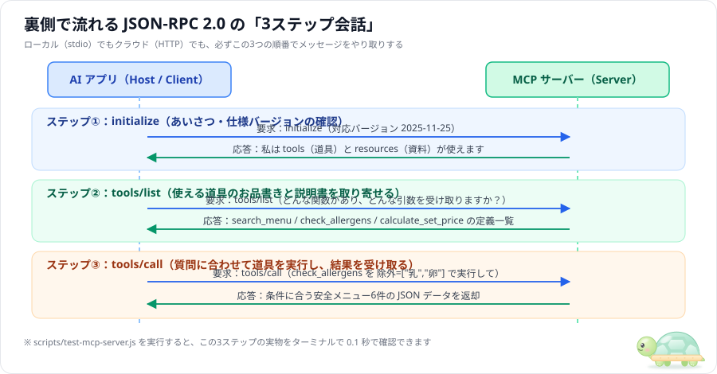

- **どんなサーバーでも会話は3ステップだけ**：① `initialize`（あいさつ）→ ② `tools/list`（使える道具と引数の型を取得）→ ③ `tools/call`（関数の実行と結果返却）の順に JSON メッセージが流れます。

---

## 4. CLI・Skills・Subagents・Hooks との使い分け

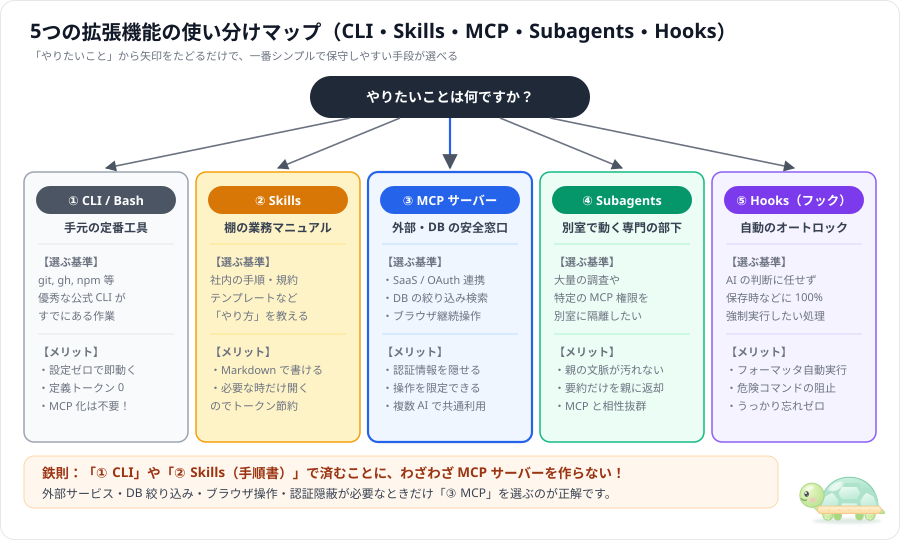

- **迷ったらまず CLI と Skills を検討する**：`git` や `gh` など既存コマンドで済むなら **① CLI**、社内規約や手順書なら **② Skills**（`SKILL.md`）の方が圧倒的に軽くて保守も簡単です（[info/09](../info/09_anthropic_agent-skills-vs-mcp.md)）。
- **外部連携・認証隠蔽・DB 絞り込みのときだけ ③ MCP を選ぶ**：さらに大量出力や強い権限を隔離したいときは **④ Subagents** と組み合わせます。

---

## 5. 設定ファイル（`.mcp.json`）とコマンド操作

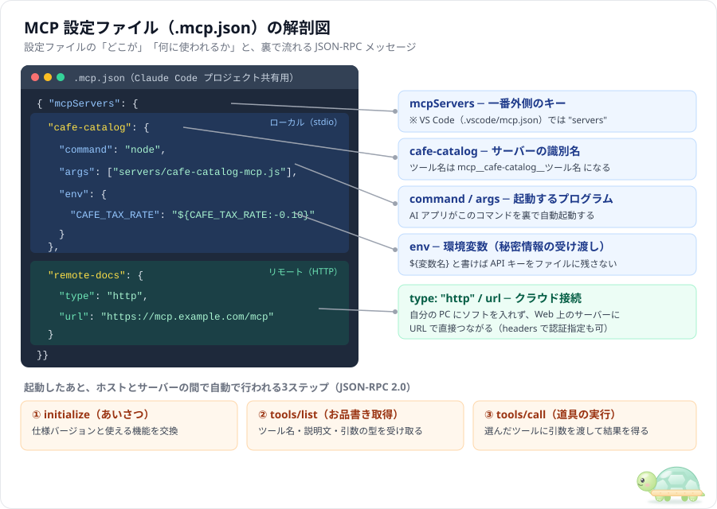

| スコープ名 | 保存場所 | 共有範囲 | 主な用途 |
|---|---|---|---|
| **`project`** | リポジトリ直下の **`.mcp.json`** | **チーム全員**（Git 共有） | プロジェクト共通ツール・実験サーバー |
| **`local`**（既定） | `~/.claude.json`（プロジェクト枠） | 自分 × このプロジェクト | 個人トークンを含む設定・試作 |
| **`user`** | `~/.claude.json`（全体共通枠） | 自分 × 全プロジェクト | どこでも使う汎用ツール |

```powershell
# プロジェクト共有（.mcp.json）にローカルサーバーを追加
claude mcp add --scope project cafe-catalog -- node servers/cafe-catalog-mcp.js

# 登録一覧の確認（対話画面の中では /mcp と入力）
claude mcp list
```

- **初回は承認が必要**：プロジェクト共有の `.mcp.json` に書かれたサーバーは、安全のため、対話モードで初めて起動したときに「このサーバーを使ってよいか」の確認が出ます（承認前の `/mcp` では「Pending approval」と表示されます）。
- **相対パスの基準**：`args` に `servers/cafe-catalog-mcp.js` のような相対パスを書いた場合、**Claude Code を起動したフォルダ**が基準になります。どこから起動しても動かしたいときは `${CLAUDE_PROJECT_DIR:-.}/servers/cafe-catalog-mcp.js` のように書きます。

---

## 6. 実践：60行の最小サーバーと 0.1秒テスト

ローカル自作サーバー（[samples/01-minimal-stdio/server.js](../samples/01-minimal-stdio/server.js)）は、外部パッケージ不要・Node.js 標準機能だけで約60行で書けます。やることは **3つの `req.method` に JSON を返すだけ**です（下は要点だけに絞った抜粋です。実ファイルには、壊れた JSON や知らないメソッドにエラーを返す処理も入っています）。

```javascript
#!/usr/bin/env node
const readline = require('node:readline');
const rl = readline.createInterface({ input: process.stdin, terminal: false });

rl.on('line', (line) => {
  if (!line.trim()) return;
  const req = JSON.parse(line);
  // id のないメッセージ（notifications/initialized などの「通知」）には返事をしない
  if (req.id === undefined) return;

  if (req.method === 'initialize') {
    send(req.id, { protocolVersion: '2025-11-25', capabilities: { tools: {} }, serverInfo: { name: 'dice', version: '1.0.0' } });
  } else if (req.method === 'tools/list') {
    send(req.id, { tools: [{ name: 'roll_dice', description: 'サイコロを振る', inputSchema: { type: 'object', properties: { sides: { type: 'number' } }, required: ['sides'] } }] });
  } else if (req.method === 'tools/call') {
    const sides = req.params.arguments.sides || 6;
    send(req.id, { content: [{ type: 'text', text: `出目: ${Math.floor(Math.random() * sides) + 1}` }] });
  } else {
    // 知らないメソッド（ping など）にもエラーで返事をする（無視するとクライアントが待ち続ける）
    process.stdout.write(JSON.stringify({ jsonrpc: '2.0', id: req.id, error: { code: -32601, message: 'Method not found' } }) + '\n');
  }
});

function send(id, result) {
  // ★鉄則：stdio 通信では stdout に JSON だけを書く（デバッグ表示は console.error を使う）
  process.stdout.write(JSON.stringify({ jsonrpc: '2.0', id, result }) + '\n');
}
```

Claude Code を起動しなくても、付属のテストスクリプトで **0.1秒で通信を確認**できます。

```powershell
cd C:\git_home\agent-study\mcp-guide
node scripts\test-mcp-server.js
```

### 6.1 既存のアプリに MCP の口を付ける 5 ステップ

「自分たちのアプリを AI から使えるようにしたい」ときは、アプリそのものを作り変える必要はありません。アプリが元から持っている口（Web API など）を呼ぶ MCP サーバーを、横に 1 つ置きます。[samples/06](../samples/06-wrap-existing-app/) がその見本です。

| # | やること | samples/06 では |
|---|---|---|
| 1 | **相手の口を調べる**：Web API・DB・ファイル・SDK・コマンドのどれがあるか。口がなければ作れない | `GET /api/stock`・`POST /api/orders`（API キー必須） |
| 2 | **AI に任せたい作業を「道具」として決める**：API の数だけ作るのではなく、作業の単位でまとめる | 「在庫を調べる」「在庫を確かめてから注文する」の 2 つ |
| 3 | **道具の説明と引数の形を書く**：LLM はこの説明を読んで道具を選ぶ | `description` と `inputSchema` |
| 4 | **呼ばれたときの処理を書く**：相手の口を呼び、結果を文章や JSON で返す。危ない頼みはここで止める | 在庫確認 → 注文の 2 回の呼び出し、1〜10 個の柵 |
| 5 | **AI アプリに登録して試す**：まずは点検スクリプトとデモで確かめる | `.mcp.json`、`inspect-mcp-tools.js`、`run-demo.js` |

手順 4 の中身（[order-mcp.js](../samples/06-wrap-existing-app/order-mcp.js) の抜粋）です。1 つの道具の中で、注文アプリの API を 2 回呼んでいます。

```javascript
async function placeOrder({ itemId, qty }) {
  if (!Number.isInteger(qty) || qty < 1 || qty > 10) {
    return '注文できるのは 1〜10 個です。注文アプリには送っていません。';   // 柵：頼み間違いをここで止める
  }
  const stock = await callApp('GET', '/api/stock?id=' + encodeURIComponent(itemId));   // 1 回目：在庫を確かめる
  if (stock.data.count < qty) return `在庫が ${stock.data.count} 個しかないため、注文しませんでした。`;
  const order = await callApp('POST', '/api/orders', { itemId, qty });                // 2 回目：注文する
  return `注文しました：注文番号 ${order.data.orderId}（${stock.data.name} × ${qty}）。`;
}
```

---

## 7. 知っておくべき2大注意点（トークン消費とセキュリティ）

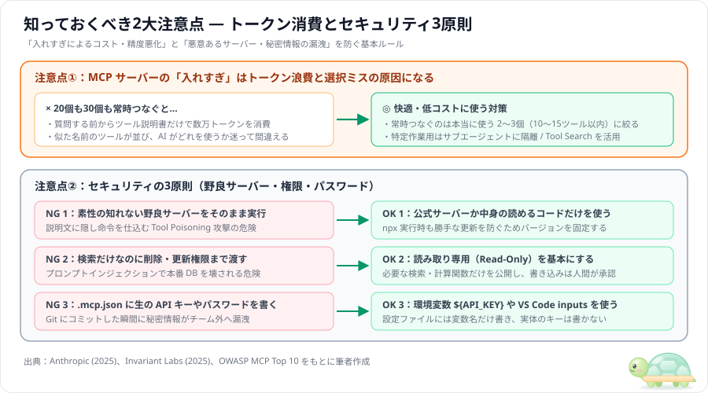

- **入れすぎない**：常時つなぐサーバーは **2〜3個**（10〜15ツール以内）を目安に絞り、残りはサブエージェントに分離します。なお Claude Code では **MCP Tool Search**（ツール定義の遅延読み込み）が**既定でオン**のため、ツール定義が最初から文脈を埋めることはありませんが、ツールが多いほど「探す手間」と「選び間違い」は増えます。VS Code（Copilot）など他のアプリでは全定義を読み込む場合もあるので、やはり厳選が基本です（詳しくは [docs/02](02_mcp-patterns.md)）。
- **安全の3原則**：①出所の確かなコードだけを使う（**Tool Poisoning** 対策）、②基本は**読み取り専用**（Read-Only）にする、③パスワードや API キーは **`${環境変数}`** で渡してファイルに直書きしない、の3点を徹底してください。

> [!IMPORTANT]
> **もっと詳しく**：主なリスク 8 つ、入れる前のチェックリストと点検スクリプト（`scripts/inspect-mcp-tools.js`）、4 層の守り、職場での申請と審査の流れは [03. MCP を安全に使うための注意点と対策](03_mcp-security-and-rules.md) にまとめています。

---

## 8. 参考文献

詳しい要約と原文引用は [info/](../info/README.md) にまとめています。

| # | 出典 | 時期 | 本書での引用箇所 |
|---|---|---|---|
| 1 | Anthropic「[Introducing the Model Context Protocol](https://www.anthropic.com/news/model-context-protocol)」 | 2024-11 | MCP の目的、Host / Client / Server 構造 |
| 2 | Model Context Protocol「[Specification](https://modelcontextprotocol.io/specification/)」 | 2026-11 取得 | Tools / Resources / Prompts、stdio・HTTP、JSON-RPC |
| 3 | Claude Code Docs「[Connect Claude Code to tools via MCP](https://code.claude.com/docs/en/mcp)」 | 2026-11 取得 | `.mcp.json`、3スコープ、MCP Tool Search |
| 4 | Anthropic「[Code execution with MCP](https://www.anthropic.com/engineering/code-execution-with-mcp)」 | 2025-11 | ツール定義のトークン消費とオンデマンド読込 |
| 5 | Anthropic「[Equipping agents for the real world with Agent Skills](https://www.anthropic.com/engineering/equipping-agents-for-the-real-world-with-agent-skills)」 | 2025-10 | MCP と Skills・CLI の役割分担 |
| 6 | Invariant Labs「[MCP Security Notification: Tool Poisoning Attacks](https://invariantlabs.ai/blog/mcp-security-notification-tool-poisoning-attacks)」 | 2025-04 | Tool Poisoning 攻撃とセキュリティ対策 |
| 7 | Model Context Protocol「[Security Best Practices](https://modelcontextprotocol.io/specification/2025-11-25/basic/security_best_practices)」 | 2026-11 取得 | ローカル MCP の任意のコード実行、どこでデータが外に出るか |
| 8 | Claude API Docs「[MCP connector](https://platform.claude.com/docs/en/agents-and-tools/mcp-connector)」 | 2026-11 取得 | API 側からリモート MCP を呼ぶ使い方（2.4 節の D） |
