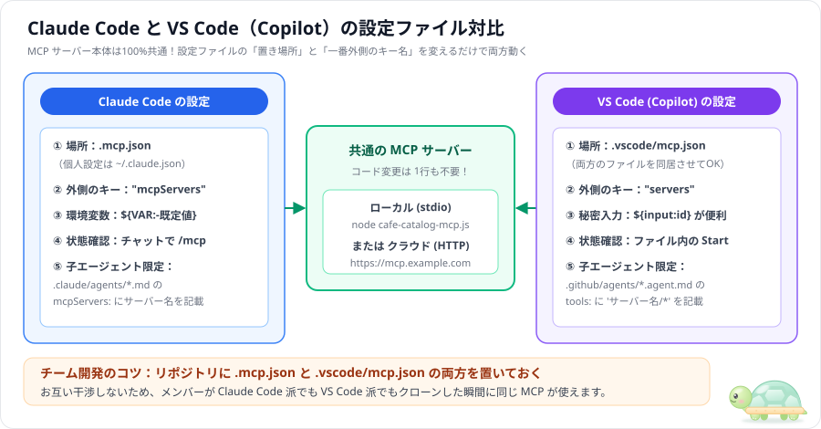

# GitHub Copilot / VS Code で MCP はどう使うか

> [MCP 入門（Claude Code 編）](00_mcp-guide.md)の続編です。Claude Code 用に作った MCP サーバーを **VS Code（GitHub Copilot Agent Mode）** でそのまま動かす方法と、設定ファイルの違いを図解でまとめます（2026-11-10 時点、出典は [info/08](../info/08_vscode-copilot_mcp-docs.md)）。

---

## 目次

1. [結論：MCP サーバー本体は100%そのまま使える](#1-結論mcp-サーバー本体は100そのまま使える)
2. [設定ファイル（`.mcp.json` vs `.vscode/mcp.json`）の比較](#2-設定ファイルmcpjson-vs-vscodemcpjsonの比較)
3. [VS Code ならではの安全機能：`inputs`（パスワード入力欄）](#3-vs-code-ならではの安全機能inputsパスワード入力欄)
4. [VS Code の Agent Mode で動かす4ステップ](#4-vs-code-の-agent-mode-で動かす4ステップ)
5. [サブエージェントごとに使える MCP を絞る方法](#5-サブエージェントごとに使える-mcp-を絞る方法)
6. [会社の環境（Business / Enterprise）での注意点](#6-会社の環境business--enterpriseでの注意点)
7. [参考文献](#7-参考文献)

---

## 1. 結論：MCP サーバー本体は100%そのまま使える



- **サーバーのコード変更はゼロ**：`servers/cafe-catalog-mcp.js` のような自作サーバーも、公式のクラウド MCP も、**1行も書き換えずに両方のツールでそのまま動きます**。
- **変えるのは主に設定ファイルの「場所」と「一番外側のキー名」**（細かい書き方の差は次章の表）：リポジトリに `.mcp.json` と `.vscode/mcp.json` の**両方を同居させておけば**、チームの誰がどちらのエディタを使っても即座に動きます。

---

## 2. 設定ファイル（`.mcp.json` vs `.vscode/mcp.json`）の比較

このワークスペースのルート直下（`mcp-guide/`）に置いてある2つのファイルを見比べてみましょう。

#### Claude Code 用（`.mcp.json`）
```json
{
  "mcpServers": {
    "cafe-catalog": {
      "command": "node",
      "args": ["servers/cafe-catalog-mcp.js"]
    }
  }
}
```

#### VS Code / GitHub Copilot 用（`.vscode/mcp.json`）
```json
{
  "servers": {
    "cafe-catalog": {
      "type": "stdio",
      "command": "node",
      "args": ["${workspaceFolder}/servers/cafe-catalog-mcp.js"]
    }
  }
}
```

| 比較項目 | Claude Code | VS Code（GitHub Copilot） |
|---|---|---|
| **プロジェクト設定ファイル** | **`.mcp.json`** | **`.vscode/mcp.json`** |
| **一番外側のキー名** | **`"mcpServers"`** | **`"servers"`** |
| **`type` の書き方** | ローカルなら省略可（省略時は stdio） | **`"type": "stdio"`** を書く |
| **パス指定のコツ** | 相対パスは「Claude Code を起動したフォルダ」基準 | **`${workspaceFolder}/servers/...`** が確実 |
| **環境変数の参照** | `${VAR}` / `${VAR:-既定値}` | `${env:VAR}`（秘密情報は次章の `${input:...}`） |
| **稼働状態の確認** | チャット欄で **`/mcp`** | ファイル内の **`Start / Restart`** ボタン |

環境変数をサーバーに渡したいときは、どちらも `env` 欄に書きます（下は書き方の例です。この実験用サーバーは環境変数を使いません）。

```jsonc
// Claude Code（.mcp.json）：自分の PC の環境変数 API_KEY を渡す
"env": { "API_KEY": "${API_KEY}" }

// VS Code（.vscode/mcp.json）：同じことを VS Code の書き方で
"env": { "API_KEY": "${env:API_KEY}" }
```

---

## 3. VS Code ならではの安全機能：`inputs`（パスワード入力欄）

`.vscode/mcp.json` では **`inputs`** を使うことで、API キーをファイルに一切書かずに安全に受け取れます（[VS Code Docs](https://code.visualstudio.com/docs/copilot/customization/mcp-servers)）。

```json
{
  "inputs": [
    {
      "type": "promptString",
      "id": "my-api-key",
      "description": "社内 API のキーを入力してください",
      "password": true
    }
  ],
  "servers": {
    "company-knowledge": {
      "type": "http",
      "url": "https://mcp.internal.example.com/mcp",
      "headers": { "Authorization": "Bearer ${input:my-api-key}" }
    }
  }
}
```

- **初回起動時に VS Code 上部に入力ボックスが出現**し、入力したキーは VS Code の安全な領域に記憶されます。

---

## 4. VS Code の Agent Mode で動かす4ステップ

1. **起動確認**：VS Code で `.vscode/mcp.json` を開き、`"cafe-catalog"` の上に表示される **`Start`**（または `Running`）をクリックする。
2. **Agent モード選択**：Copilot Chat パネルを開き、モードを **Agent** に切り替える。
3. **ツールの有効化**：入力欄のツールアイコン（🔧）を押し、`cafe-catalog` の3つのツールにチェックが入っていることを確認する。
4. **依頼する**：`prompts/01-allergen-menu.md` の内容を貼って実行する。

---

## 5. サブエージェントごとに使える MCP を絞る方法

特定のサブエージェントにだけ MCP ツールを渡したい場合の書き方比較です（見本は [samples/04-subagent-scoped/](../samples/04-subagent-scoped/)）。

```yaml
# Claude Code 版（.claude/agents/catalog-specialist.md）
---
name: catalog-specialist
description: カフェのメニュー検索・アレルゲン照合・価格計算の専門調査員。
tools: Read, mcp__cafe-catalog__search_menu, mcp__cafe-catalog__check_allergens, mcp__cafe-catalog__calculate_set_price
mcpServers:
  # サーバーの定義をここに直接（インラインで）書く → 親エージェントには見えない
  - cafe-catalog:
      type: stdio
      command: node
      args: ["servers/cafe-catalog-mcp.js"]
---
```

> ⚠️ **「子だけに渡す」ための大事なポイント（Claude Code）**：`mcpServers:` には「サーバー名だけ」を書く方法（例：`- cafe-catalog`）もありますが、これは **`.mcp.json` などに登録済みのサーバーを参照する書き方**で、**親エージェントも同じサーバーを使える状態のまま**です。親から完全に隠したいときは、上のように**サブエージェント定義の中にサーバーをインラインで書き、`.mcp.json` には登録しない**でください。

```yaml
# GitHub Copilot 版（.github/agents/catalog-specialist.agent.md）
---
name: catalog-specialist
description: カフェのメニュー検索・アレルゲン照合・価格計算の専門調査員。
tools: ['read', 'cafe-catalog/*']
user-invocable: false
---
```

- `tools: ['cafe-catalog/*']` で、このエージェントが使えるツールを `cafe-catalog` サーバーのものに絞れます。`user-invocable: false` は「人がエージェント選択欄から直接選べないようにし、サブエージェントとしてだけ使う」設定です。
- ただし Copilot では `.vscode/mcp.json` に登録したサーバーは**メインのエージェントからも使える**状態です。メイン側で使わせたくない場合は、チャット入力欄のツール選択（🔧）で `cafe-catalog` のチェックを外してください。

---

## 6. 会社の環境（Business / Enterprise）での注意点

| 注意点 | 対処法 |
|---|---|
| **組織ポリシーで無効化されている** | 管理者が GitHub 組織設定の「**MCP servers in Copilot**」を **Enabled** にする必要があります。 |
| **社内プロキシで `npx` が失敗する** | 毎回外部通信する `npx` ではなく、リポジトリ内のスクリプトを `node` で直接起動する構成が安定します。 |
| **ツール実行時の承認ダイアログ** | 読み取り専用の安全なツールは「このセッションで常に許可」、更新系ツールは「毎回人間が確認」にします。 |

---

## 7. 参考文献

すべて 2026-11-10 閲覧（詳細は [info/08_vscode-copilot_mcp-docs.md](../info/08_vscode-copilot_mcp-docs.md)）。

| # | 出典 | 内容 |
|---|---|---|
| 1 | VS Code Docs「[Use MCP servers in VS Code](https://code.visualstudio.com/docs/copilot/customization/mcp-servers)」 | `.vscode/mcp.json` の `servers`・`inputs`、Agent Mode の操作 |
| 2 | GitHub Docs「[Extending GitHub Copilot Chat with MCP](https://docs.github.com/en/copilot/customizing-copilot/extending-copilot-chat-with-mcp)」 | 組織ポリシー設定と注意点 |
| 3 | VS Code Docs「[Custom agents in VS Code](https://code.visualstudio.com/docs/copilot/customization/custom-agents)」 | `.agent.md` の `tools:` での `'サーバー名/*'` 指定 |
