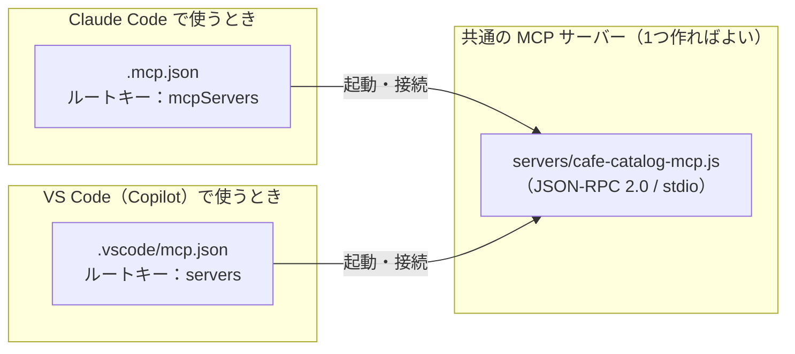

# GitHub Copilot / VS Code で MCP はどう使うか

> [MCP 入門（Claude Code 編）](00_mcp-guide.md)の続編です。Claude Code で作った MCP サーバーを、**GitHub Copilot（VS Code の Agent Mode や Copilot CLI** もそのまま使えるか、設定ファイルの書き方がどう違うかをまとめます。
> 内容は 2026-11-10 時点の公式ドキュメントにもとづきます。根拠となる一次情報は [info/08_vscode-copilot_mcp-docs.md](../info/08_vscode-copilot_mcp-docs.md) および[参考文献](#参考文献)にあります。
> Claude Code 用（`.mcp.json`）と VS Code 用（`.vscode/mcp.json`）の両方を並べた見本は、[samples/](../samples/README.md) およびこのワークスペースのルート直下に置いてあります。

---

## 目次

1. [結論：MCP サーバー本体は100%そのまま使える](#1-結論mcp-サーバー本体は100そのまま使える)
2. [Claude Code と VS Code（Copilot）の対応表](#2-claude-code-と-vs-codecopilotの対応表)
3. [設定ファイル（`.vscode/mcp.json`）の書き方の違い](#3-設定ファイルvscodemcpjsonの書き方の違い)
4. [VS Code の Agent Mode で実際に動かす手順](#4-vs-code-の-agent-mode-で実際に動かす手順)
5. [サブエージェント（`.agent.md`）ごとに使える MCP を絞る](#5-サブエージェントagentmdごとに使える-mcp-を絞る)
6. [会社の環境（Copilot Business / Enterprise）での注意点](#6-会社の環境copilot-business--enterpriseでの注意点)
7. [まとめ](#7-まとめ)
8. [参考文献](#参考文献)

---

## 1. 結論：MCP サーバー本体は100%そのまま使える

**MCP の最大のメリットがここで活きます。**

- サーバー側のプログラム（たとえばこのワークスペースの `servers/cafe-catalog-mcp.js` や、各社の公式 MCP サーバー）は、**1行も書き換えることなく Claude Code と VS Code（GitHub Copilot）の両方でそのまま動きます**。
- 変える必要があるのは **どのファイルを読みに行くか（置き場所）」** **JSON の一番外側のキー名（`mcpServers` か `servers` か）** 2点だけです。



---

## 2. Claude Code と VS Code（Copilot）の対応表

| やりたいこと | Claude Code | GitHub Copilot（VS Code） |
|---|---|---|
| **プロジェクト共有の設定ファイル** | リポジトリ直下の **`.mcp.json`** | リポジトリ内の **`.vscode/mcp.json`** |
| **個人全体の設定ファイル** | `~/.claude.json` | VS Code のユーザー設定フォルダ内の `mcp.json`（コマンドパレット `MCP: Open User Configuration` で開く） |
| **JSON の一番外側のキー名** | **`"mcpServers"`** | **`"servers"`** |
| **秘密の API キーの渡し方** | 環境変数 `"${API_KEY}"` | 環境変数 `"${env:API_KEY}"` または **入力プロンプト `"${input:id}" **初回に入力欄が出る） |
| **ツールを使わせるモード** | 通常の対話 / `claude -p` | チャットパネルの **Agent Mode（エージェントモード）** |
| **稼働状態の確認・再起動** | チャットで `/mcp` | コマンドパレット `MCP: List Servers`、または `.vscode/mcp.json` ファイル内の「Start / Restart」ボタン |
| **Resources（資料）の参照** | `@サーバー名:URI` | チャットの「Add Context...」→「MCP Resources」 |
| **Prompts（定型文）の呼び出し** | `/mcp__サーバー名__プロンプト名` | `/mcp.サーバー名.プロンプト名` |
| **サブエージェントでの MCP 限定** | `.claude/agents/*.md` の `mcpServers:` | `.github/agents/*.agent.md` の `tools:` に `'サーバー名/*'` を指定 |

出典：[Claude Code Docs「MCP」](https://code.claude.com/docs/en/mcp)、[VS Code Docs「Use MCP servers in VS Code」](https://code.visualstudio.com/docs/copilot/customization/mcp-servers)

---

## 3. 設定ファイル（`.vscode/mcp.json`）の書き方の違い

### 3.1 同じサーバーを2つの形式で並べて比べる

このワークスペースのルート直下には、両方のファイルが置いてあります。見比べると違いが一目で分かります。

#### Claude Code 用（`.mcp.json`）
```json
{
  "mcpServers": {
    "cafe-catalog": {
      "command": "node",
      "args": ["servers/cafe-catalog-mcp.js"],
      "env": {
        "CAFE_TAX_RATE": "${CAFE_TAX_RATE:-0.10}"
      }
    }
  }
}
```

#### VS Code / GitHub Copilot 用（`.vscode/mcp.json`）
```json
{
  "servers": {
    "cafe-catalog": {
      "type": "stdio",
      "command": "node",
      "args": ["${workspaceFolder}/servers/cafe-catalog-mcp.js"],
      "env": {
        "CAFE_TAX_RATE": "0.10"
      }
    }
  }
}
```

押さえておくべきポイントは3つです。

1. **`"mcpServers"` ではなく `"servers"` にする**：ここを間違えると VS Code で認識されません（ただし VS Code 側でエディタの入力補完が効くので、迷いにくくなっています）。
2. **`${workspaceFolder}` が使える**：VS Code 固有の変数 `${workspaceFolder}`（開いているフォルダの絶対パス）を書いておくと、どのフォルダ階層から実行しても確実にスクリプトを見つけられます。
3. **両方のファイルをリポジトリに同居させてよい**：Claude Code は `.mcp.json` を読み、VS Code は `.vscode/mcp.json` を読むため、**両方ともリポジトリに入れておけば、チームの誰がどちらのツールを使ってもすぐ動きます**。

### 3.2 VS Code ならではの便利機能：`inputs`（秘密情報の安全な入力）

外部の API キーが必要な MCP サーバーをチームで共有するとき、VS Code の `.vscode/mcp.json` では **`inputs`** という仕組みが使えます（[VS Code Docs](https://code.visualstudio.com/docs/copilot/customization/mcp-servers)）。

```json
{
  "inputs": [
    {
      "type": "promptString",
      "id": "my-api-key",
      "description": "社内ナレッジ API のキーを入力してください",
      "password": true
    }
  ],
  "servers": {
    "company-knowledge": {
      "type": "http",
      "url": "https://mcp.internal.example.com/mcp",
      "headers": {
        "Authorization": "Bearer ${input:my-api-key}"
      }
    }
  }
}
```

こう書いておくと、サーバーを初めて起動するときに VS Code の画面上部にパスワード入力欄（`password: true` なら伏せ字）が出現し、入力した値は VS Code の安全な記憶領域に保存されます。**設定ファイル自体には秘密情報を一切書かずに Git でチーム共有できる**ため、非常に安全です。

---

## 4. VS Code の Agent Mode で実際に動かす手順

1. VS Code でこのフォルダ（`mcp-guide`）を開く。
2. `.vscode/mcp.json` を開くと、エディタ上の `"cafe-catalog"` のすぐ上に小さく **`Start **または `Running | Stop | Restart`）という文字（コードレンズ）が表示されるので、`Start` をクリックして起動できることを確認する。
3. Copilot Chat パネルを開き、入力欄のモード選択を **Agent** に切り替える。
4. 入力欄のツールアイコン（🔧）をクリックし、`cafe-catalog` のツール（`search_menu`、`check_allergens`、`calculate_set_price`）にチェックが入っていることを確認する。
5. `prompts/01-allergen-menu.md` の内容を貼り付けて依頼する。
6. Copilot が自動で `check_allergens` や `calculate_set_price` を呼び出す確認ダイアログを出したら、`Continue`（または自動許可）を押す。

---

## 5. サブエージェント（`.agent.md`）ごとに使える MCP を絞る

[agent-guide の Copilot 編](../../agent-guide/docs/01_copilot-subagent-guide.md)で扱った `.github/agents/*.agent.md`（カスタムエージェント／サブエージェント）と MCP を組み合わせることもできます。

すべてのエージェントに全部の MCP ツールを持たせるのではなく、****という絞り込みが可能です（見本は [samples/04-subagent-scoped/](../samples/04-subagent-scoped/)）。

### Claude Code と Copilot での書き方の違い

```yaml
# Claude Code 版（.claude/agents/catalog-specialist.md）
---
name: catalog-specialist
description: カフェのメニュー検索・アレルゲン照合・価格計算を専門に行う調査員。
tools: Read, mcp__cafe-catalog__search_menu, mcp__cafe-catalog__check_allergens, mcp__cafe-catalog__calculate_set_price
mcpServers:
  - cafe-catalog
---
```

```yaml
# GitHub Copilot 版（.github/agents/catalog-specialist.agent.md）
---
name: catalog-specialist
description: カフェのメニュー検索・アレルゲン照合・価格計算を専門に行う調査員。
tools: ['read', 'cafe-catalog/*']
user-invocable: false
---
```

- **Claude Code**：`mcpServers:` にサーバー名を列挙し、さらに特定のツールだけに絞りたい場合は `tools:` に `mcp__サーバー名__ツール名` と書きます。
- **GitHub Copilot（VS Code** `tools:` の配列の中に `'サーバー名/*'`（そのサーバーの全ツール）または `'サーバー名/ツール名'` を書きます。

---

## 6. 会社の環境（Copilot Business / Enterprise）での注意点

会社のアカウントで GitHub Copilot を使っている場合、次の点に注意してください（[GitHub Docs](https://docs.github.com/en/copilot/customizing-copilot/extending-copilot-chat-with-mcp)）。

| 注意点 | 内容と対処 |
|---|---|
| **組織ポリシーで無効になっている場合がある** | Copilot Business / Enterprise では、組織（Organization / Enterprise）の管理者がポリシー設定の **「MCP servers in Copilot」を Enabled（有効）** にしていないと、`.vscode/mcp.json` を置いても読み込まれません。使えない場合は管理者に確認してください。 |
| **社内プロキシ・ファイアウォール** | `npx -y @xxx/mcp-server` で毎回外部からパッケージをダウンロードする書き方は、社内プロキシ環境で失敗しやすいです。社内環境では、リポジトリ内に置いたスクリプトを `node` で直接起動するか、事前にインストールしたパッケージを指定する方が安定します。 |
| **承認ダイアログの扱い** | MCP ツールは外部のシステムを操作できるため、既定では実行のたびに「このツールを実行してよいですか？」と確認が出ます。読み取り専用の安全な自作ツールなら「このセッションでは常に許可」を選べますが、書き込みや外部送信を行うツールは毎回確認する運用が安全です。 |

---

## 7. まとめ

- **サーバーは共通**：Node.js や Python で作った MCP サーバーは、Claude Code でも VS Code（Copilot）でもそのまま動く。
- **設定ファイルは2つ並べて置ける**：Claude Code 用に `.mcp.json`（キー名 `mcpServers`）、VS Code 用に `.vscode/mcp.json`（キー名 `servers`）を両方リポジトリに置いておけば、チーム全員がどちらの環境でもすぐ試せる。
- **秘密情報は `inputs` か環境変数へ**：`.vscode/mcp.json` の `inputs` を使えば、API キーをファイルに一切書かずに初回入力プロンプトで受け取れる。
- **サブエージェントとの組み合わせ**：`.github/agents/*.agent.md` の `tools:` で `'サーバー名/*'` を指定すれば、必要なサブエージェントにだけ MCP ツールを渡せる。

---

## 8. 参考文献

すべて 2026-11-10 閲覧（詳しくは [info/08_vscode-copilot_mcp-docs.md](../info/08_vscode-copilot_mcp-docs.md)）。

| # | 文献 | 本書で使った内容 |
|---|---|---|
| 1 | VS Code Docs「[Use MCP servers in VS Code](https://code.visualstudio.com/docs/copilot/customization/mcp-servers)」 | `.vscode/mcp.json` の構造（`servers`、`inputs`）、Agent Mode でのツール選択、Resources / Prompts の呼び出し方 |
| 2 | GitHub Docs「[Extending GitHub Copilot Chat with Model Context Protocol (MCP)](https://docs.github.com/en/copilot/customizing-copilot/extending-copilot-chat-with-mcp)」 | Copilot での MCP 利用手順、組織ポリシー（MCP servers in Copilot）の制限 |
| 3 | VS Code Docs「[Custom agents in VS Code](https://code.visualstudio.com/docs/copilot/customization/custom-agents)」 | `.github/agents/*.agent.md` の `tools` 欄での MCP サーバー・ツールの指定方法 |
