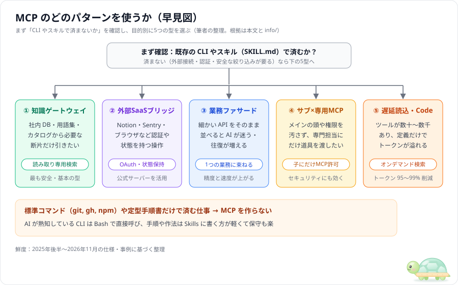
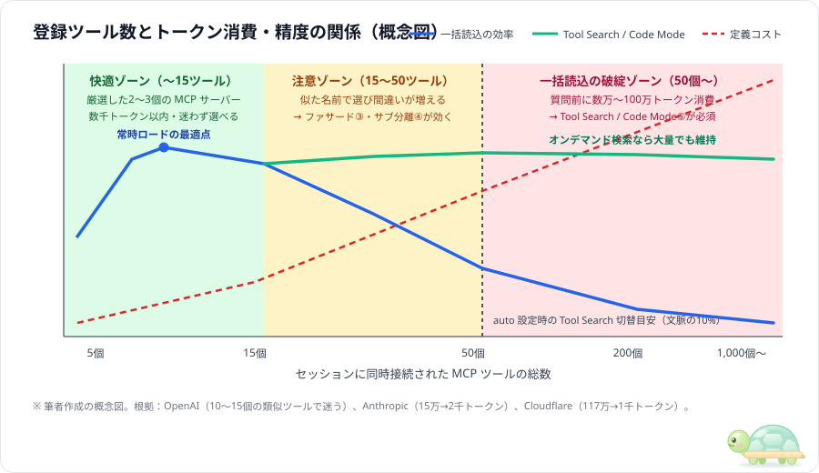
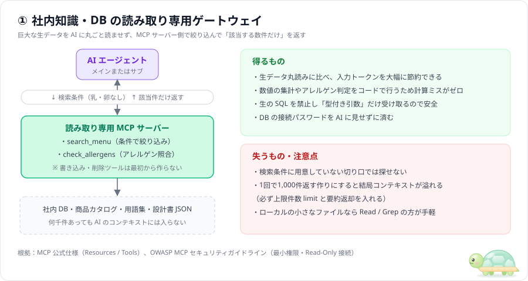
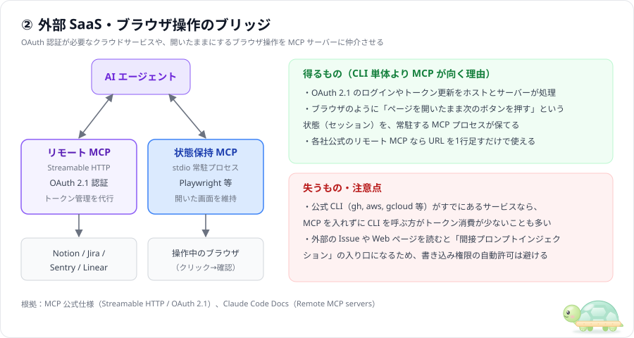
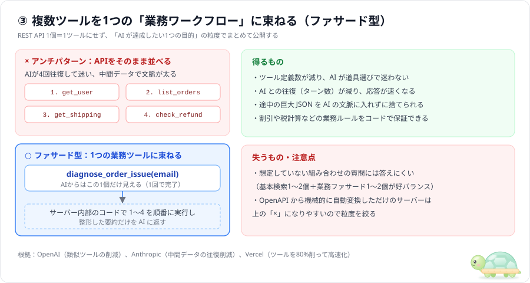
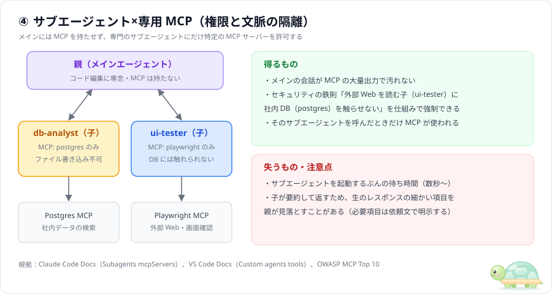
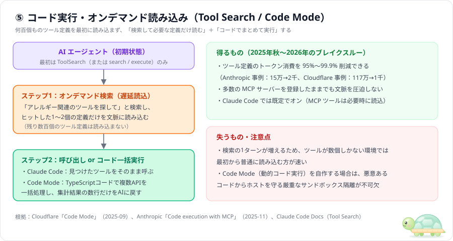

# MCP の定番パターン5選 — 効く理由・失うもの・CLIやスキルとの使い分け

> 「MCP サーバーはどう設計すると本当に役に立つのか？いつ CLI や Skills で済ませるべきか？」を、**7枚のベクター図解**（SVG）で整理した実践パターン集です。
> 調査日は **2026-11-10**。根拠となる一次情報（10件）は [info/](../info/README.md) にまとめています。
> **鮮度ラベル**：**新**＝6か月以内（2026-05〜）／**中**＝6〜12か月前（2025-11〜2026-04）／**古**＝12か月超（〜2025-10、当時の全定義一括読込を前提とした議論に注意）。

---

## 目次

0. [まず結論（5パターンの早見図）](#0-まず結論5パターンの早見図)
1. [大前提：登録ツール数とトークン消費・精度の関係](#1-大前提登録ツール数とトークン消費精度の関係)
2. [パターン①：社内知識・DB の読み取り専用ゲートウェイ](#2-パターン①社内知識db-の読み取り専用ゲートウェイ)
3. [パターン②：外部 SaaS・ブラウザ操作のブリッジ](#3-パターン②外部-saasブラウザ操作のブリッジ)
4. [パターン③：複数処理を1つの「業務ワークフロー」に束ねる（ファサード型）](#4-パターン③複数処理を1つの業務ワークフローに束ねるファサード型)
5. [パターン④：サブエージェント×専用 MCP（権限と文脈の隔離）](#5-パターン④サブエージェント専用-mcp権限と文脈の隔離)
6. [パターン⑤：オンデマンド検索・コード実行（Tool Search / Code Mode）](#6-パターン⑤オンデマンド検索コード実行tool-search--code-mode)
7. [2025年→2026年で変わった「MCP・CLI・スキル」の境界線](#7-2025年2026年で変わったmcpcliスキルの境界線)
8. [参考文献](#8-参考文献)

---

## 0. まず結論（5パターンの早見図）

| # | パターン | ひとことで | 向く場面 | 向かない場面 | 鮮度 |
|---|---|---|---|---|---|
| ① | **知識・DB ゲートウェイ** | サーバー側で絞り込み**数件だけ返す** | 社内 DB・商品カタログの正確な検索 | 小さなファイル1〜2個を読むだけ | 新〜中 |
| ② | **外部 SaaS・状態ブリッジ** | **OAuth 認証**や**開いた画面**を維持 | Notion / Sentry 連携、Playwright 操作 | `git` や `gh` 等の標準 CLI があるとき | 新 |
| ③ | **業務ファサード** | **1つの業務目的＝1ツール**に束ねる | 複数ステップや割引・税計算の自動化 | 自由な切り口でのデータ探索 | 中〜新 |
| ④ | **サブエージェント×専用 MCP** | **専門の子にだけ**特定 MCP を許可 | 大量出力の隔離、外部読取と DB の分離 | 1回だけ軽く呼べば終わる作業 | 新 |
| ⑤ | **遅延読込・Code Mode** | **必要な定義だけ検索**＋コード一括実行 | ツールが数十〜数千個ある大規模環境 | ツールが3〜5個だけの構成 | 中〜新 |

---

## 1. 大前提：登録ツール数とトークン消費・精度の関係

- **常時ロードの快適ゾーンは 10〜15ツールまで**：ツール定義をすべて最初に読み込む方式で MCP サーバーを何十個も同時につなぐと、質問する前にツール定義だけで数万トークン（巨大な API を丸ごとツール化した極端な例では100万トークン超）を消費し、AI の選択ミスも増えます（[info/03](../info/03_armin-mario_mcp-vs-cli.md)、[info/04](../info/04_cloudflare_code-mode.md)、[info/05](../info/05_anthropic_code-execution-with-mcp.md)）。
- **Claude Code では事情が少し違う**：2026年11月時点の Claude Code は **Tool Search が既定でオン**で、MCP のツール定義は必要になるまで読み込まれません（パターン⑤）。そのため「定義だけで文脈が埋まる」問題は起きにくくなりましたが、ツールが多いほど検索の手間と選び間違いは増えるので、**厳選する原則は変わりません**。
- **作る前の3チェック**：① `git` や `gh` 等の**既存 CLI** で済まないか？ ② 手順書なら **Skills**（`SKILL.md`）で済まないか？ ③ それでも「認証隠蔽・DB 絞り込み・状態維持」が必要なときだけ MCP を選びます。

---

## 2. パターン①：社内知識・DB の読み取り専用ゲートウェイ

- **効く理由**：生データ全件を AI に読ませず、サーバー側で正確にフィルタリングして**該当する数件だけ**を返すため、トークン節約とハルシネーション防止を両立できます（見本：[samples/02-knowledge-search/](../samples/02-knowledge-search/)）。
- **注意点**：検索ヒットが多すぎるときに全件返すと文脈が溢れるため、必ずサーバー側で **返却上限（`limit: 10` など）** を設けてください。

---

## 3. パターン②：外部 SaaS・ブラウザ操作のブリッジ

- **効く理由**：SaaS 公式のリモート MCP（**Streamable HTTP + OAuth 2.1**）によるクラウド連携や、Playwright のように「画面を開いたまま次のターンでボタンを押す」**状態保持プロセス**を自然に扱えます（[info/06](../info/06_mcp_spec-2025-2026.md)）。
- **注意点**：外部の Issue や Web ページを読む際は、本文内の偽指示（間接プロンプトインジェクション）に備え、削除・外部送信ツールの自動実行を許可しないでください（[info/10](../info/10_owasp-trailofbits_mcp-security.md)）。

---

## 4. パターン③：複数処理を1つの「業務ワークフロー」に束ねる（ファサード型）

- **効く理由**：細かい REST API を1対1で並べるのではなく、「①商品照合 → ②割引判定 → ③税・原価率計算」を **1つの業務ツール**（例：`calculate_set_price`）にまとめることで、AI の選択ミスと計算ズレをゼロにできます（見本：[samples/03-workflow-facade/](../samples/03-workflow-facade/)）。
- **注意点**：OpenAPI 定義から100個のエンドポイントを機械的に100ツールへ自動変換するのは避け、**よく使う 3〜5個の業務ツール**に絞るのが鉄則です。

---

## 5. パターン④：サブエージェント×専用 MCP（権限と文脈の隔離）

- **効く理由**：重たい出力を出す MCP や強い権限を持つ MCP を**専門のサブエージェントだけに割り当てる**ことで、親のコンテキストを綺麗に保ち、外部読取と機密 DB 操作の同居（セキュリティ上の危険な組み合わせ）を分断できます（見本：[samples/04-subagent-scoped/](../samples/04-subagent-scoped/)）。
- **「親に見せない」書き方**：Claude Code では、サブエージェント定義の `mcpServers:` に**サーバーをインラインで定義**し、`.mcp.json` には登録しません。`mcpServers: [cafe-catalog]` のように名前だけ書くと、登録済みサーバーを親と共有する扱いになり、親からも使えてしまいます。
- **注意点**：サブエージェントの起動には数秒のオーバーヘッドがあるため、1回だけの軽いツール呼び出しなら親で直接呼ぶ方が速いです。

---

## 6. パターン⑤：オンデマンド検索・コード実行（Tool Search / Code Mode）

- **効く理由**：①必要な瞬間だけツール定義を検索して読む **Tool Search**（Claude Code に標準搭載で**既定でオン**。環境変数 `ENABLE_TOOL_SEARCH=auto` にすると「定義が文脈の10%を超えたときだけ」使う方式に変えられる：[info/07](../info/07_claude-code_mcp-docs.md)）と、②複数回の呼び出しをスクリプト1本でサンドボックス実行する **Code Mode** により、ツール定義トークンを **98〜99% 削減**できます（[Anthropic 2025-11](../info/05_anthropic_code-execution-with-mcp.md)、[Cloudflare 2025-09](../info/04_cloudflare_code-mode.md)）。
- **注意点**：ツール総数が 5〜10個程度の小規模な環境では、最初から読み込んでも軽量なため効果は小さく、検索の1ターンが増えるぶん遅くなることもあります。毎ターン必ず使う少数のツールは、Claude Code の `.mcp.json` でサーバーに `"alwaysLoad": true` を付けると最初から読み込ませられます。

---

## 7. 2025年→2026年で変わった「MCP・CLI・スキル」の境界線

| 2025年前半によくあったやり方 | 2026年現在の推奨スタイル | 理由 |
|---|---|---|
| なんでも MCP にして常時10個以上つなぐ | **常時接続は2〜3個**＋残りは Tool Search / 子分離 | ツール定義のトークン肥大化と選択ミスを防ぐため |
| 社内の手順書や作法も MCP で書く | 手順・作法は **Skills**（`SKILL.md`）に書く | Markdown で保守でき、段階的開示で軽いため（[info/09](../info/09_anthropic_agent-skills-vs-mcp.md)） |
| GitHub 操作等にも必ず MCP を入れる | ローカルなら **`gh` 等の既存 CLI** を Bash で呼ぶ | AI がすでにコマンドを熟知しており定義コスト 0 のため（[info/03](../info/03_armin-mario_mcp-vs-cli.md)） |
| REST API を1対1でそのままツール化する | **業務ファサード（③）** または **Code Mode（⑤）** | 往復回数と暗算ミスを減らすため |

---

## 8. 参考文献

詳しい要約・原文引用・注意点は [info/](../info/README.md) を参照してください。

| # | 出典 | 時期 | 鮮度 |
|---|---|---|---|
| 1 | Anthropic, [Introducing the Model Context Protocol](https://www.anthropic.com/news/model-context-protocol)（[info/01](../info/01_anthropic_introducing-mcp.md)） | 2024-11 | 古 |
| 2 | Invariant Labs, [Tool Poisoning Attacks](https://invariantlabs.ai/blog/mcp-security-notification-tool-poisoning-attacks)（[info/02](../info/02_invariant_tool-poisoning-attacks.md)） | 2025-04 | 古 |
| 3 | Armin Ronacher / Mario Zechner, [MCP vs CLI 議論](https://lucumr.pocoo.org/2025/7/3/tools/)（[info/03](../info/03_armin-mario_mcp-vs-cli.md)） | 2025-07〜08 | 古 |
| 4 | Cloudflare, [Code Mode: the better way to use MCP](https://blog.cloudflare.com/code-mode/)（[info/04](../info/04_cloudflare_code-mode.md)） | 2025-09 | 古 |
| 5 | Anthropic, [Code execution with MCP](https://www.anthropic.com/engineering/code-execution-with-mcp)（[info/05](../info/05_anthropic_code-execution-with-mcp.md)） | 2025-11 | 中 |
| 6 | Model Context Protocol, [Official Specification](https://modelcontextprotocol.io/specification/)（[info/06](../info/06_mcp_spec-2025-2026.md)） | 2026-11 取得 | 新 |
| 7 | Claude Code Docs, [Connect Claude Code to tools via MCP](https://code.claude.com/docs/en/mcp)（[info/07](../info/07_claude-code_mcp-docs.md)） | 2026-11 取得 | 新 |
| 8 | VS Code / GitHub Docs, [Use MCP servers in VS Code](https://code.visualstudio.com/docs/copilot/customization/mcp-servers)（[info/08](../info/08_vscode-copilot_mcp-docs.md)） | 2026-11 取得 | 新 |
| 9 | Anthropic, [Equipping agents for the real world with Agent Skills](https://www.anthropic.com/engineering/equipping-agents-for-the-real-world-with-agent-skills)（[info/09](../info/09_anthropic_agent-skills-vs-mcp.md)） | 2025-10〜2026-11 | 中〜新 |
| 10 | OWASP GenAI Security Project, [OWASP MCP Top 10](https://genai.owasp.org/)（[info/10](../info/10_owasp-trailofbits_mcp-security.md)） | 2025-10〜2026-06 | 新 |
