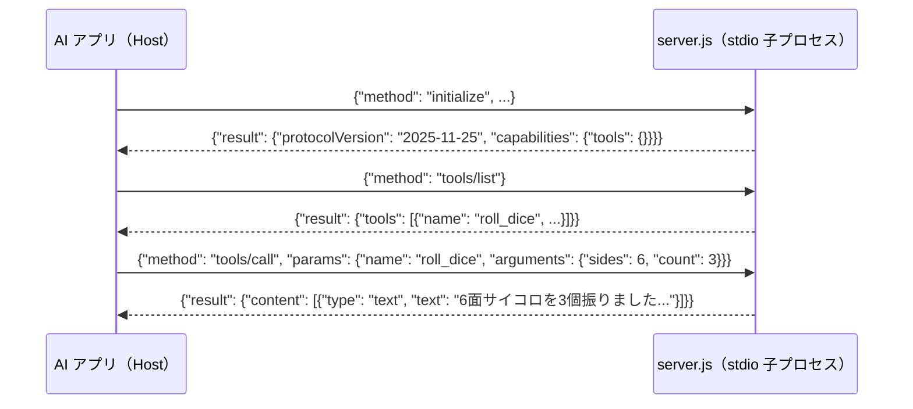

# 01 最小の stdio MCP サーバー（約60行・外部パッケージ不要）

MCP サーバーが裏側で何をしているかを一番シンプルに理解するための最小構成です。ガイドの [00 の 5章](../../docs/00_mcp-guide.md#5-実践最小のローカル-mcp-サーバーを作って-claude-code-に繋ぐ) に対応します。

- `npm install` は一切不要で、Node.js が入っていればそのまま動きます。
- 提供するツールは `roll_dice`（指定した面数のサイコロを指定個数振って合計を返す）の1つだけです。

## 構成と通信の流れ



## ファイル

- [server.js](server.js)：MCP サーバー本体（約60行）
- [claude-code/.mcp.json](claude-code/.mcp.json)：Claude Code 用の設定見本
- [copilot/.vscode/mcp.json](copilot/.vscode/mcp.json)：VS Code（GitHub Copilot）用の設定見本

## すぐ試す（Claude なしで通信確認）

```powershell
cd C:\git_home\agent-study\mcp-guide
node scripts\test-mcp-server.js samples\01-minimal-stdio\server.js
```
