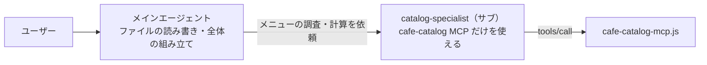

# 04 サブエージェント×専用 MCP（権限と文脈の隔離）

ガイドの [01 の 5章](../../docs/01_copilot-mcp-guide.md#5-サブエージェントごとに使える-mcp-を絞る方法) および [02 の 5章（パターン④：サブエージェント×専用 MCP）](../../docs/02_mcp-patterns.md#5-パターン④サブエージェント専用-mcp権限と文脈の隔離) に対応する見本です。

## 構成のポイント

- `catalog-specialist` は、**カフェのメニュー検索・アレルゲン照合・セット価格計算の MCP ツールだけ**を持ち、ファイルを書き換える権限（`Write` / `Edit`）もコマンド実行権限（`Bash`）も持ちません。
- メインエージェントは、細かいカタログ検索や価格計算をすべてこのサブエージェントに任せ、返ってきた確定数値だけを使って Web ページや企画書を仕上げます。

## 2つの形式の違い

| 項目 | Claude Code（`claude-code/`） | GitHub Copilot（`copilot/`） |
|---|---|---|
| エージェント定義 | [.claude/agents/catalog-specialist.md](claude-code/.claude/agents/catalog-specialist.md) | [.github/agents/catalog-specialist.agent.md](copilot/.github/agents/catalog-specialist.agent.md) |
| MCP 設定 | **`.mcp.json` は置かない**（エージェント定義の中にインラインで書く） | [.vscode/mcp.json](copilot/.vscode/mcp.json) |
| MCP の割り当て方 | `mcpServers:` にサーバー定義をインラインで書く ＋ `tools:` に `mcp__cafe-catalog__...` | `tools: ['read', 'cafe-catalog/*']` |
| 親エージェントから見えるか | **見えない**（サブエージェントの起動中だけ接続される） | 見える（メイン側のツール選択で外す） |

## なぜ Claude Code 版は `.mcp.json` を置かないのか

Claude Code のサブエージェント定義の `mcpServers:` には2通りの書き方があります。

| 書き方 | 例 | 親エージェントから |
|---|---|---|
| **名前で参照** | `- cafe-catalog` | **使える**（`.mcp.json` などに登録済みのサーバーを親と共有する） |
| **インラインで定義** | `- cafe-catalog: { type: stdio, command: node, args: [...] }` | **使えない**（子の起動中だけ接続し、終われば切断） |

「専門の子にだけ MCP を渡す」のが目的なので、このサンプルはインライン定義にしています。もし `.mcp.json` にも同じサーバーを登録すると、親エージェントもそのツールを直接呼べるようになり、隔離の意味がなくなります。

> 📌 インライン定義の相対パス（`../../../servers/cafe-catalog-mcp.js`）は、**Claude Code を起動したフォルダ**（このサンプルでは `claude-code/`）が基準です。自分のプロジェクトにコピーするときは、サーバーの置き場所に合わせて書き換えてください。
