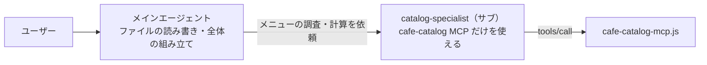

# 04 サブエージェント×専用 MCP（権限と文脈の隔離）

ガイドの [01 の 5章](../../docs/01_copilot-mcp-guide.md#5-サブエージェントagentmdごとに使える-mcp-を絞る) および [02 の 5章（パターン④：サブエージェント×専用 MCP）](../../docs/02_mcp-patterns.md#5-パターン④サブエージェント専用-mcp権限と文脈の隔離) に対応する見本です。

## 構成のポイント

- `catalog-specialist` は、**カフェのメニュー検索・アレルゲン照合・セット価格計算の MCP ツールだけ**を持ち、ファイルを書き換える権限（`Write` / `Edit`）もコマンド実行権限（`Bash`）も持ちません。
- メインエージェントは、細かいカタログ検索や価格計算をすべてこのサブエージェントに任せ、返ってきた確定数値だけを使って Web ページや企画書を仕上げます。

## 2つの形式の違い

| 項目 | Claude Code（`claude-code/`） | GitHub Copilot（`copilot/`） |
|---|---|---|
| エージェント定義 | [.claude/agents/catalog-specialist.md](claude-code/.claude/agents/catalog-specialist.md) | [.github/agents/catalog-specialist.agent.md](copilot/.github/agents/catalog-specialist.agent.md) |
| MCP 設定 | [.mcp.json](claude-code/.mcp.json) | [.vscode/mcp.json](copilot/.vscode/mcp.json) |
| MCP の割り当て方 | `mcpServers: [cafe-catalog]` ＋ `tools:` に `mcp__cafe-catalog__...` | `tools: ['read', 'cafe-catalog/*']` |
