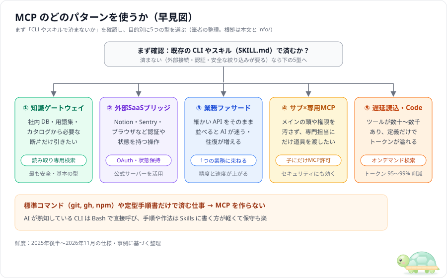

# MCP 設定・サーバー実装のサンプル集

ガイド（[00_mcp-guide.md](../docs/00_mcp-guide.md)、[01_copilot-mcp-guide.md](../docs/01_copilot-mcp-guide.md)、[02_mcp-patterns.md](../docs/02_mcp-patterns.md)）に出てきた MCP の構成とサーバー実装を、**そのまま読める・コピーして動かせる見本**としてまとめた置き場です。

> ワークスペース直下の [.mcp.json](../.mcp.json)、[.vscode/mcp.json](../.vscode/mcp.json)、[servers/cafe-catalog-mcp.js](../servers/cafe-catalog-mcp.js) は「このワークスペースですぐ実験に使える MCP サーバー」です。こちらの `samples/` は「目的別の最小コードと設定ファイルを見比べるための見本」です。すべてのサンプルサーバーは**外部パッケージ不要**（Node.js 標準機能のみ）で動くように書いてあります。

## パターン一覧

| # | サンプル | 学べること | ガイドの該当箇所 | Claude Code | Copilot |
|---|---|---|---|---|---|
| 01 | [最小の stdio サーバー](01-minimal-stdio/) | 約60行で動く一番シンプルな MCP サーバー（Tools のみ） | 00 の 6章 | ○ | ○ |
| 02 | [社内用語集の検索ゲートウェイ](02-knowledge-search/) | 読み取り専用で JSON データを検索し、該当分だけ返す | 02 の 2章（パターン①） | ○ | ○ |
| 03 | [業務ワークフロー・ファサード](03-workflow-facade/) | 複数のチェック・集計を1つの高水準ツールに束ねる | 02 の 4章（パターン③） | ○ | ○ |
| 04 | [サブエージェント×専用 MCP](04-subagent-scoped/) | 特定のサブエージェントにだけ MCP サーバーを許可する | 01 の 5章、02 の 5章（パターン④） | ○ | ○ |
| 05 | [Resources と Prompts も返すサーバー](05-resources-and-prompts/) | Tools だけでなく参考資料（Resources）と定型文（Prompts）も実装する | 00 の 3.1節 | ○ | ○ |



## フォルダの見方

各サンプルには、サーバー本体（`.js`）に加えて Claude Code 用と GitHub Copilot（VS Code）用の設定ファイルを並べて入れてあります。`copilot/` 配下には、新しい **Copilot ハーネス用の `.mcp.json`**（推奨）と **旧 Local ハーネス用の `.vscode/mcp.json`** の両方を用意しています。

```text
samples/<サンプル名>/
├─ README.md                 ← 仕組み・試し方・設定のポイント
├─ *.js                      ← Node.js 標準機能だけで動く MCP サーバー
├─ claude-code/
│  └─ .mcp.json              ← Claude Code 用の設定（ルートキー：mcpServers）
└─ copilot/
   ├─ .mcp.json              ← Copilot ハーネス用の設定（推奨・ルートキー：mcpServers）
   └─ .vscode/mcp.json       ← VS Code 旧 Local ハーネス用の設定（ルートキー：servers）
```

> [!NOTE]
> **設定ファイル内の相対パスについて**：各サンプルの設定（例：`"args": ["../server.js"]`、04 は `"../../../servers/cafe-catalog-mcp.js"`）は、**`claude-code/` フォルダで Claude Code を起動したとき**、または **`copilot/` フォルダを VS Code のワークスペースとして開いたとき**に動くように書いてあります。自分のプロジェクトにコピーするときは、サーバー（`.js`）を置いた場所に合わせてパスを書き換えてください。
>
> ※ サンプル 04 の Claude Code 版だけは、サブエージェント定義の中にサーバーを書く方式なので `.mcp.json` がありません（理由は [04 の README](04-subagent-scoped/README.md)）。

## Claude Code と VS Code（Copilot）の設定ファイルの違い（3点）

| 項目 | Claude Code | Copilot ハーネス（後継・推奨） | VS Code 旧 Local ハーネス |
|---|---|---|---|
| **置き場所** | プロジェクト直下の `.mcp.json` | プロジェクト直下の `.mcp.json` | プロジェクト内の `.vscode/mcp.json` |
| **一番外側のキー** | `"mcpServers": { ... }` | `"mcpServers": { ... }` | `"servers": { ... }` |
| **サブエージェントでの指定** | `.claude/agents/*.md` の `mcpServers:` にサーバーをインライン定義（名前だけだと親と共有になる） | `.github/agents/*.agent.md` に `tools: ['名前/*']` | `.github/agents/*.agent.md` に `tools: ['名前/*']` |

> [!TIP]
> **Copilot ハーネス・旧 Local ハーネスどちらでもそのまま試せます**：各サンプルの `copilot/` フォルダには、Copilot ハーネス用の `.mcp.json`（`mcpServers` 形式）と旧 Local ハーネス用の `.vscode/mcp.json`（`servers` 形式）の両方を用意しています。VS Code の `Session Target` を Copilot に切り替えた場合でも、`copilot/` を開けば `.mcp.json` をそのまま参照できます（移行の詳細は [Local と Copilot ハーネス](../../copilot-fusion/01_harness-local-vs-copilot.md#3-なぜ-mcp-が見えなくなるのか原因と移行) を参照）。

## 動作テストのしかた（Claude なしで1秒で確認）

ルートのテストスクリプト [scripts/test-mcp-server.js](../scripts/test-mcp-server.js) にサーバーのパスを渡すと、どのサンプルサーバーでもその場で JSON-RPC 通信（`initialize` → `tools/list`）の動作を確認できます。

```powershell
cd C:\git_home\agent-study\mcp-guide
node scripts\test-mcp-server.js samples\01-minimal-stdio\server.js
node scripts\test-mcp-server.js samples\02-knowledge-search\glossary-mcp.js
node scripts\test-mcp-server.js samples\03-workflow-facade\catering-plan-mcp.js
node scripts\test-mcp-server.js samples\05-resources-and-prompts\full-feature-mcp.js
```
