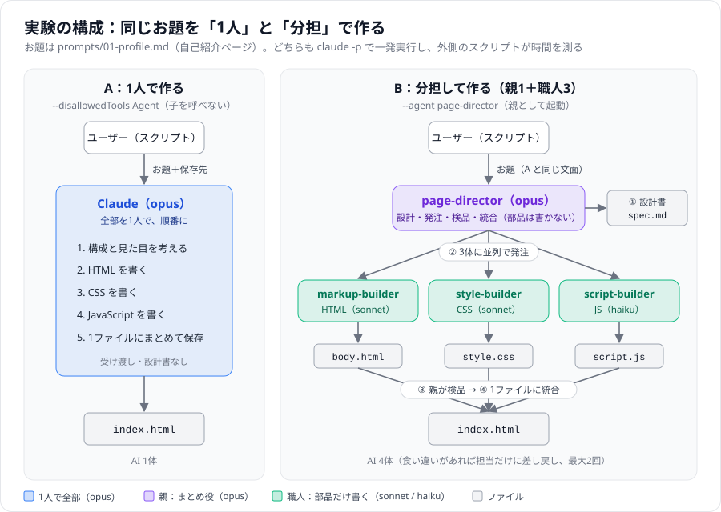
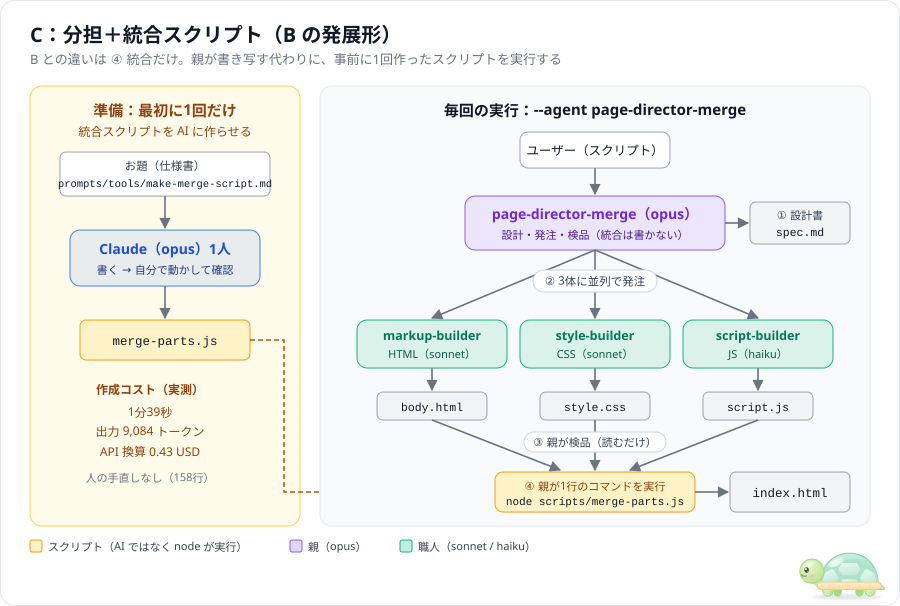
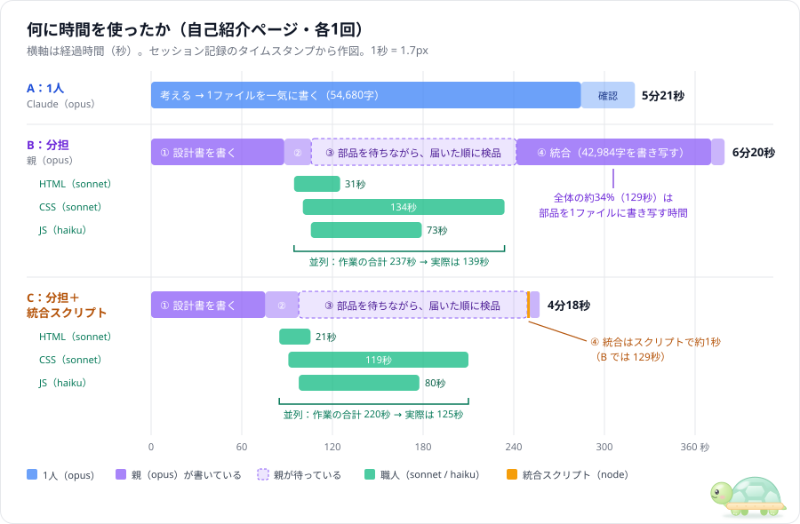

# 実験レポート：自己紹介ページを3つの方式で作り比べる

- 実施日：2026-11-06
- 実施者：Claude Code（Opus 5.5）が [scripts/run-experiment.ps1](../scripts/run-experiment.ps1) で自動実行・自動計測
- 回数：各方式 **1回**（偶然の差を含む可能性があります）

| 方式 | 中身 |
|---|---|
| **A：1人** | AI（opus）1人に全部任せる。サブエージェント禁止 |
| **B：分担** | 親（opus）が設計し、職人3体（HTML・CSS は sonnet、JS は haiku）に並列で発注。最後に親が部品を1ファイルに書き写して統合 |
| **C：分担＋統合スクリプト** | B と同じ流れで、最後の統合だけをスクリプト（`node scripts/merge-parts.js`）で行う。スクリプトは事前に AI に1回作らせた |

## 結論

1. **C が一番速く、一番安かった**：A 5分21秒・1.15 USD、B 6分20秒・1.68 USD、C **4分18秒・1.05 USD**（コストは API 換算の目安）。
2. **B が遅かった原因は「統合」で、スクリプトにしたら 129秒 → 1秒になった**：B と C の差（約2分）は、ほぼこの1工程で説明できます。
3. **スクリプトの作成コストは 1分39秒・0.43 USD**：B と比べると、**1回目でもう元が取れます**。A と比べると、時間は2回目、API 換算コストは5回目から C の方が得になります。

---

## 1. 構成と指示の出し方

### A と B



### C（B の発展形）



| | A：1人 | B：分担 | C：分担＋統合スクリプト |
|---|---|---|---|
| 起動 | `--disallowedTools Agent --model opus` | `--agent page-director` | `--agent page-director-merge` |
| 動いた AI | opus × 1 | opus × 1 ＋ sonnet × 2 ＋ haiku × 1 | B と同じ |
| 人が渡した指示 | お題 ＋「保存先」「1人で作って」 | お題だけ | お題だけ |
| 分担の決まりごと | なし | [page-director.md](../.claude/agents/page-director.md) と職人3体の定義 | [page-director-merge.md](../.claude/agents/page-director-merge.md) と職人3体の定義（職人は B と同じもの） |
| 統合 | （最初から1ファイルで書く） | 親が部品を読んで、1ファイルに書き写す | 親が `node scripts/merge-parts.js --title "…"` を1回実行する |
| 権限（共通） | ファイルの作成・編集は自動許可。シェルは `node scripts/merge-parts.js` だけ許可 | 同じ | 同じ |

## 2. 実行したタスク

お題は [prompts/01-profile.md](../prompts/01-profile.md)（3方式とも同じ文面）。架空の人物「山田 太郎」の自己紹介ページです。

- セクション：ヒーロー（ひとことが1文字ずつ出る）／プロフィール（登った山の数がカウントアップ）／スキル（横棒グラフが伸びる）／山ギャラリー（CSS で描いたカード6枚、クリックで拡大）／連絡先
- 動き：スクロールでふわっと表示、ライト／ダーク切り替え、固定ナビで今いるセクションを強調
- 条件：スマホ幅（〜480px）対応、外部ライブラリ・外部画像なし

C の準備として、統合スクリプトの仕様を [prompts/tools/make-merge-script.md](../prompts/tools/make-merge-script.md) に書き、AI（opus 1人）に作らせました。

## 3. 結果（見た目）

| A：1人 | B：分担 | C：分担＋統合スクリプト |
|---|---|---|
|  |  |  |
| [フォルダ](20261106-090625_01-profile_solo/) | [フォルダ](20261106-091155_01-profile_agents/) | [フォルダ](20261106-093101_01-profile_agents-merge/) |

※ 画面幅 1280×800 で開いて約8秒後のファーストビュー。実物は各フォルダの `index.html` をブラウザで開いてください。

| 確認項目 | A | B | C |
|---|---|---|---|
| 完成品 | ○（57.6 KB） | ○（46.1 KB） | ○（42.0 KB） |
| JavaScript のエラー（ブラウザのコンソール） | なし | なし | なし |
| お題のセクション・動き（AI の自己申告） | すべて実装 | すべて実装 | すべて実装 |
| 設計書・部品が残るか | 残らない | 残る | 残る |
| 差し戻し | — | なし | なし |

3つとも「深い緑と生成り色・明朝体の見出し・山並みのシルエット」という、お題に沿った雰囲気になりました。
A は中央寄せ、B は左寄せ、C は深い緑の背景にした大胆なヒーローです。デザインの差は方式の違いというより、毎回の揺らぎの範囲に見えます。良し悪しは、人が見て判断する部分です（各フォルダの `report.md` に評価欄があります）。

## 4. 時間



| 工程 | A：1人 | B：分担 | C：分担＋統合スクリプト |
|---|---|---|---|
| **全体（スクリプトで実測）** | **321.5 秒（5分21秒）** | **380.8 秒（6分20秒）** | **258.2 秒（4分18秒）** |
| ① 設計 | （書きながら考える） | 88 秒 | 76 秒 |
| ② 発注 | — | 18 秒 | 22 秒 |
| ③ 部品づくり（並列） | 285 秒（1人で全部） | 139 秒（合計 237 秒ぶん） | 125 秒（合計 220 秒ぶん） |
| ④ 統合 | — | **129 秒**（親が 42,984 字を書き写す） | **1.1 秒**（スクリプト） |
| 確認・報告 | 36 秒 | 9 秒 | 7 秒 |

**読み取れること**

- **統合をスクリプトにした効果は大きい**：B で全体の34%を占めていた統合が、約1秒になりました。B と C の差（123 秒）は、ほぼこの1工程の差です。部品の中身をそのまま連結するだけの作業なので、AI に書き写させる理由はありません。
- **並列化は B・C とも効いている**：3体の作業を合計すると 220〜237 秒ですが、実際には 125〜139 秒で終わっています。
- **待ち時間は一番遅い職人で決まる**：どちらも CSS 担当が一番遅く（119〜134 秒）、HTML 担当は 20〜30 秒で終わって待っていました。
- C では、CSS の部品ができてから親が読み始めるまでに 28 秒の空きがありました（B では 2 秒）。原因は記録からは分かりません。これがなければ、C はさらに速くなる可能性があります。

## 5. コスト

### 1回あたり

| | A：1人 | B：分担 | C：分担＋統合スクリプト |
|---|---|---|---|
| 出力トークン（AI が書いた量）合計 | 36,654 | 78,795 | 54,460 |
| 　うち opus | 36,654 | 33,940 | **12,242** |
| 　うち sonnet（HTML・CSS） | — | 25,879 | 21,741 |
| 　うち haiku（JS） | — | 18,976 | 20,477 |
| キャッシュ読込トークン | 211,682 | 286,884 | 316,672 |
| **API 換算コスト** | **1.15 USD** | **1.68 USD** | **1.05 USD** |
| 　内訳 | opus 1.15 | opus 1.29 ＋ sonnet 0.38 ＋ haiku 0.01 | opus 0.71 ＋ sonnet 0.33 ＋ haiku 0.01 |

※ API 換算コストは「API で払ったらいくらか」の目安です。今回はサブスクリプションで実行しているので、実際の請求はありません。

**読み取れること**

- **C で安くなったのは、高いモデル（opus）が書く量が減ったから**です。opus の出力は A 36,654 → C 12,242 と約3分の1になり、残りの作業は安い sonnet・haiku に回っています。
- **トークンの「量」だけを見ると、C は A より多い**（約1.5倍）です。安いモデルのトークンが増えたぶん、量は増えても金額は下がりました。サブスクの使用枠がモデルごとにどう減るかは公開されていないので、量と換算コストの両方を見てください。

### 統合スクリプトの作成コスト（最初の1回だけ）

| 項目 | 値 |
|---|---|
| 作ったもの | [scripts/merge-parts.js](../scripts/merge-parts.js)（Node.js、158行、外部パッケージなし） |
| 方式 | `-Mode plain -Model opus`（AI 1人に仕様書を渡しただけ） |
| 時間 | **99.1 秒（1分39秒）** |
| 出力トークン | **9,084**（opus） |
| API 換算コスト | **0.43 USD** |
| AI がやったこと | 作成 → 自分で6パターンの動作確認（正常・引数不足・部品不足・警告・出力先指定など） |
| 人の手直し | なし（B の部品で試しても正しく統合できることを、こちらで確認） |
| 記録 | [output/20261106-092851_make-merge-script_plain/](20261106-092851_make-merge-script_plain/) |

※ 親エージェントの定義ファイル（`page-director-merge.md`）は、B の定義を少し書き換えて人（この会話の Claude）が作ったので、計測に含めていません。

### 何回使えば元が取れるか

C の1回目には、スクリプトの作成コストが上乗せされます。それを含めた**累計**で比べると次のとおりです（1回ずつの実測値をもとにした計算）。

| 実行回数 | A：1人（累計） | B：分担（累計） | C（作成コスト込みの累計） |
|---|---|---|---|
| 1回 | 322 秒 / 1.15 USD | 381 秒 / 1.68 USD | 357 秒 / 1.48 USD |
| 2回 | 643 秒 / 2.30 USD | 762 秒 / 3.36 USD | **616 秒** / 2.54 USD |
| 3回 | 965 秒 / 3.45 USD | 1,142 秒 / 5.04 USD | **874 秒** / 3.59 USD |
| 5回 | 1,608 秒 / 5.75 USD | 1,904 秒 / 8.40 USD | **1,390 秒 / 5.70 USD** |
| 10回 | 3,215 秒 / 11.49 USD | 3,808 秒 / 16.80 USD | **2,681 秒 / 10.96 USD** |

- **B と比べると**：1回で 123 秒・0.63 USD 得をするので、作成コスト（99 秒・0.43 USD）は**1回目で回収**できます。作成コストを含めても、1回目から C の方が速くて安いです。
- **A と比べると**：1回で 63 秒・0.10 USD 得をします。時間は **2回目**、API 換算コストは **5回目**で元が取れます。
- 出力トークンの量だけで比べると、C は1回あたり A より約 17,800 トークン多いので、A に対しては何回使っても元は取れません（B に対しては1回目で回収できます）。

## 6. 分かったこと・次に試すなら

1. **分担するなら、「決まった手順でできる作業」は AI にさせずスクリプトにする**。今回の統合のように、部品をつなげるだけの作業を AI に書き写させると、時間もコストも大きく増えます。
2. **作業を役割で分けて安いモデルに回すと、コストが下がる**。ただし親（opus）の作業量が減らないと（B）、職人のぶんが上乗せになるだけです。親を「設計と検品だけ」に絞ると（C）、効果が出ます。
3. **ページ1枚の大きさでも、C なら1人より速くて安い**（今回の1回ずつの結果）。ただし A と C の差（63 秒・0.10 USD）は、毎回の揺らぎでひっくり返る可能性がある大きさです。B と C の差（統合の 129 秒）は工程そのものの差なので、繰り返しても再現しやすいはずです。
4. **次に試すなら**
   - A と C を2〜3回ずつ繰り返し、差が安定して出るか確かめる
   - CSS 担当がいつも一番遅いので、CSS を2体に分ける（例：レイアウトと装飾）
   - お題を大きくして（カフェのホームページ `prompts/02-homepage.md` など）、差が広がるか確かめる

## 7. 再現手順

リポジトリのルートで、次のコマンドを1つずつ順番に実行します（同時に実行しないこと）。各コマンドの詳しい説明は [README.md](../README.md) にあります。

```powershell
# A：1人
powershell -ExecutionPolicy Bypass -File scripts\run-experiment.ps1 -Prompt prompts\01-profile.md -Mode solo -Model opus

# B：分担（統合も AI）
powershell -ExecutionPolicy Bypass -File scripts\run-experiment.ps1 -Prompt prompts\01-profile.md -Mode agents

# C の準備：統合スクリプトを AI に作らせる（scripts\merge-parts.js が無いとき、または作成コストを測り直したいとき）
powershell -ExecutionPolicy Bypass -File scripts\run-experiment.ps1 -Prompt prompts\tools\make-merge-script.md -Mode plain -Model opus

# C：分担（統合はスクリプト）
powershell -ExecutionPolicy Bypass -File scripts\run-experiment.ps1 -Prompt prompts\01-profile.md -Mode agents-merge
```

| 使ったもの | 場所 |
|---|---|
| お題 | [prompts/01-profile.md](../prompts/01-profile.md)、[prompts/tools/make-merge-script.md](../prompts/tools/make-merge-script.md) |
| エージェント定義 | [.claude/agents/](../.claude/agents/)（page-director、page-director-merge、markup-builder、style-builder、script-builder） |
| 統合スクリプト | [scripts/merge-parts.js](../scripts/merge-parts.js) |
| 計測スクリプト | [scripts/run-experiment.ps1](../scripts/run-experiment.ps1) |
| 実行環境 | Windows 11、Claude Code 2.1.318、モデルは claude-opus-5-5 / claude-sonnet-5-5 / claude-haiku-5-5、サブスクリプションでログイン |

## 8. 計測について（補足）

- 「全体」の時間は、計測スクリプトが `claude` の起動から終了までをストップウォッチで測った値です。
- 工程ごとの時間は、Claude Code のセッション記録（`~/.claude/projects/…/<session_id>.jsonl` と子エージェントの記録）に残っているタイムスタンプから計算しました。
- Claude Code が自分で報告する `duration_ms` は、B・C では実測より大幅に短い値（B 145.6 秒、C 47 秒）でした。親だけの時間しか数えていないとみられ、分担方式の比較には使えません。`duration_api_ms` は、並列に動いた子の時間を足し合わせるので、実測より長くなります。
- `num_turns` は親だけを数えるので、方式どうしの比較には使っていません。
- どの方式も、シェルは統合スクリプトの実行しか許可していません。そのため AI は、ブラウザでの動作確認や JavaScript の構文チェックはしていません。
