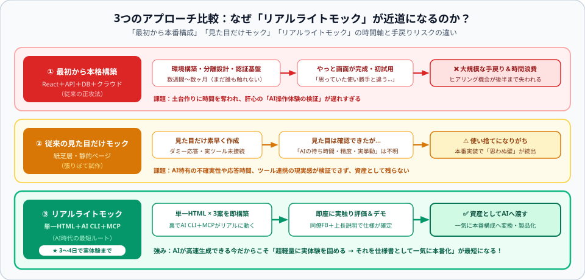
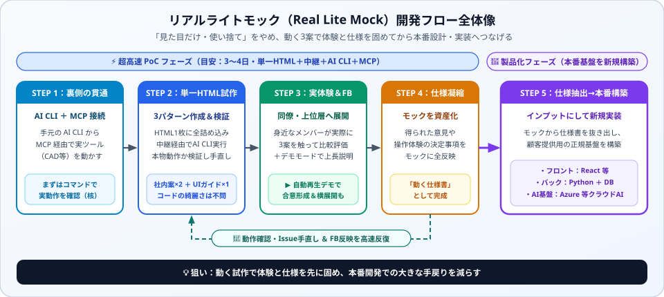

# 00. リアルライトモック（Real Lite Mock）とは？

## 1. 一言でいうと

> **「HTML 1 ファイルの超軽量な器に、AI と実ツールが本物同様に動く体験を詰め込み、フィードバックを出し切った後、そこから仕様を抜き出して本番製品を新しく作る開発手法」**

これまでの開発では、「見た目だけのモック（試作品）」はすぐ捨てられがちで、逆に「最初から本番構成」で作ると時間がかかりすぎるという悩みがありました。  
AI で素早くコードを生成・手直しできる今は、**「まず超軽量にリアルな試作品を作って体験を固める → それを設計図にして本番構成を新しく作る」** ほうが、大きな手戻りを減らす近道になります（筆者の実践から生まれた提案です）。

---

## 2. よくある「見た目だけモック」との違い

| 比較項目 | よくある「見た目だけモック」 | リアルライトモック（Real Lite Mock） |
|---|---|---|
| **動きのリアルさ** | 画面遷移やダミー文字だけの「紙芝居」 | 裏で **AI CLI ＋ MCP** が動き、実ツール（例：CAD の 3D 生成）まで実行 |
| **ファイル構成** | 静的デザイン画像や簡易ページ | **HTML 1 ファイル**（HTML＋CSS＋JS 全一括・ビルド不要 ※CLI 呼び出し用の小さな中継プログラムを添える） |
| **中身のコード品質** | そもそも実処理は動かない | **最初はぐちゃぐちゃで OK**（体験と手直しの速さを最優先） |
| **試作パターン数** | 1 案に絞ることが多い | **複数案（3 パターン）**を同時に作って触り比べ |
| **作製期間（目安）** | 見た目の合意だけで数日〜数週間 | **目安 3〜4 日（1 週間以内）**で裏の実動作＋3 案 UI まで到達 |
| **役割と寿命** | 確認が終われば**使い捨て**になりやすい | フィードバックを全反映し、**本番設計・実装のインプット（資産）**として活かす |

> [!NOTE]
> **専門用語の補足**
> - **PoC（ピーオーシー：Proof of Concept／概念実証）**：本格開発の前に「このアイデアや技術が本当に役に立つか・実現できるか」を小さく試す検証のこと。
> - **CLI（シーエルアイ：Command Line Interface）**：黒い画面から文字コマンドでソフトや AI（GitHub Copilot CLI など）を操作する仕組み。※GitHub Copilot CLI などは標準では社外（GitHub 側）のクラウドで処理されます。手元のモデル等につなぐ設定もありますが、会社のルールを確認してから使います。
> - **MCP（エムシーピー：Model Context Protocol）**：AI と外部のツール・データ（CAD ソフトや社内システムなど）をつなぐための共通接続規格。

---

## 3. なぜ「フロントとバックを最初から分けない」のか？

開発初期に React や Python API、データベース、クラウド認証（Azure 等）をきちんと分離して作り始めると、次のような問題が起きやすくなります。

1. **土台作りに時間を奪われる**：環境構築や画面〜サーバー間の接続整備に時間がかかり、肝心の「誰かに触ってもらう」時期が遅れる。
2. **ヒアリングと改善の機会を逃す**：動くものが見えない期間が長いと、身近な同僚や現場メンバーから「ここが使いにくい」「本当はこう使いたい」という生きた意見を引き出しにくい。
3. **AI 特有の癖に気づくのが遅れる**：見た目だけの試作では気づきにくい、**AI ならではの応答待ち時間・想定外の出力のブレ・実ツール連携の癖**は、実物につないで動かすと早く確かめられる。

だからこそ、**最初は「HTML 1 ファイルに全部入り」という割り切り**が強力な武器になります。

> [!IMPORTANT]
> **うまく進めるコツ：一発完成を目指さず「動かして見抜き、サッと直す」**  
> AI にモックを一気に作らせても、最初から完璧に動くことはありません。「エラーが隠れている」「実は AI を呼ばず固定のダミー結果を返している」といったことがよく起きます。  
> この手法の速さは「一発で作れること」ではなく、**「本当に動いているか自分の目で確かめ、見つけた問題を AI でサッと手直しできること」** から生まれます。

---

## 4. リアルライトモックの 4 大特徴

| # | 特徴 | ねらい |
|---|---|---|
| **1** | **リアルに動く超軽量構成** | 単一 HTML（＋小さな中継プログラム）から AI CLI と MCP を動かし、製品に近い操作感を目安 3〜4 日で体験可能にする |
| **2** | **3 パターン並行試作** | 現場メンバー想定案 2 つ＋[AI UI 7 パターン](../ui-guide/00_ai-ui-patterns.md)からの選定案 1 つを同時比較し、思い込みを防ぐ |
| **3** | **自動再生デモモード搭載** | 再生ボタン 1 つでユースケースを自動実演し、上位レイヤー（上長・経営層）への説明や横展開をスムーズにする |
| **4** | **使い捨てない「資産化」** | フィードバックを詰め込んだモックから仕様書を抜き出し、顧客提供用の本番構成を新しく作るインプットにする |

---

▶ 次の章：[01. 実践ワークフローとアーキテクチャ](01_workflow-and-architecture.md)
