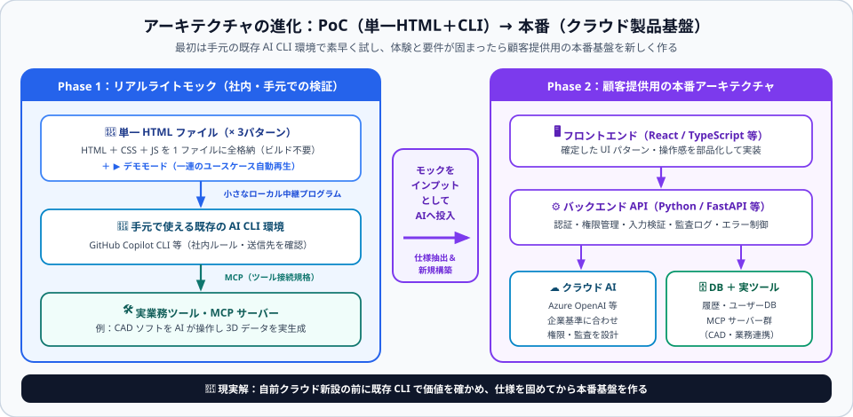
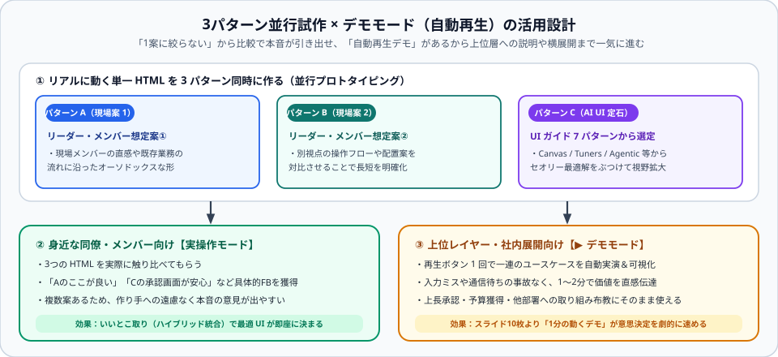

# 01. 実践ワークフローとアーキテクチャ

「実際にどの順番で作り、どんな技術構成で PoC から本番へつなげるのか？」を、図解ベースで整理します。

---

## 1. アーキテクチャの 2 段階進化（手元の CLI 検証 → クラウド製品化）

企業内で AI アプリを立ち上げるとき、いきなり自前のクラウド AI 環境（Azure 等）を新規契約・稟議・構築しようとすると時間がかかります。  
リアルライトモックでは **2 段階** で進めます。

### Phase 1：リアルライトモック（社内・手元での超高速検証）
- **UI 層**：HTML＋CSS＋JavaScript をすべて詰め込んだ **単一 HTML ファイル**（ビルド環境不要）。
- **小さな中継プログラム**：ブラウザの HTML 単体からは PC 上のコマンドを直接起動できないため、裏に小さなローカルサーバー（Node.js や Python で数十行程度）を 1 つ置いて橋渡しします。
- **AI 層**：社内で利用が許可されている既存の **AI CLI**（例：GitHub Copilot CLI など）を中継プログラム経由で呼び出します。自前のクラウド基盤を新設する前に、素早く操作感を試せます（※データの送信先や社内ポリシーは事前確認します）。
- **ツール層**：AI の裏側で **MCP（Model Context Protocol）** を経由して実ツールを操作します（例：CAD ソフトを操作して 3D データを自動生成）。

### Phase 2：顧客提供用の本番アーキテクチャ（仕様を抜き出して新規構築）
- 十分なフィードバックと仕様が固まったタイミングで、完成したリアルライトモックを **AI へのインプット** として渡します。
- まずモックから画面遷移・入力項目・プロンプト・ツール連携の仕様書を抜き出し、会社のセキュリティ基準に合わせた正規構成（例：**フロントエンド：React ／ バックエンド：Python ／ データベース ／ クラウド AI：Azure OpenAI 等**）を新しく設計・実装します。

---

## 2. 5 ステップの実践フロー（筆者の実践目安：STEP 1〜3 を 3〜4 日で進行）

### STEP 1：裏側の「核」をコマンドで貫通させる
- まずは UI を作らず、**AI CLI ＋ MCP で実ツール（例：CAD ソフトの 3D 生成）が動く状態**をコマンドベースで完成させます。
- ここで「本当に AI で業務ツールが動かせるか」という技術的な最大リスクを先に潰します。

### STEP 2：単一 HTML で 3 パターン作り、「本物か確かめて手直し」する
- 裏側が動いたら、大きなコンテキストをまとめて AI に渡し、**HTML 1 ファイル完結の Web UI** を一気に 3 パターン作ります。
- **同僚に見せる前の大事なひと手間（動作確認と手直し）**：
  - 作りたてのモックには「エラーが画面に出ず握りつぶされている」「実は AI を呼ばず固定のダミーを返している（1 秒で返るなど不自然に速い）」といった問題がよく混じります。
  - 対象業務の感覚で実際に動かし、見つけた問題を GitHub Issue などにメモして AI でサッと改修します。**本当に動くと確認できてから**次のステップへ進みます。

#### 3 パターンの組み合わせ例
| パターン | 作り方・元ネタ | 役割 |
|---|---|---|
| **パターン A（現場案 1）** | プロジェクトリーダーやメンバーが思い描く代表的な案① | 現場の感覚・既存業務とのなじみやすさを確認 |
| **パターン B（現場案 2）** | メンバーから出た別アプローチ・別レイアウト案② | 案①との対比で長所・短所をはっきりさせる |
| **パターン C（AI UI 定石）** | [ui-guide で整理した 7 パターン](../ui-guide/00_ai-ui-patterns.md)から選定（例：Canvas 型、Tuners＋Hybrid 型、Agentic 型） | 現場の発想だけでは出にくい UI パターンを比較対象に入れる |

### STEP 3：身近な同僚に使ってもらい、デモモードで上位層へ広げる
1. **身近なメンバー・同僚への実触りテスト**：
   - 実際の利用者に近いメンバーに 3 つの HTML を触り比べてもらいます。1 案だけだと遠慮して褒めがちになりますが、3 案並べると「B は入力が面倒」「A は迷わない」といった率直な比較意見が出やすくなります。
   - 集まった指摘をもとに、**どの案をベースにどう良い点を統合・改善するかは作り手が考えて決めます**。
2. **▶ デモモード（自動再生機能）の追加**：
   - 画面上に「▶ デモ再生」ボタンを 1 つ足し、押すだけで **入力 → AI 実行 → ツール連携 → 結果可視化** の流れが自動再生されるようにします。
   - **上位レイヤー（上長・決裁者）への説明** や **他部署への紹介** で、操作ミスや通信待ちの心配なく 1〜2 分（目安）でイメージを伝えられます。

### STEP 4：フィードバックをすべてモックに凝縮する（仕様の資産化）
- 試用で出た要望・改善点・エラー時の振る舞い・画面遷移を、選定したリアルライトモックへどんどん反映します。
- この時点でモックは単なる試作ではなく、**体験まで含めて確定した「動く仕様書」（本資料での呼び名）** になります。

### STEP 5：リアルライトモックから仕様を抜き出し、本番構築する
- 体験と要件が固まったら、決定版モックを AI へ渡し、まず**文章の機能仕様・設計案を抜き出させて**から、顧客提供用の本番アプリ（React ＋ Python ＋ DB ＋ Azure 等のクラウド AI）を新規構築・テストします。

> [!IMPORTANT]
> **ここが最大のポイント**  
> 本番化では、モックの泥臭い単一 HTML コードを無理やり継ぎ足して直すのではなく、**「モック＝仕様と体験の原本」から設計書を起こし、本番用の清潔な構成を新しく作る**のが成功の秘訣です（詳しくは次章 [02. 関連する考え方・研究と注意点](02_validity-and-prior-art.md) を参照）。

---

◀ 前の章：[00. コンセプトと全体像](00_concept-and-overview.md) ／ ▶ 次の章：[02. 関連する考え方・研究と注意点](02_validity-and-prior-art.md)
