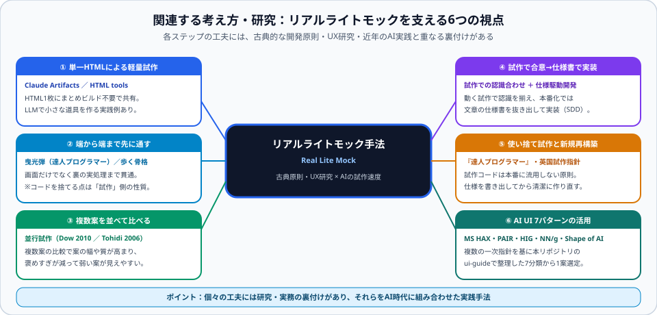
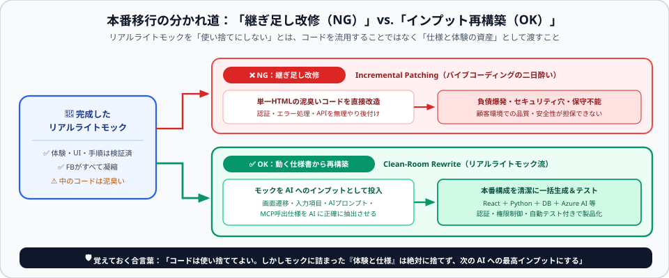

# 02. 関連する考え方・研究と、企業導入の注意点

**「この進め方は有効なのか？ すでに世の中でも似た取り組みはあるのか？」**  
調べてみると、リアルライトモックの各ステップには **古典的なソフトウェア開発の原則・UX（使い勝手）の研究・近年の AI 開発の実践** と重なるしっかりした裏付けがあります。

従来は「実際に動く」「複数案を作る」「試作コードを捨てる」の 3 つを同時に満たすには手間と費用がかかりすぎましたが、AI で試作コストが下がったことで組み合わせやすくなりました（なお、「3〜4 日で進めて本番の手戻りを減らす」という全体の流れは筆者の実践に基づく提案です。各出典の詳しい検証は [evidence.md](evidence.md) にまとめています）。

---

## 1. リアルライトモックを支える「6 つの関連知見」

| # | 視点・関連する考え方 | わかりやすい意味（背景） | リアルライトモックとの対応 |
|---|---|---|---|
| **①** | **単一 HTML による軽量試作** （Claude Artifacts ／ HTML tools 等） | AI で動く画面を直接作る流れのなかでも、HTML・CSS・JS を 1 ファイルにまとめるやり方（例：Claude Artifacts［2024年〜］や、開発者 Simon Willison が LLM で 150 個以上作った「HTML tools」の実践）。ビルド環境が不要で、配りやすく手直しも速いのが利点です。 | HTML 1 ファイルに画面と処理を詰め込んで素早く試作するアプローチ（STEP 2）。 |
| **②** | **端から端まで先に通す** （曳光弾 ／ 歩く骨格） | 名著『達人プログラマー』の「曳光弾（Tracer Bullet）」や、Alistair Cockburn の「歩く骨格（Walking Skeleton）」。画面だけ先に作るのではなく、細くても **主要な構成要素を端から端までつないで動かす** ことで、技術的なリスクを最初に確かめます。 | 先に AI CLI → MCP → CAD 実操作を通し（STEP 1）、続けて UI までつなぐ点（STEP 2）。※原典の曳光弾はコードを捨てずに育てますが、本手法で**コードを捨てる点は同書が区別する「プロトタイプ（試作）」側**の性質にあたります。 |
| **③** | **複数案を並べて比べる** （並行プロトタイピング） | スタンフォード大学の実験研究（Dow ら 2010）では、1 案ずつ講評を受けるより複数案を作ってからまとめて講評を受けたほうが、案の多様性や評価が高まりました。また利用者評価の実験（Tohidi ら 2006）では、**1 案だけだと評価が甘くなりがちな一方、3 案並べると褒めすぎが減り、弱い案への否定的な指摘が出やすくなる**ことが示されています（改善策そのものは作り手が考える必要があります）。 | 1 案に絞らず、最初から **3 パターン** を並べて同僚に触り比べてもらう設計（STEP 2〜3）。 |
| **④** | **試作での合意と仕様駆動開発** （試作による認識合わせ ＋ SDD） | 動く試作で関係者の認識を揃える実践は以前からあり、近年も AI 試作と仕様文書を組み合わせて使う事例（Uber の実践報告など）があります。さらに実装前に**文章の仕様書・設計計画を整えてから AI にコードを書かせる「仕様駆動開発（SDD：GitHub Spec Kit・Kiro 等）」** が登場しています。 | 動くモックで体験の認識を揃え（STEP 4）、本番化の前にモックから**文章の仕様書・設計案を抜き出して**実装する流れ（STEP 5）。 |
| **⑤** | **使い捨て試作からの新規再構築** （Throwaway Prototyping） | 『達人プログラマー』や英国政府のサービス設計マニュアル（Alpha 段階指針）などにある **「試作のコードは本番の土台に流用しない」** という原則です。また Vibe Coding（対話任せの高速試作）も提唱者自身が「使い捨て向き」と述べています。 | 数日で作った単一 HTML は試作用と割り切り、細かい仕様が抜け落ちないよう先に仕様書へ書き出してから本番構成を新しく作る点（STEP 5）。 |
| **⑥** | **AI UI 7 パターンの活用** （一次ガイドラインに基づく整理） | NN/g は「AI＝チャット」だけが答えではないと論じており、ほかにも Microsoft HAX（18 の指針）・Google PAIR・Apple HIG・The Shape of AI（`Tuners` 等）などが、AI 機能の画面設計の指針やパターン集を公開しています。 | 3 パターンのうち 1 枠に、これらを参考に本リポジトリの [ui-guide](../ui-guide/00_ai-ui-patterns.md) で整理した 7 パターンから 1 案を入れる点。 |

---

## 2. 本番移行の分かれ道：「継ぎ足し」か「仕様を抜き出して再構築」か

高速に作った PoC を本番製品へ進める際、次の 2 つのルートのどちらを選ぶかで後の保守性が大きく変わります。

- **❌ 失敗しやすいルート（継ぎ足し改修）**  
  動いている単一 HTML や泥臭い試作コードに、認証・エラー処理・DB 接続をそのまま後付けして本番にしようとするやり方です。AI で素早く作ったコードをそのまま本番運用して保守で行き詰まる現象は、海外メディアで **「vibe coding hangover（バイブコーディングの二日酔い）」** とも表現されています。
- **✅ リアルライトモックが選ぶルート（仕様を抜き出して新規再構築）**  
  コードの流用にはこだわらず、モックに詰まった「画面構成・操作フロー・AI プロンプト・MCP 呼び出し仕様」を AI で文章の仕様書として整理し、本番アーキテクチャ（React＋Python＋DB＋Azure 等）をゼロから清潔に実装・テストします。

> [!TIP]
> **なぜ作り直しても遠回りになりにくいのか？**  
> 数日規模の小さなモックであれば、仕様がはっきりした状態で AI と一緒に本番コードを新しく組む手間は以前より小さくなっています。「正解がわからないまま重い本番環境を何度も作り直す手戻り」を減らせるのが、この進め方の狙いです。

---

## 3. 企業で実践するときの「4 つの注意点（ガードレール）」

この手法を社内で安全・確実に回すために、次の **1 つの前提と 3 つの落とし穴** を押さえておきましょう。

| 項目 | よくある失敗・リスク | 対策（ガードレール） |
|---|---|---|
| **⓪ 前提：動いているふり（ダミー）を見抜く** | AI がタイマーや固定データで「動いているふり」をするコードを作っても気づかず、偽物の動作で同僚評価や上長承認を進めてしまう。 | 対象業務の感覚（ドメイン知識）を持つ人が必ず検証する。 ・**応答時間**（1 秒で返るなど速すぎるならダミーを疑う） ・**出力の変化**（入力を変えて試す） ・**CLI／MCP の実呼び出しログ** ・**わざと失敗させたときのエラー表示** ・**実ツールの成果物ファイル** を目で確かめる。 |
| **① デモの罠** （画面完成度の誤解） | モックやデモモードの見た目が整っているため、上長や顧客が **「もう 9 割完成している！来週出せるね？」と誤解** してしまう（Joel Spolsky が「氷山の秘密」として指摘した現象）。 | デモの際に必ず **「今は体験確認の Phase 1 であり、本番化（Phase 2）には認証・権限管理・監査ログ・障害対策・クラウド構築が別途必要」** と伝え、試作段階であることがわかる見せ方にする。 |
| **② 継ぎ足し改修の誘惑** | 「動いているし、このまま少し直して客先に出そう」と妥協してしまう。 | 単一 HTML＋中継プログラム構成は **PoC 専用** と線引きし、顧客提供時は必ず Phase 2 の正規基盤で新しく作る。 |
| **③ 社内ルールとデータの扱い** | 手元の AI CLI だからと安心し、未承認の機密データや本番データを入力してしまう。 | GitHub Copilot CLI などは、**標準では社外（GitHub 側）のクラウドで処理される**（手元のモデル等につなぐ設定もある）。**会社で許可された CLI・ポリシー環境** を使い、試作段階は **ダミーデータや検証用モデル** で行う。 |

---

◀ 前の章：[01. ワークフローとアーキテクチャ](01_workflow-and-architecture.md) ／ ▶ 次の章：[03. 実践プレイブック＆プロンプト集](03_playbook-checklist.md)
