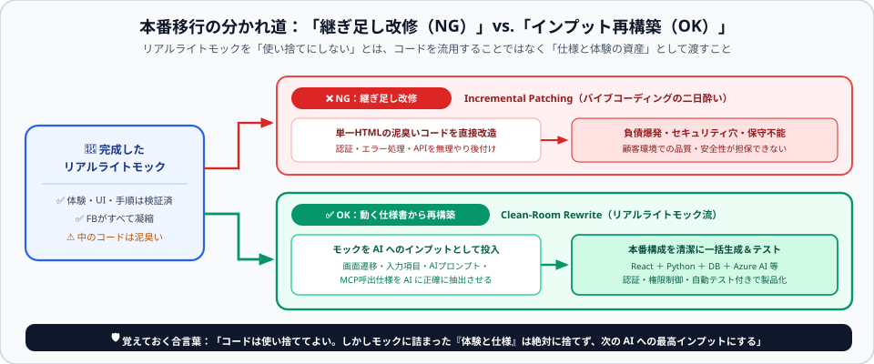

# 03. すぐ真似できる実践プレイブック＆プロンプト集

次に新しい AI ツールや PoC（概念実証）を立ち上げるとき、**そのまま真似して 3〜4 日で回せる実践手順** と **AI への指示プロンプト雛形** をまとめました。

---

## 1. モデルスケジュール（3〜4 日超高速スプリント）

| 日程 | フェーズ | やること（ゴール） | 完了の合図 |
|---|---|---|---|
| **Day 1** | **裏側の貫通** | AI CLI（GitHub Copilot CLI 等）＋ MCP で、対象ツール（CAD・社内ツール等）をコマンドから実操作できるようにする | ターミナルから 1 回、実ツールが動いて成果物が出た |
| **Day 2** | **3 パターン並行試作** | HTML＋CSS＋JS 一括の **単一 HTML モックを 3 つ** 生成する（現場案×2 ＋ [ui-guide 7 パターン](../ui-guide/00_ai-ui-patterns.md)最適案×1）。裏で AI CLI を呼び出す | ブラウザで 3 画面すべて開き、実際に AI＋ツールが動いた |
| **Day 3** | **同僚テスト＆デモ追加** | 身近なメンバー 2〜5 名に 3 案を触り比べてもらい、フィードバック収集。同時に **「▶ デモモード（自動再生）」** を組み込む | どの要素を残し・統合するか決まり、1 分自動デモが動く |
| **Day 4** | **統合・上長デモ・仕様化** | フィードバックを全反映した「決定版リアルライトモック」へ統合。上長・関係者にデモ実施し、Phase 2（本番化）の合意を取る | **「動く仕様書」** の完成＆本番化 Go サイン |
| **Phase 2** | **AI で本番構成へ変換** | 決定版モックを AI へインプットし、顧客提供用の本番基盤（React＋Python＋DB＋Azure 等）を新規構築・テストする | 認証・権限・監査ログ・自動テスト付きの本番アプリ完成 |

---

## 2. 実践チェックリスト（振り返り・抜け漏れ防止）

### Phase 1：リアルライトモック構築時
- [ ] **技術貫通**：見た目だけにとどめず、AI CLI ＋ MCP で実ツールを 1 回以上動かしたか？
- [ ] **単一ファイル割り切り**：ビルド環境やフレームワーク選定で悩まず、HTML 1 ファイルに詰め込んだか？
- [ ] **3 パターン並行**：1 案に固執せず、現場案 2 つ＋[AI UI 7 パターン](../ui-guide/00_ai-ui-patterns.md)からの 1 つを並べたか？
- [ ] **実触り FB**：作った本人だけでなく、身近な同僚・メンバーに実際に操作してもらったか？
- [ ] **デモモード**：再生ボタン 1 回で一連のユースケースを可視化できる自動実演モードを付けたか？
- [ ] **デモの罠対策**：上長・顧客へ見せる際、「本番化には認証・セキュリティ・クラウド移行工程が別途必要」と伝えたか？

### Phase 2：本番製品化への移行時



- [ ] **仕様凝縮**：PoC で得たフィードバック・エラー時の動き・プロンプトの工夫をすべて決定版モックへ反映したか？
- [ ] **クリーンルーム再構築**：モックの単一 HTML を継ぎ足し改造せず、**仕様のインプット**として渡し、本番構成を新規構築したか？
- [ ] **非機能要件の補完**：本番化時に「認証・権限制御・入力検証・監査ログ・障害復旧・自動テスト」を明示的に設計へ追加したか？

---

## 3. そのまま使える AI 指示プロンプト雛形（3 種）

### 雛形①：3 パターンの単一 HTML リアルライトモックを一括生成する

```text
あなたは UX デザイナー兼フルスタックエンジニアです。
裏側で動作する「[例：AI CLI ＋ CAD 操作 MCP]」を操作するための Web UI モックを、
**HTML / CSS / JavaScript を 1 ファイルにすべて詰め込んだ単一 HTML** として 3 パターン作成してください。

【前提・制約】
- ビルドツールや外部フレームワークのインストール不要で、ブラウザで即動く単一 HTML にすること。
- コードの綺麗さより「実際に操作できるリアルな体験」を最優先すること。
- 実行ボタンを押すと、ローカルの橋渡しエンドポイント（例: http://localhost:3000/run-cli）へ指示を送り、
  実際の AI 応答と処理ログを表示できること。

【作成する 3 パターン】
1. `mock-a-team1.html`（現場案①）：[メンバー想定の画面構成を 2〜3 行で記載]
2. `mock-b-team2.html`（現場案②）：[別アプローチの画面構成を 2〜3 行で記載]
3. `mock-c-ai-pattern.html`（AI UI 定石案）：[例：Canvas 型 / Tuners＋Hybrid 型 / Agentic 承認型] を採用し、
   誤操作防止や結果プレビューを最適化した画面構成にする。
```

---

### 雛形②：上長説明・横展開用の「▶ デモモード（自動再生）」を追加する

```text
この単一 HTML モック（`mock-final.html`）に、上長や他部署へのプレゼンで使える
**「▶ デモモード（自動再生）」** 機能を追加してください。

【要件】
- 画面右上に「▶ デモ再生」「⏹ 停止」ボタンを追加する。
- 再生を押すと、以下のユースケース手順を 1 ステップずつ視覚的にハイライト・タイピング演出付きで自動実演する：
  1. ユーザー入力（サンプル条件の自動入力）
  2. AI CLI の思考・MCP ツール呼び出しログのリアルタイム風表示
  3. 実ツール実行結果（プレビュー・生成物）の可視化と完了サマリー
- ネットワークや実ツールが一時的にオフラインでも説明が止まらないよう、
  「実動作モード」と「プレゼン用シナリオ再生」を切り替えられるようにする。
```

---

### 雛形③：決定版モックをインプットにして本番構成（Phase 2）へ変換する

```text
添付する `mock-final.html` と MCP 連携仕様書は、現場メンバーの試用とフィードバックをすべて反映した
**「動く仕様書（リアルライトモック）」** です。

このモックのコードをそのまま流用・継ぎ足しするのではなく、
**ここから画面構成・状態遷移・入力項目・AI プロンプト・ツール連携仕様を正確に抽出し、
以下の顧客提供用・本番アーキテクチャでゼロから清潔に再設計・実装計画を作成してください。**

【ターゲット本番構成】
- フロントエンド：React + TypeScript（コンポーネント分割・状態管理）
- バックエンド：Python (FastAPI)（入力検証・例外処理・監査ログ）
- AI 基盤：Azure OpenAI（プロンプト管理・リトライ制御・タイムアウト）
- データ層：PostgreSQL（実行履歴・ユーザー権限管理）
- 非機能要件：認証・RBAC（役割ベース権限管理）、機密情報マスキング、主要フローの自動テスト

まずは「① モックから抽出した機能仕様一覧」「② 画面〜API〜DB〜MCP の設計書」「③ ディレクトリ構成案」を出力してください。
```

---

◀ 前の章：[02. 有効性の根拠と類似手法](02_validity-and-prior-art.md) ／ 🏠 [トップ（README）へ戻る](README.md)
