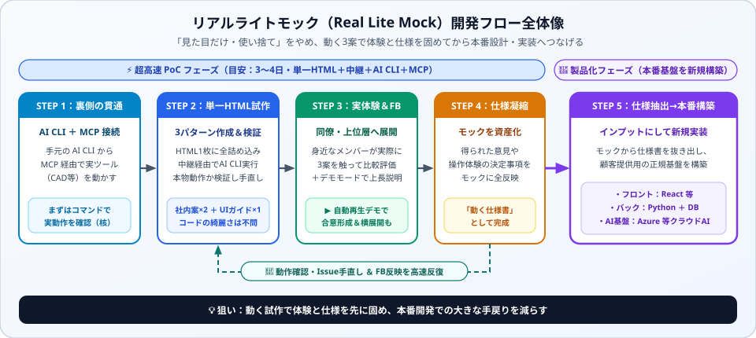

# リアルライトモック（Real Lite Mock）開発手法ガイド

**「見た目だけの張りぼてモック」も「いきなり本番構成の重厚開発」もやめよう。**  
HTML 1 ファイルの中に画面と動きをすべて詰め込み、裏側では **AI の CLI（コマンド操作ツール）＋ MCP（外部ツール接続規格）** で実際に動く試作品を **3〜4 日（目安）で 3 パターン** 作り、得られたフィードバックごと **次の AI へのインプット（動く仕様書）** にして本番アプリ構築へつなげる――それが **リアルライトモック（Real Lite Mock）** 手法です。



> [!TIP]
> **まず触ってわかる！ブラウザで開く動的ガイド（ビルド・外部通信不要）**
> - **[リアルライトモック わかる動的ガイド（interactive-guide.html）](interactive-guide.html)**（図も表示する場合はこのフォルダごと利用してください）
>   - 3 つの開発アプローチ比較タイムライン、**3 パターン並行試作 × ▶ 自動再生デモモード** の体験ラボ、PoC→本番切替、6 つの関連知見、コピペ用プロンプト 3 種を収録！
>
> **30 秒でわかる要点（この手法の 4 つの柱）**
> 1. **超軽量なのに「リアルに動く」**：HTML 1 ファイル（＋CLI を呼ぶ小さな中継プログラム）から手元の AI CLI（例：GitHub Copilot CLI）＋ MCP を動かし、CAD などの実ツールまで実際に連携させる。
> 2. **最初から 3 パターン並行で作る**：現場メンバー案 × 2 ＋ [AI UI 7 パターン](../ui-guide/00_ai-ui-patterns.md)からの選定案 × 1 を並べて触り比べ、遠慮のない比較意見を引き出す。
> 3. **デモモードで上長・他部署も動かす**：再生ボタン 1 回でユースケースを自動実演し、合意形成や社内の取り組み展開に活用する。
> 4. **使い捨てず「本番化のインプット」にする**：動作確認とフィードバックを重ねたモックから仕様書・設計案を抜き出し、React＋Python＋DB＋クラウド AI（Azure 等）の正規構成を新しく作る。

---

## どこから読むか（目的別マップ）

後から見返したときに「すぐ流れを思い出せる」よう、図解中心で 4 章に分けています。

| 知りたいこと | 読むファイル | 主な内容 |
|---|---|---|
| **まず触って比較・自動デモ・プロンプトコピーを試したい** | [interactive-guide.html](interactive-guide.html) | 3 パターン比較ラボ＋▶ 自動再生デモ体験、6 つの関連知見、チェックリスト＆プロンプトコピー |
| **まず全体像と「なぜ近道か」を掴みたい** | [00. コンセプトと全体像](00_concept-and-overview.md) | 従来開発・見た目モックとの違い、4 大特徴、「動かして直す」前提 |
| **具体的な進め方と技術構成を確認したい** | [01. ワークフローとアーキテクチャ](01_workflow-and-architecture.md) | 手元の AI CLI＋MCP 構成、ダミー見抜き＆手直し、3 パターン比較、本番移行の流れ |
| **この手法の裏付けや注意点を知りたい** | [02. 関連する考え方・研究と注意点](02_validity-and-prior-art.md) | 6 つの関連する考え方・研究、本番移行の分かれ道、企業導入の 4 つの注意点 |
| **次の案件ですぐそのまま実践したい** | [03. 実践プレイブック＆プロンプト集](03_playbook-checklist.md) | Day 1〜4 進行表（目安）、チェックリスト、AI に貼るだけのプロンプト雛形 3 種 |

---

## 収録ベクター図解（SVG 全 6 枚）

| 図 | テーマ | 主な収録章 |
|---|---|---|
| [rlm-01](assets/rlm-01-overview-flow.svg) | **全体像**：超高速試作 → 動作確認・手直し → 本番構築までの 5 段階フロー | README / 00 |
| [rlm-02](assets/rlm-02-comparison-traditional.svg) | **手法比較**：最初から本格構築 vs. 見た目だけのモック vs. リアルライトモック | 00 |
| [rlm-03](assets/rlm-03-architecture-poc-to-prod.svg) | **構成の進化**：単一 HTML＋中継＋AI CLI＋MCP → React＋Python＋DB＋クラウド AI | 01 |
| [rlm-04](assets/rlm-04-three-pattern-and-demo.svg) | **活用設計**：3 パターン並行試作（同僚比較）× デモモード（上長説明・横展開） | 01 |
| [rlm-05](assets/rlm-05-prior-art-landscape.svg) | **関連知見マップ**：古典原則・UX 研究・近年の AI 実践と重なる 6 つの視点 | 02 |
| [rlm-06](assets/rlm-06-spec-extraction-trap.svg) | **本番移行の極意**：「継ぎ足し改修（NG）」vs.「仕様抽出から再構築（OK）」 | 02 / 03 |

---

## 関連ガイド・検証記録

- [ui-guide（AI アプリと普遍的な UI 設計）](../ui-guide/README.md) — 3 パターン試作の「AI UI 定石枠」を選ぶための 7 パターン集
- [mcp-guide（MCP 外部ツール接続規格）](../mcp-guide/README.md) — 裏側で実ツール（CAD 等）を AI から動かす仕組みの解説
- [evidence.md（一次情報による検証記録）](evidence.md) ／ [revision-map.md（検証に基づく改修対応表）](revision-map.md) — 各主張の詳しい出典・検証経緯の記録

---

## フォルダ構成

```text
real-lite-mock/
├─ README.md                         ← この全体案内
├─ 00_concept-and-overview.md        ← コンセプト・従来手法との比較・4大特徴
├─ 01_workflow-and-architecture.md   ← 5ステップ実践フロー・PoC→本番の構成変化・デモモード
├─ 02_validity-and-prior-art.md      ← 6つの関連する考え方・研究と、企業導入の注意点
├─ 03_playbook-checklist.md          ← Day 1〜4 進行表（目安）・チェックリスト・AI指示プロンプト雛形
├─ interactive-guide.html            ← 3案比較×▶自動デモ体験＆プロンプトコピー付き動的ガイド
├─ evidence.md                       ← 一次情報との突き合わせ検証記録
├─ revision-map.md                   ← evidence.md に基づく教材改修の対応表
└─ assets/                           ← 説明用ベクター図解（SVG 全6枚）
```
