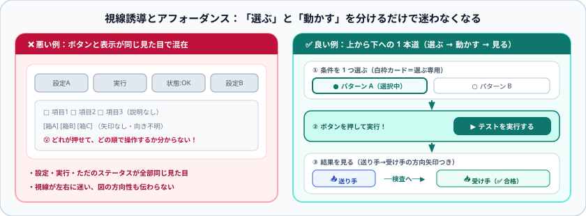
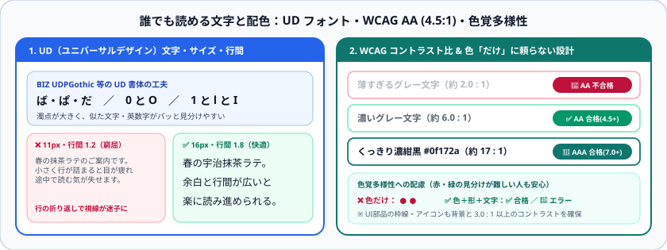
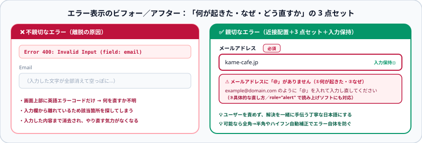

# 01. 普遍的な UI 設計の基礎（視線誘導・UD 文字・配色・エラー表示）

AI の仕組みがどれだけ優秀でも、画面の文字が読みにくかったり、どのボタンを押せばよいか分からなかったり、不親切なエラーが出たりすると、お客さまはすぐに使うのをやめてしまいます。

この章では、AI アプリに限らず **「誰が見ても直感的に分かり、安心して使える UI」** を作るための 5 つの基礎を整理します。

> 悪い UI と良い UI の違いをボタン 1 つで見比べたい方は、[動的ガイド（interactive-guide.html）](interactive-guide.html) の STEP 2〜3 を試してください。

---

## 1. 視線誘導と情報構造（迷わせない並べ方）

人は画面を見た瞬間、文章を隅から隅まで読むのではなく **「目で流し見して、まず全体構造と押す場所を探す」** 行動をとります。

### ① 1 画面・1 セクションにつき目的は 1 つ
1 つの枠の中に「設定」「結果」「履歴」「設定の詳細コード」「ヘルプ」を全部詰め込むと、視線が迷子になります。
- **上から下への 1 本道**（ストーリー → 選ぶ → 動かす → 結果を見る → まとめ）で並べると、誰でも迷わず操作できます。

### ② デザインの 4 原則（近接・整列・反復・対比）
| 原則 | かんたんな意味 | 画面での具体例 |
|---|---|---|
| **近接（ちかづける）** | 関係あるもの同士を近づけ、関係ないものは離す | 入力欄とエラー文はすぐ隣に置く。章と章の間は広く空ける |
| **整列（そろえる）** | 左端や上端の見えない線にピシッと揃える | 見出し・本文・カードの左端を揃える（中央揃えの多用は避ける） |
| **反復（くりかえす）** | 同じ役割の部品は同じ色・形にする | 「実行ボタンは常に濃い青」「選ぶカードは常に白枠」と統一する |
| **対比（メリハリ）** | 大事なものを大きく濃く、補足は小さく薄くする | 主ボタンは塗りつぶし、サブボタンは枠線だけにする |

### ③ 余白は「もったいない空間」ではなく「読みやすさのクッション」
情報を詰め込みすぎると脳が疲れます。カードの枠内余白（パディング）や要素同士の間隔を広めに取るだけで、情報量を減らさずに見やすさが劇的に向上します。

---

## 2. アフォーダンスと操作の明確さ（「押せる」と「読む」の分離）



**アフォーダンス（Affordance）** とは、**「見た目だけで『これは押せそう』『これはつまんで動かせそう』と自然に伝わる手がかり」** のことです。

### よくある 3 つの失敗と対策

1. **「押せるボタン」と「ただのラベル・図」の見分けがつかない**
   - ❌ 悪い例：ただのステータス表示（「処理中」など）にボタンと同じ立体影や枠をつけてしまい、ユーザーが何度もクリックしてしまう。
   - ✅ 良い例：押せるボタンには「はっきりした枠線・影・ホバー（マウスを乗せたときの変化）・動詞ラベル（例：`実行する` `次へ進む`）」をつけ、読むだけのバッジは薄く平らにする。
2. **「設定を選ぶボタン」と「実行するボタン」が同じ列に混ざっている**
   - ❌ 悪い例：条件選択ボタンと「実行」ボタンが同じデザインで横に並び、どれを押せば動き出すのか分からない。
   - ✅ 良い例：**「① 選ぶエリア（白枠カード）」** と **「② 動かすエリア（背景色を変えた帯＋濃い塗りつぶしボタン）」** を上下に完全に分離する。
3. **図表に「方向性（誰から誰へ・何のためか）」がない**
   - ❌ 悪い例：登場人物の箱がただ横に並んでいるだけで、誰が誰に何を渡しているのか文章を熟読しないと分からない。
   - ✅ 良い例：箱に **「送り手／受け手」** の目印をつけ、**矢印（`──何のために──▶`）** で情報の向きと目的を図そのものに描き込む。

---

## 3. タイポグラフィとユニバーサルデザイン文字（UD フォント）



文字の読みやすさは、画面の印象と疲労感を大きく左右します。

### ユニバーサルデザイン（UD）フォントとは？
**UD フォント** とは、年齢・視力・読み書きの特性にかかわらず、**「文字の形がはっきり見えて、似た文字を読み間違えにくいように設計された書体」** です（例：Windows 標準搭載の `BIZ UDPゴシック` / `BIZ UDGothic`、モリサワ `UD新ゴ` など）。

- **UD フォントの主な工夫**：
  - 文字の内側の空間（ふところ）が広く、小さくしても潰れにくい。
  - 濁点（゛）と半濁点（゜）が大きくはっきりしており、`ば` と `ぱ` を読み間違えにくい。
  - 数字の `1`・英小文字の `l`・大文字の `I`、数字の `0` と英字の `O` の区別がつきやすい。
- **Web / CSS での指定例**：
  ```css
  font-family: "BIZ UDPGothic", "Hiragino Kaku Gothic ProN", "Yu Gothic UI", "Meiryo", sans-serif;
  ```
  ※ 端末に `BIZ UDPGothic` が入っていれば優先して使い、無ければ見やすいゴシック体へ自然にフォールバックします。

### 読みやすい文字サイズ・行間・1 行の長さの目安

| 項目 | 推奨の目安 | 理由 |
|---|---|---|
| **本文の文字サイズ** | **16px 以上**（補足でも 12〜14px 以上） | 12px 以下の長文は目が疲れやすく、スマホではピンチ拡大が必要になる |
| **行間（line-height）** | **1.5 〜 1.9**（日本語本文は 1.7〜1.9 が快適） | 日本語は漢字の画数が多いため、英語（1.4〜1.5）より広めの行間が読みやすい |
| **1 行の文字数** | **全角 35 〜 45 文字前後**（本文幅 680〜820px 目安） | 横幅が広すぎると、行末から次の行頭へ視線を戻すときに迷子になる |
| **太さのメリハリ** | 見出し・重要語は太字（700〜800）、本文は標準（400） | 全部太字にすると逆にどこが重要か分からなくなる |

---

## 4. 配色とアクセシビリティ（WCAG 基準と色覚多様性）

配色は「おしゃれさ」より先に **「誰の目にもくっきり読めること」** が最優先です。

### ① 失敗しない配色バランス（60 : 30 : 10 の法則）
- **ベース色（約 60%）**：背景の白やごく薄いグレー（例：`#f8fafc`、`#ffffff`）
- **メイン色（約 30%）**：文字の濃いチャコール（例：`#0f172a`）やカードの枠・見出し
- **アクセント色（約 10%）**：本当に押してほしい主ボタンや現在地だけに使う 1 色

> 💡 背景は真っ白（`#ffffff`）と少しだけ柔らかいグレー（`#f8fafc`）、文字は真っ黒（`#000000`）より少し柔らかい濃紺黒（`#0f172a`）にすると、長時間見ても目がチカチカしにくくなります。

### ② コントラスト比の国際基準（WCAG 2.1 / 2.2）
**WCAG（Web Content Accessibility Guidelines＝ウェブ・アクセシビリティの国際基準、日本の JIS X 8341-3 とも一致）** では、文字や部品と背景の明るさの差（コントラスト比）に明確な合格ラインを定めています。

| 対象 | 最低合格基準（AA） | より高い基準（AAA） |
|---|---|---|
| **通常の文字**（16px など） | **4.5 : 1 以上** | 7.0 : 1 以上 |
| **大きい文字**（24px 以上、または太字 18.66px 以上） | **3.0 : 1 以上** | 4.5 : 1 以上 |
| **UI 部品の枠線・アイコン・グラフ** | **3.0 : 1 以上** | — |

> ⚠️ よくある失敗：「薄いグレー背景に、さらに薄いグレー文字」はおしゃれに見えてもコントラスト比が 2:1 程度になり、高齢者や明るい屋外のスマホ画面ではまったく読めません。

### ③ 色覚多様性への配慮（色「だけ」で伝えない）
日本人男性の約 20 人に 1 人（約 5%）は、赤と緑の見分けがつきにくいなど多様な色覚特性を持っています。
- ❌ 悪い例：成功を「緑の丸」、エラーを「赤の丸」だけで区別する。
- ✅ 良い例：**色 ＋ アイコン（`✅` / `⚠️` / `🚫`）＋ 短い文字（「合格」「エラー」）** を必ずセットで表示する。

---

## 5. エラー表示と安心設計（ユーザーを困らせない・責めない）



システムを使う人がいちばん不安になり、離脱してしまう瞬間が **「エラーが出たとき」** です。良いエラー表示には、はっきりした型があります。

### ① 親切なエラー文の「3 点セット」
エラーメッセージには、次の 3 つを平易な日本語で入れます。

1. **何が起きたか**（事実）
2. **なぜ起きたか**（原因・条件）
3. **どう直せばよいか**（次にとる具体的な行動）

| ❌ 悪いエラー例（不親切） | ✅ 良いエラー例（3 点セット） |
|---|---|
| `エラー: Invalid Input (Code 400)` | `メールアドレスに「@」が含まれていません。example@domain.com のような形式で入力してください。` |
| `送信に失敗しました` | `通信が途切れたため送信できませんでした。入力内容は消えていませんので、数秒後にもう一度「送信する」を押してください。` |
| `不正なファイルです` | `このファイル形式（.exe）は登録できません。PDF または PNG（10MB 以下）を選んでください。` |

### ② ユーザーを責めない言葉づかい
「入力ミスです」「不正な操作です」と責める言い方ではなく、「〜の形式で入力してください」「〜を確認してください」と **解決を一緒に手伝うトーン** にします。

### ③ 配置とタイミング（近接配置・インライン表示）
- 画面の一番上にまとめて「入力エラーが 3 件あります」とだけ出すと、どこを直せばいいか探す羽目になります。
- **問題がある入力欄のすぐ下（近接位置）** に赤い枠線＋警告アイコン＋具体的な直し方を表示し、画面読み上げソフト（スクリーンリーダー）でも気づけるよう `role="alert"` などを添えます。
- 入力途中（まだ打ち終わっていない瞬間）から赤いエラーを出すと焦らせてしまうため、基本は「入力欄からカーソルが離れたとき」または「送信ボタンを押したとき」に表示し、正しく直したら即座にエラーを消します。

### ④ 予防設計とやり直し（Undo）
そもそもエラーを起こさせない工夫（例：数字しか入らない欄は半角自動変換する、必須項目に「必須」バッジをつける、危険な削除の前だけ確認を出す）と、間違えても 1 クリックで戻せる **Undo（元に戻す）** が、最高の安心設計です。

---

次の章では、ここまでのセオリーを実際のアプリ開発・画面レビューでそのまま使えるチェックリストにまとめました。
→ [02 実践チェックリスト＆アンチパターン集](02_design-checklist.md)
