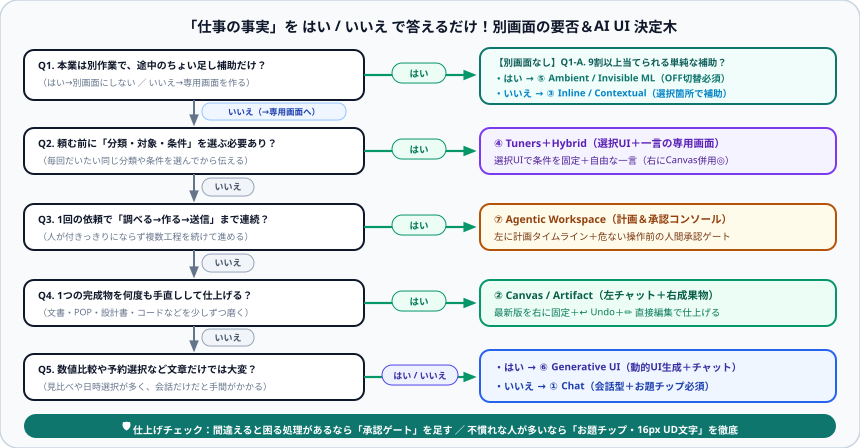

# 02. 実践チェックリスト＆AI に最適 UI を相談するプロンプト集

実際に AI アプリや業務画面を設計・実装・レビューするときにそのまま使える **チェックリスト**、**よくあるアンチパターン集**、そして **自分のワークスペースを見せて AI に最適な UI パターンを提案してもらうための相談プロンプト** をまとめました。

> ポチポチ条件を選ぶだけでおすすめパターンを診断し、入力内容入りの AI 相談プロンプトを 1 クリックコピーできるツールは、[動的ガイド（interactive-guide.html）](interactive-guide.html) の STEP 2 に収録しています。



---

## 1. AI に「最適な UI パターン」を相談するためのプロンプト（コピペ用）

作りたいアプリのアイデアや既存ワークスペースを AI（Claude Code / GitHub Copilot 等）に見せて、**一次情報に基づく 7 つの AI UI パターンの中から最適な構成を複数案比較させる** ためのプロンプトです。

### 📋 そのまま使える基本プロンプト

```text
このワークスペースの構成（および ui-guide/00_ai-ui-patterns.md の一次情報ベース 7 パターン）を踏まえて、
これから作りたいアプリに最適な UI 設計を提案してください。

【作りたいアプリの概要】
- 何をするアプリか：（例：社内の部品資料を検索して見積もり案を作るツール）
- 主な利用者：（例：AI に慣れていない営業担当者・現場スタッフ）
- 利用頻度・作業の性質：（例：毎日使う定型業務が 8 割、たまに細かい個別条件あり）
- 取り返しのつかない操作：（例：見積書 PDF 出力・顧客へのメール送信）

【相談したいこと】
以下の 7 つの AI UI パターン（単体または組み合わせ）の中から、最適な候補を 2〜3 案比較してください。
1. Conversational / Chat（会話・チャット型）
2. Canvas / Artifact Workspace（成果物並列型）
3. Inline / Contextual Assistance（その場補助型）
4. Structured Controls / Tuners ＋ Hybrid（調整UI＋一言ハイブリッド型）
5. Ambient / Invisible ML（不可視・先回り自動処理型）
6. Generative UI（動的 UI 生成型）
7. Agentic / Multi-step Workspace（計画＆承認ワークスペース型）

【出力に含めてほしいこと】
- おすすめ第 1 案と、あえて他の案を採らない理由（Google PAIR / Apple HIG / Microsoft HAX / NN/g の観点で）
- 画面レイアウトのシンプルなテキスト図（上から下の視線誘導・設定と実行の分離）
- エラー表示・待ち時間・承認ゲート（Human-in-the-loop）・Undo の具体案
- UD フォント・WCAG AA（コントラスト 4.5:1 以上）を満たすための注意点
```

> 💡 **使い方のコツ**：このリポジトリ（`agent-study`）や `ui-guide/` を参照させながら聞くことで、AI が「なんでもチャット欄にする（Conversation Trap）」を避け、根拠付きの具体的なレイアウト案を出してくれます。

---

## 2. AI UI 設計チェックリスト（10 項目）

画面を作り始める前・公開する前の 2 回チェックするのがおすすめです。

### A. パターン選択と操作の分かりやすさ
- [ ] **「チャット欄ありき（Conversation Trap）」になっていないか？**（Inline / Tuners＋Hybrid / Ambient・Invisible の方が速くて親切ではないか検討したか）
- [ ] **複数パターンの組み合わせ（例：Tuners ＋ Canvas ＋ Inline）を検討したか？**
- [ ] **「白紙の恐怖」を防げているか？**（初期画面にお題チップ・例文ボタン・おすすめ初期値がある）
- [ ] **「選ぶ（設定）」と「動かす（実行）」が別の枠・別の見た目で分離されているか？**

### B. 一次フレームワークに基づく安心設計（Google PAIR / Apple HIG / Microsoft HAX）
- [ ] **最初に「何ができるか・限界は何か」が分かるか？（Microsoft G1・G2）**
- [ ] **待ち時間に「今何をしているか」が表示され、途中でキャンセルできるか？（Microsoft G7）**
- [ ] **Proactive（先回り）機能がある場合、誤判定時にすぐ無視・オフにできるか？（Apple HIG）**
- [ ] **外部送信・削除・確定などの重要操作の前に、人間の承認ゲート（Human-in-the-loop）があるか？**
- [ ] **AI の変更を 1 クリックで元に戻せる（Undo）か、結果を手動で直接微調整できるか？（Microsoft G8）**
- [ ] **思考ログや生 JSON などの詳細データは「詳細を見る ▼」の折りたたみ（Progressive Disclosure）にしまわれているか？**

---

## 3. 普遍的な UI・アクセシビリティチェックリスト（10 項目）

AI 機能に関係なく、すべての画面で満たすべき基礎基準です。

### C. 視線誘導とアフォーダンス
- [ ] **上から下へ 1 本道で視線が流れる構成になっているか？**（1 セクション 1 目的）
- [ ] **押せるボタンと、読むだけのカード／ラベルが見た目で明確に区別できるか？**
- [ ] **ボタンの文字が「OK」「確定」だけでなく具体的な動詞（例：`見積もりを作成する` `元に戻す`）になっているか？**
- [ ] **図表に「誰から誰へ・何のためか」の方向矢印があるか？**

### D. 文字（UD）と配色（WCAG）
- [ ] **本文の文字サイズは 16px 以上、行間は 1.5〜1.9 になっているか？**
- [ ] **UD ゴシック等の判別しやすいフォント（`BIZ UDPGothic` など）が優先指定されているか？**
- [ ] **通常文字のコントラスト比は 4.5 : 1 以上、ボタンや入力欄の枠線は 3.0 : 1 以上あるか？**
- [ ] **赤／緑などの色「だけ」で合否やエラーを伝えていないか？**（アイコン＋文字を併用しているか）

### E. エラー表示とフォームの親切さ
- [ ] **エラー文に「何が起きた・なぜ・どう直すか」の 3 点が平易な日本語で書かれているか？**
- [ ] **エラー文は問題のある入力欄のすぐ下（近接位置）に表示され、エラー時も入力内容が消えずに残るか？**

---

## 4. よくあるアンチパターン集（悪い例 → 良い例）

### ケース 1：なんでもチャット欄 1 つに押し込む（NN/g：Conversation Trap）
- **❌ 悪い例**：毎回「対象顧客・文字数・トーン」を指定して案内文を作るツールなのに、真っ白なチャット欄だけ。「いい感じにプロンプトを書いてください」と放置。
- **✅ 良い例**：**Tuners（構造化コントロール）＋ Hybrid 型** にし、「対象顧客ボタン」「雰囲気スライダー」「文字数ボタン」で 8 割を 1 秒指定。必要なときだけ「追加の一言」欄を使う。

### ケース 2：頼んでいない先回り（Proactive）が外れまくる（Apple HIG 違反）
- **❌ 悪い例**：精度 60% の AI が、作業中の画面に毎回ポップアップで「これをしましょうか？」と割り込み、閉じるボタンも小さい。
- **✅ 良い例**：精度が十分高くないうちは **Proactive（先回り）** を避け、ユーザーがボタンを押したときだけ動く **Reactive（応答）型** や **Inline（その場補助）型** にとどめる。

### ケース 3：設定ボタン・実行ボタン・チェックボックスが同じ場所に混在
- **❌ 悪い例**：条件切替ボタン 5 個と「実行」「リセット」ボタン、説明なしのチェックボックスが 1 つの枠にびっしり並ぶ。
- **✅ 良い例**：上段を「① 条件を 1 つ選ぶ（白枠カード）」、中段を「② 動かして試す（強調帯＋濃い塗りつぶしボタン）」に明確分離する。

### ケース 4：開発者目線の冷たいエラー表示
- **❌ 悪い例**：画面上部に赤文字だけで `Error 422: Unprocessable Entity (field: tel)`。入力欄の中身も全部リセットされて消える。
- **✅ 良い例**：電話番号欄のすぐ下に `⚠️ 電話番号はハイフンなしの半角数字（10〜11桁）で入力してください。例：09012345678` と表示し、入力内容は残す。

### ケース 5：AI が勝手に外部送信・上書きしてしまう（Human-in-the-loop 欠如）
- **❌ 悪い例**：ボタンを押した瞬間に AI が文章を作ってそのまま顧客へメール送信してしまう。
- **✅ 良い例**：**Agentic Workspace / 承認ゲート** を設け、プレビュー画面で人間が確認・微調整してから **「この内容で送信する」** ボタンを自分で押す 2 段階設計にする。

---

→ さっそく診断・ミニアプリ体験・AI 相談プロンプト生成を使う：[AI・UI設計 わかる動的ガイド（interactive-guide.html）](interactive-guide.html)
→ 一次情報の出典を確認する：[info/README.md](info/README.md)
