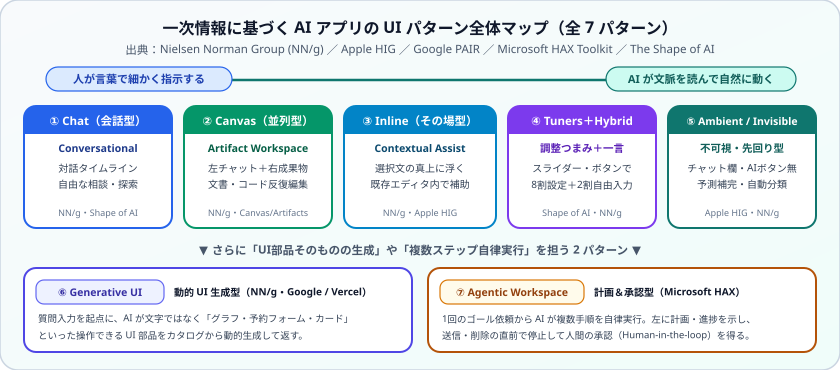

# AI アプリと普遍的な UI 設計ガイド（ui-guide）

**「AI 機能を持つアプリを、どんな画面構成にすればお客さまにとって分かりやすいか？」** を、**Google (PAIR)・Apple (HIG)・Microsoft (HAX Toolkit)・Nielsen Norman Group (NN/g)・The Shape of AI** といった一次情報のガイドラインに基づいて整理し、あわせて **普遍的な見やすい UI 基礎（UD フォント・WCAG 配色・親切なエラー表示）** を、1 パターン 1 枚の独立画面イメージを含む **ベクター図解（全 13 枚）** と操作サンプル付きでまとめたガイドです。



> [!TIP]
> **実際に触って操作感を試せる＋自分のアプリの最適 UI を診断＆AI へ相談できる！**
> - **[AI・UI設計 わかる動的ガイド（interactive-guide.html）](interactive-guide.html)**（ブラウザで開くだけ・外部依存なし）
>   - **一次情報ベースの 7 大 AI UI パターン**を一覧＆代表 5 パターン（Chat / Canvas / Inline / Tuners＋Hybrid / Ambient・Invisible）のミニアプリを実際に操作して比較！
>   - **ポチポチ選ぶ「最適 AI UI パターン診断」** ＋ **そのまま AI に貼り付けて相談できるプロンプト自動生成＆コピー機能**付き！
>   - 悪い UI ⇔ 良い UI ビフォー／アフター比較、UD 文字・行間・WCAG AA（4.5:1）コントラスト体感ラボも収録。

---

## どこから読むか（目的別マップ）

| 知りたいこと | 読むファイル | 主な内容 |
|---|---|---|
| **まず触って比較・診断・AI相談プロンプトを作りたい** | [interactive-guide.html](interactive-guide.html) | 一次情報 7 パターン比較ミニアプリ、ポチポチ診断、AI相談プロンプトコピー、UD/WCAG 体感 |
| **一次情報に基づく AI UI の 7 パターンと根拠を知りたい** | [00 AI 活用アプリの UI パターン体系](00_ai-ui-patterns.md) | NN/g・Apple HIG・Google PAIR・Microsoft HAX・Shape of AI に基づく 7 パターン分類、使い分け、AI 特有 UX 原則 |
| **見やすい文字・配色・エラー表示の基礎を押さえたい** | [01 普遍的な UI 設計の基礎](01_universal-ui-basics.md) | 視線誘導、アフォーダンス（押せる/読む・設定/実行の分離）、UD フォント、WCAG 配色基準、親切なエラー表示 |
| **レビュー用チェックリスト＆AI へ相談するプロンプトを使いたい** | [02 実践チェックリスト＆AI相談プロンプト](02_design-checklist.md) | 20 項目チェックリスト、アンチパターン集、自分のワークスペースを見せて AI に最適 UI を聞くプロンプト集 |
| **一次情報の出典・提唱元を確認したい** | [info/README.md](info/README.md) | Google PAIR / Apple HIG / Microsoft HAX / NN/g / Shape of AI / WCAG / JIS 等の出典一覧 |

---

## 図の一覧（全 13 枚）

| 図 | 内容 | 収録章 |
|---|---|---|
| [ui-01](assets/ui-01-seven-patterns-map.svg) | 一次情報に基づく AI UI 全 7 パターンの全体マップ | 00 / README |
| [ui-05](assets/ui-05-four-frameworks.svg) | AI UI 設計の根拠となる 4 大一次フレームワーク | 00 |
| [ui-p1](assets/ui-p1-chat.svg) | **① Conversational / Chat（会話型）の画面イメージ** | 00 |
| [ui-p2](assets/ui-p2-canvas.svg) | **② Canvas / Artifact（成果物並列編集型）の画面イメージ** | 00 |
| [ui-p3](assets/ui-p3-inline.svg) | **③ Inline / Contextual（その場補助型）の画面イメージ** | 00 |
| [ui-p4](assets/ui-p4-tuners-hybrid.svg) | **④ Tuners ＋ Hybrid（調整UI＋一言）の画面イメージ** | 00 |
| [ui-p5](assets/ui-p5-ambient.svg) | **⑤ Ambient / Invisible ML（不可視・先回り型）の画面イメージ** | 00 |
| [ui-p6](assets/ui-p6-genui.svg) | **⑥ Generative UI（動的 UI 生成型：出発点＋文字返答比較）の画面イメージ** | 00 |
| [ui-p7](assets/ui-p7-agentic.svg) | **⑦ Agentic Workspace（計画＆承認コンソール型）の画面イメージ** | 00 |
| [ui-06](assets/ui-06-visual-hierarchy-and-affordance.svg) | 視線誘導とアフォーダンス（悪い配置 ⇔ 良い配置） | 01 |
| [ui-07](assets/ui-07-ud-typography-and-wcag.svg) | UD フォント・サイズ・行間・WCAG コントラスト・色覚多様性 | 01 |
| [ui-08](assets/ui-08-error-ux-three-points.svg) | エラー表示のビフォー／アフター（3 点セット＋近接配置） | 01 |
| [ui-09](assets/ui-09-selection-decision-flow.svg) | 最適 AI UI パターン選定フロー（組み合わせ推奨） | 02 |

---

## フォルダ構成

```text
ui-guide/
├─ README.md                    ← この全体案内
├─ 00_ai-ui-patterns.md         ← 一次情報ベースの AI UI 7 大パターン（全7画面イメージ付き）
├─ 01_universal-ui-basics.md    ← 視線誘導・UD フォント・WCAG 配色・エラー表示など普遍 UI の基礎
├─ 02_design-checklist.md       ← チェックリスト・アンチパターン集・AI 相談プロンプト雛形
├─ assets/                      ← 説明用ベクター図解（SVG 全 13 枚：全体図＋7画面イメージ＋基礎図）
├─ info/README.md               ← Google / Apple / Microsoft / NN/g 等の一次情報出典メモ
└─ interactive-guide.html       ← 操作感ミニアプリ＋最適UI診断＋AI相談プロンプト生成付き動的ガイド
```
