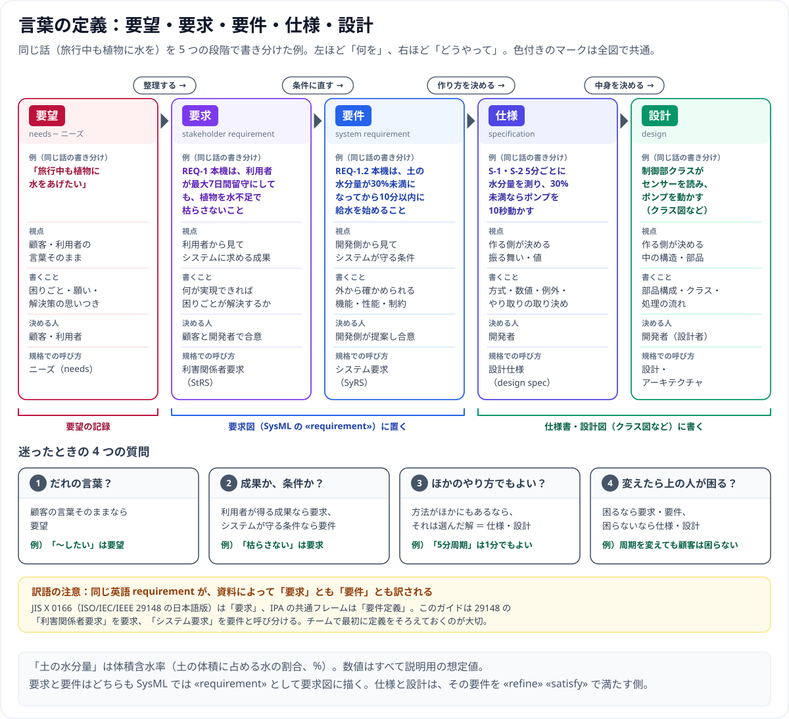
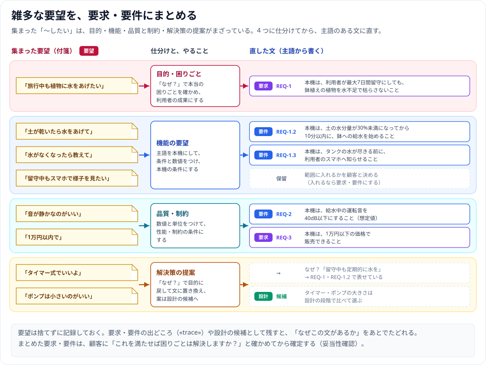
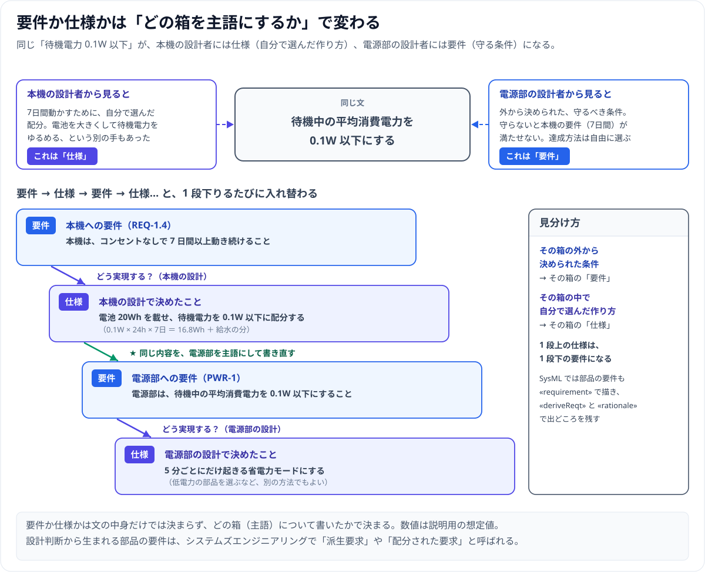
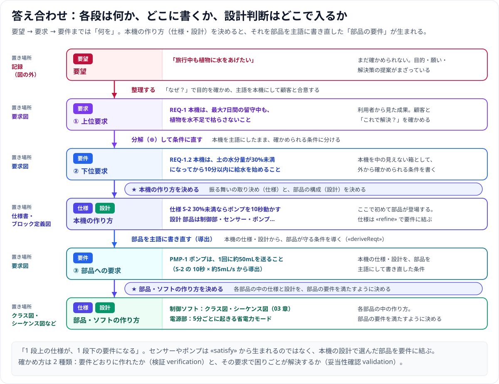

# 00 言葉の定義 — 要望・要求・要件・仕様・設計

要求図を書く前に、いちばん大事な土台をそろえます。「要求」「要件」「仕様」は人によって意味がずれやすい言葉です。日本の規格どうしでも訳語がそろっていません。そこでこのガイドでは、**同じ 1 つの話（旅行中も植物に水をあげたい）**を 5 つの段階で書き分けて、それぞれの言葉の意味を決めます。

> **30 秒でわかる要点**
> 1. **要望**：顧客の言葉そのまま（「〜したい」）。**要求**：利用者が求める**成果**。**要件**：本機が守る**条件**。**仕様**：作り方の**取り決め**。**設計**：中の**構造**。左ほど「何を」、右ほど「どうやって」です。
> 2. 要求と要件の文は、**必ず主語（本機は／ポンプは）から書き**、数値の対象も書きます（例：「**土の水分量**が 30% 未満」）。
> 3. 要件か仕様かは「**どの箱を主語にするか**」で変わります。本機の仕様（設計で選んだ配分）は、1 段下の電源部にとっては要件です。

全部の図に、言葉ごとの色付きマークを付けています：**［要望］赤・［要求］紫・［要件］青・［仕様］藍・［設計］緑**。

> [!NOTE]
> **「土の水分量」とは**：この例では**体積含水率**（土の体積に占める水の体積の割合、%）を指します。土壌水分センサーでよく使われる量です。30% などの数値は、すべて説明用の想定値です。

---

## 1. 言葉の定義：同じ話を 5 段階で書き分ける

| マーク | 言葉 | 意味（このガイドの定義） | 同じ話の書き分け | 規格での呼び方 |
|---|---|---|---|---|
| 赤 | **要望** | 顧客・利用者の言葉そのまま。困りごと・願い・解決策の思いつきがまざる | 「旅行中も植物に水をあげたい」 | ニーズ（needs） |
| 紫 | **要求** | 要望を整理し、**利用者から見てシステムに求める成果**として確かめられる形にしたもの | REQ-1 **本機は**、利用者が最大 7 日間留守にしても、鉢植えの植物を水不足で枯らさないこと | 利害関係者要求（StRS） |
| 青 | **要件** | 要求を満たすために、**システム（や部品）が守らなければならない条件**。外から確かめられる機能・性能・制約 | REQ-1.2 **本機は**、土の水分量が 30% 未満になってから 10 分以内に、鉢への給水を始めること | システム要求（SyRS） |
| 藍 | **仕様** | 要件を満たすために作る側が決めた、**振る舞い・値・例外の取り決め** | S-1・S-2 5 分ごとに水分量を測り、30% 未満ならポンプを 10 秒動かす | 設計仕様 |
| 緑 | **設計** | 仕様を実現する**中の構造・部品・処理の流れ**を決めること（とその図） | 制御部クラスがセンサーを読み、ポンプを動かす（クラス図・シーケンス図） | 設計・アーキテクチャ |

- **要求と要件の違い**は「だれから見たか」です。要求は**利用者から見た成果**（植物が枯れない）、要件は**開発側から見てシステムが守る条件**（30% 未満で 10 分以内に給水開始）です。ISO/IEC/IEEE 29148 も、利害関係者要求（StRS）とシステム要求（SyRS）を別の文書・別の段階として扱っています。
- **仕様と設計の違い**は「外から見た取り決めか、中の作りか」です。仕様は「5 分ごとに測る」「10 秒動かす」のような**振る舞いと値の取り決め**、設計は「どのクラス・部品がそれを担うか」という**構造**です。
- **要求と要件は、どちらも SysML の要求図に «requirement» として描きます。** 仕様は «requirement» にせず、仕様書（表・文章）やアクティビティ図・ステートマシン図に書いて **«refine»**（詳しくする）で要件に結びます。設計で選んだ部品（ブロック）は **«satisfy»**（満たす）で要件に結びます（4 章）。

> [!IMPORTANT]
> **訳語の注意**：同じ英語の *requirement* が、資料によって「要求」とも「要件」とも訳されます。たとえば JIS X 0166（ISO/IEC/IEEE 29148 の日本語版）は「要求エンジニアリング」、IPA の共通フレームは「要件定義」です。このガイドは 29148 の**利害関係者要求を「要求」、システム要求を「要件」**と呼び分けます。チームでは、最初に言葉の定義をそろえておくのが大切です。

### 迷ったときの 4 つの質問

1. **だれの言葉？** 顧客の言葉そのままなら**要望**。
2. **成果か、条件か？** 利用者が得る成果なら**要求**（「枯らさない」）、システムが守る条件なら**要件**（「10 分以内に給水を始める」）。
3. **ほかのやり方でもよい？** 目的を果たす方法がほかにもあるなら、それは選んだ解＝**仕様・設計**（「5 分周期」は 1 分周期でもよい）。
4. **変えたら上の人が困る？** 困るなら要求・要件、困らないなら仕様・設計（周期を変えても、10 分以内に給水されれば顧客は困らない）。

---

## 2. 雑多な要望を、要求・要件にまとめる

顧客から集まる「〜したい」には、性質の違うものがまざっています。**4 つに仕分けてから**、主語のある文に直します。

| 仕分け | 要望の例 | やること | 直した文 |
|---|---|---|---|
| **目的・困りごと** | 「旅行中も植物に水をあげたい」 | 「なぜ？」で本当の困りごとを確かめ、利用者の成果にする | ［要求］REQ-1 本機は、利用者が最大 7 日間留守にしても、植物を水不足で枯らさないこと |
| **機能の要望** | 「土が乾いたら水をあげて」 | 主語を本機にし、条件と数値をつける | ［要件］REQ-1.2 本機は、土の水分量が 30% 未満になってから 10 分以内に給水を始めること |
| **品質・制約** | 「音が静かなのがいい」「1 万円以内で」 | 数値と単位をつける | ［要件］REQ-2 運転音 40dB 以下（想定値）／［要求］REQ-3 1 万円以下で販売できること |
| **解決策の提案** | 「タイマー式でいいよ」 | 「なぜ？」で目的に戻し、文に置き換える。案は設計の候補へ | 「定期的に水を」は REQ-1・REQ-1.2 で表せている。タイマーかどうかは設計で比べて選ぶ |

- 同じ「旅行中も植物に水をあげたい」が、**そのまま要件（30% 未満…）になるわけではありません。** まず目的として要求（REQ-1：枯らさない）になり、それを分解して要件（REQ-1.2）が生まれます。この順番は 1 章の図と同じです。
- **解決策の提案をそのまま要求にしない**のがポイントです。「タイマー式」を要求にすると、「土の水分量を測って給水する」という別の案を選べなくなります。センサーや SD カードのような**物から考え始めると発想が狭まる**のはこのためです。物は、要件が決まったあとの設計の段階で選びます。
- 範囲に入れるか迷う要望（「スマホで様子を見たい」）は、**顧客と決めてから**文にします。
- まとめた要求・要件は、顧客に「**これを満たせば、困りごとは解決しますか？**」と確かめます（**妥当性確認**）。顧客の言葉そのものでなくても、合意できていれば顧客の要求です。

---

## 3. 要件か仕様かは「どの箱を主語にするか」で変わる

「電源部は、待機中の平均消費電力を 0.1W 以下にすること」は要件でしょうか、仕様でしょうか。答えは**どの箱を主語にするかで変わります**。

| 段 | マーク | 文 | なぜそう呼ぶか |
|---|---|---|---|
| 本機への要件（REQ-1.4） | ［要件］ | 本機は、コンセントなしで 7 日間以上動き続けること | 本機の外（利用者）から決められた条件 |
| 本機の設計で決めたこと | ［仕様］ | 電池 20Wh を載せ、待機電力を 0.1W 以下に配分する | 本機の設計者が**自分で選んだ**作り方（電池を大きくする手もあった） |
| 電源部への要件（PWR-1） | ［要件］ | 電源部は、待機中の平均消費電力を 0.1W 以下にすること | 上の行と同じ内容を、**電源部を主語にして書き直した**もの。電源部にとっては外から決められた条件 |
| 電源部の設計で決めたこと | ［仕様］ | 5 分ごとにだけ起きる省電力モードにする | 電源部の設計者が**自分で選んだ**作り方 |

- 見分け方は 1 つです。**その箱の外から決められた条件なら「要件」、その箱の中で自分で選んだ作り方なら「仕様」**。だから「1 段上の仕様は、1 段下の要件になる」のです。
- 設計判断から生まれる部品の要件は、システムズエンジニアリングで**派生要求**や**配分された要求**と呼ばれます。SysML では «requirement» として描き、«deriveReqt» で元の要件に結び、どの判断から生まれたかを «rationale» に残します。

---

## 4. 答え合わせ：各段は何か、どこに書くか、設計判断はどこで入るか

ここまでの話を、上から順に 1 本の流れにすると次のとおりです。[02 の要求図の例](02_requirement-diagram.md#3-上位要求--下位要求--部品への要求要求図の例)と [03 の設計図](03_requirements-to-design.md)も、すべてこの流れの一部です。

| 段 | マーク | 例 | 置き場所 | 前の段との間で起きること |
|---|---|---|---|---|
| 要望 | ［要望］ | 「旅行中も植物に水をあげたい」 | 記録（要求図の外） | ─ |
| ① 上位要求 | ［要求］ | REQ-1 本機は、最大 7 日間の留守中も植物を水不足で枯らさないこと | 要求図 | **整理する**（「なぜ？」で目的を確かめ、主語を本機にして合意） |
| ② 下位要求 | ［要件］ | REQ-1.2 本機は、土の水分量が 30% 未満になってから 10 分以内に給水を始めること | 要求図 | **分解（⊕）して条件に直す**（主語は本機のまま） |
| 本機の作り方 | ［仕様］［設計］ | 仕様 S-2「30% 未満ならポンプを 10 秒動かす」、設計「部品は制御部・センサー・ポンプ・通知部・電源部」 | 仕様書・ブロック定義図 | **★ 本機の作り方を決める**（ここで初めて部品が登場する） |
| ③ 部品への要求 | ［要件］ | PMP-1 ポンプは、1 回に約 50mL を送ること（S-2 の 10 秒 × 約 5mL/s から導出） | 要求図 | **部品を主語に書き直す**（«deriveReqt»＋«rationale»） |
| 部品・ソフトの作り方 | ［仕様］［設計］ | 制御ソフトのクラス図・シーケンス図（03 章）、電源部の省電力モード | クラス図・シーケンス図など | **★ 部品・ソフトの作り方を決める** |

- **①と②は「何を」だけ**を書き、部品や方式は書きません。ここに「センサー」「ポンプ」が出てきたら、設計を先取りしています。
- **センサーやポンプは «satisfy» から生まれるのではありません。** 本機の作り方を決める段階で部品を選び、そのあと「この要件はこの部品が満たす」と «satisfy» で**割り当てを記録**します。
- **③は「1 段上の仕様を、部品を主語にして書き直したもの」**です（3 章の「1 段上の仕様は、1 段下の要件」）。本機にとっては仕様、部品にとっては要件という二面性があるので、要求図には「部品への要求（要件）」として置き、«rationale» に出どころを残します。
- 確かめ方は 2 種類あります。**検証**（verification：要件どおりに作れたか）と、**妥当性確認**（validation：その要求で顧客の困りごとが本当に解決するか）です。

### どこに書くか（まとめ）

| 言葉 | 書く場所 | 要件とのつなぎ方 |
|---|---|---|
| 要望 | 要望の記録（議事録・付箋・チケットなど） | 要求から «trace» で出どころとして結ぶ |
| 要求・要件 | **要求図**（«requirement»） | 分解 ⊕・導出 «deriveReqt» で要求どうしを結ぶ |
| 仕様 | 仕様書の表・文章、アクティビティ図・ステートマシン図など | «refine» で要件に結ぶ |
| 設計 | ブロック定義図・内部ブロック図・クラス図・シーケンス図など | 部品（ブロック）を «satisfy» で要件に結ぶ |
| 確認 | テストケース | «verify» で要件に結ぶ |

この全体像を 1 枚にした図は、[02 の全体マップ](02_requirement-diagram.md#4-全体マップ要求図の外とのつながり)にあります。

---

参考：[ISO/IEC/IEEE 29148:2018](https://www.iso.org/standard/72089.html)（要求の定義、利害関係者要求とシステム要求）、JIS X 0166:2021（その日本語版）、IPA「共通フレーム 2013」（要件定義プロセス）。

次は → [01 UML と SysML](01_uml-vs-sysml.md)　｜　すぐに要求図の書き方へ → [02 要求図の書き方](02_requirement-diagram.md)
