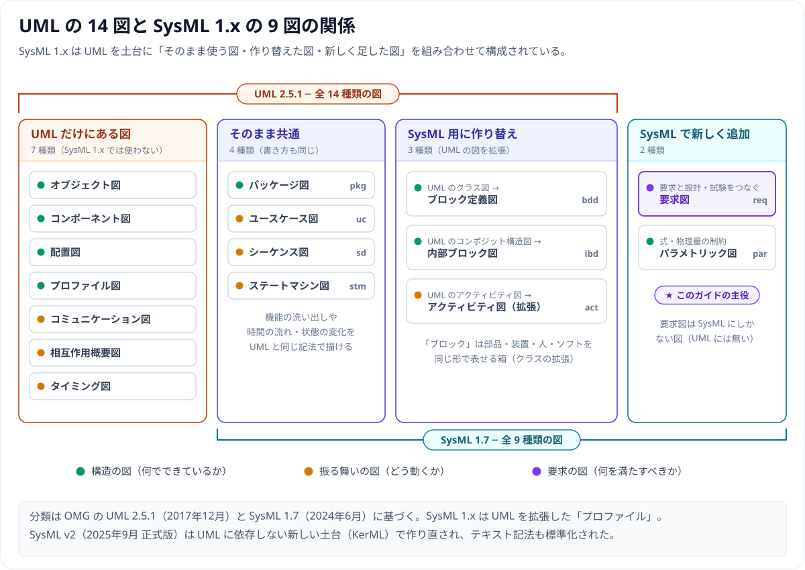
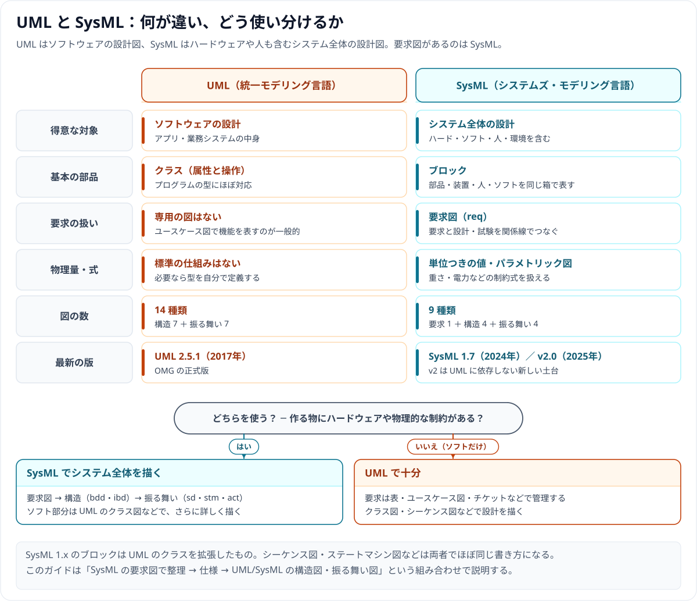

# 01 UML と SysML — 何が違い、どう使い分けるか

**UML** はソフトウェアの設計図を描くための共通言語、**SysML** は UML を土台に、ハードウェア・ソフトウェア・人を含む「システム全体」を描けるように広げた言語です。**要求図（Requirement Diagram）は SysML にしかない図**で、このガイドの主役です。

> **30 秒でわかる要点**
> 1. **UML 2.5.1 は 14 種類、SysML 1.x は 9 種類の図**を持ちます。SysML 1.x は UML の一部をそのまま使い、一部を作り替え、**要求図とパラメトリック図の 2 つを新しく追加**しています。
> 2. 基本の部品は、UML が **クラス**、SysML が **ブロック**（部品・装置・人・ソフトを同じ形で表せる箱）です。
> 3. 迷ったら「**作る物にハードウェアや物理的な制約があるか**」で選びます。あるなら SysML で全体を描き、ソフト部分は UML で詳しくします。

---

## 1. UML の 14 図と SysML の 9 図の関係

| グループ | 図 | ひとこと |
|---|---|---|
| **そのまま共通**（4） | パッケージ図・ユースケース図・シーケンス図・ステートマシン図 | 書き方は UML とほぼ同じ |
| **SysML 用に作り替え**（3） | クラス図 → **ブロック定義図（bdd）**、コンポジット構造図 → **内部ブロック図（ibd）**、アクティビティ図 → アクティビティ図（拡張） | 「クラス」が「ブロック」になり、物理的な部品も描ける |
| **SysML で新しく追加**（2） | **要求図（req）**、パラメトリック図（par） | 要求の管理と、式・物理量の制約 |
| **UML だけ**（7） | オブジェクト図・コンポーネント図・配置図・プロファイル図・コミュニケーション図・相互作用概要図・タイミング図 | SysML 1.x の 9 図には含まれない |

- **SysML 1.x は UML の「プロファイル」**です。プロファイルとは、UML に «block» «requirement» のような印（ステレオタイプ）を足して意味を広げる仕組みです。だから SysML 1.x のシーケンス図は、UML のシーケンス図とほぼ同じように読めます。
- **図の数え方は版で変わります。** 上の分類は OMG の **UML 2.5.1（2017 年 12 月）** と **SysML 1.7（2024 年 6 月）** に基づきます（[UML 2.5.1](https://www.omg.org/spec/UML/2.5.1/)、[SysML 仕様一覧](https://www.omg.org/spec/SysML/)）。

---

## 2. 何が違い、どう使い分けるか

- **得意な対象**：UML はアプリや業務システムの中身（クラスとオブジェクトの世界）。SysML は自動車・家電・ロボットのように、**部品・電気・機械・ソフト・人の操作が組み合わさったシステム**です。
- **要求の扱い**：UML には要求専用の図がなく、ユースケース図で機能を表したり、要求は表やチケットで管理したりするのが一般的です。SysML は**要求図で要求そのものをモデルの部品にし、設計（ブロック）や試験（テストケース）と線で結べます**。
- **物理量**：SysML は単位つきの値（重さ・電力など）と、パラメトリック図で制約式を扱えます。
- **組み合わせて使ってよい**：システム全体は SysML の要求図・ブロック定義図で整理し、ソフトの中身は UML のクラス図で詳しく描く、という分担はよく使われます。このガイドの [03 要求から設計図まで](03_requirements-to-design.md) もこの組み合わせで説明します。

---

## 3. SysML v2 について（知っておくだけで OK）

- OMG は **2025 年に SysML v2.0 を正式版**として公開しました（[OMG の発表](https://www.omg.org/news/releases/pr2025/07-21-25.htm)、[SysML 仕様一覧](https://www.omg.org/spec/SysML/)。仕様一覧での正式版の日付は 2025 年 9 月）。
- v2 は **UML のプロファイルではなく**、KerML という新しい土台の上に作り直されています。図だけでなく**テキストでもモデルを書ける**ようになり、ツール間でモデルをやり取りする API も標準化されました。
- 一方で、現場の多くのツール・教材・既存モデルはまだ **SysML 1.x** です。要求を「分解する」「導出する」「満たす」「確かめる」という考え方は v2 でも変わらないため、このガイドは図で学びやすい **SysML 1.x の記法**で説明します。

---

次は → [02 要求図の書き方](02_requirement-diagram.md)
