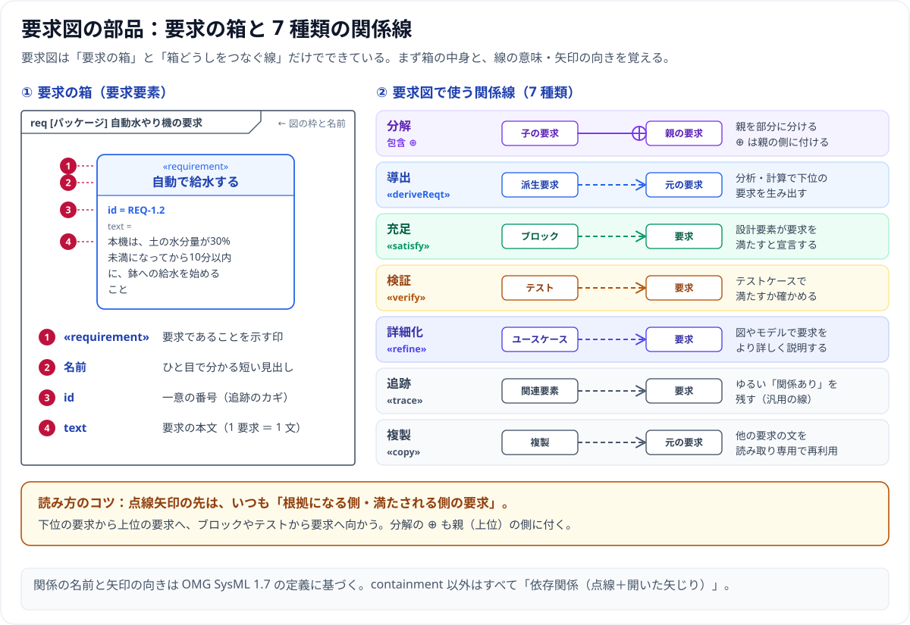
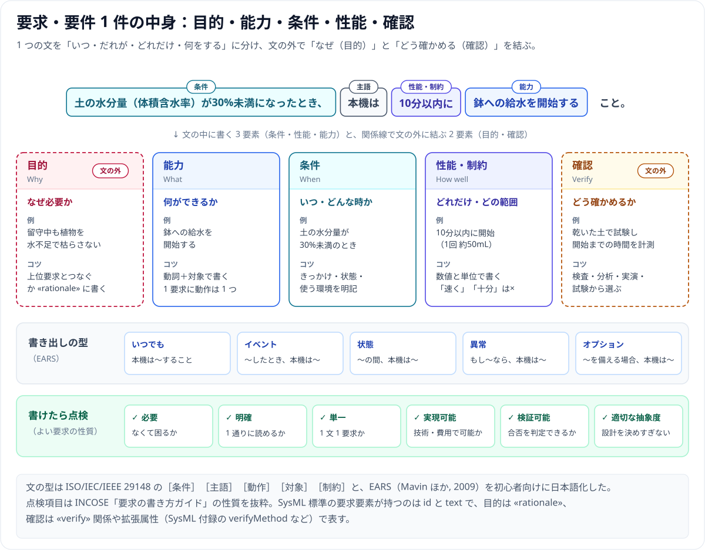
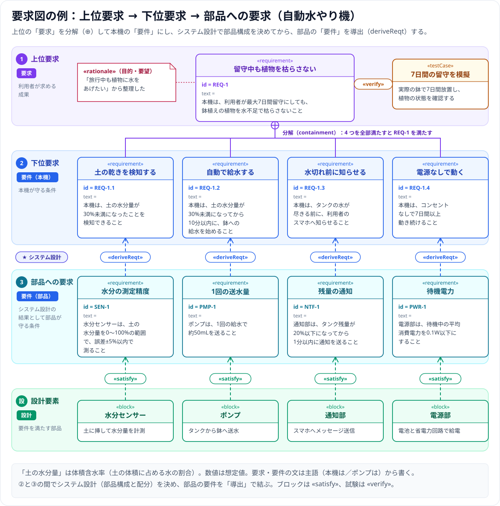
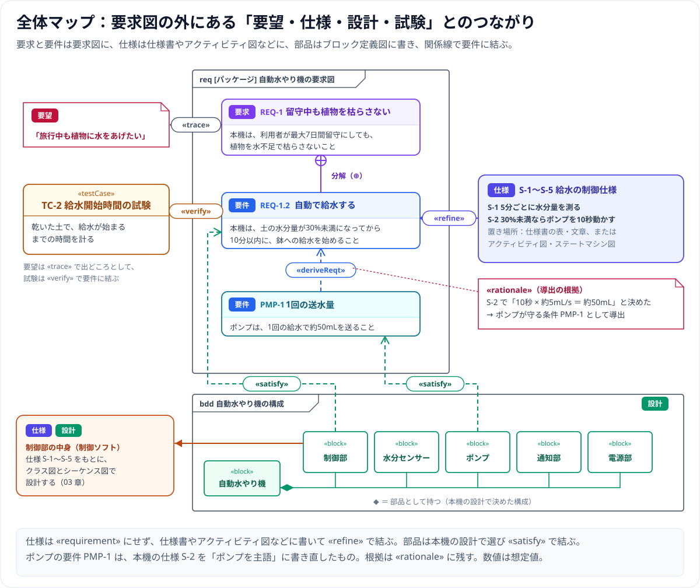
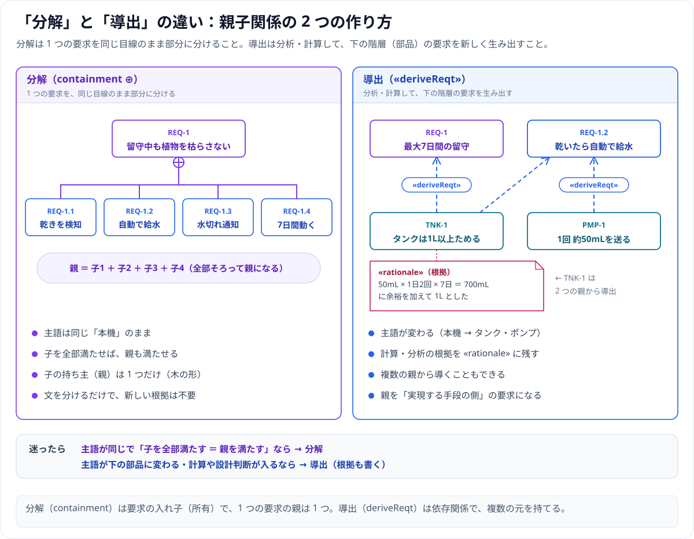
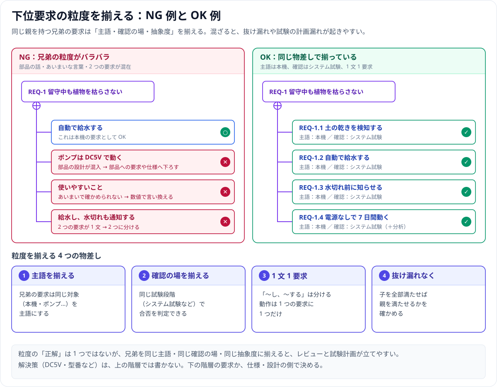
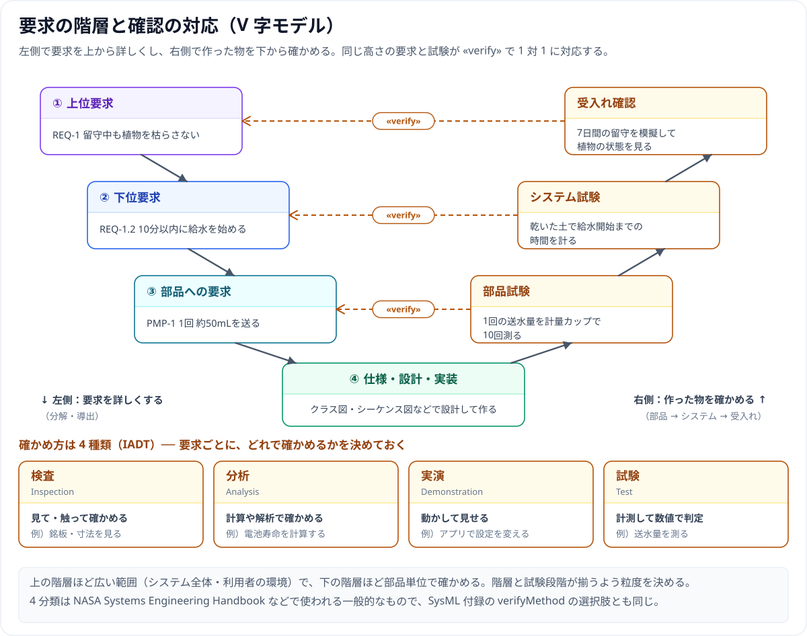
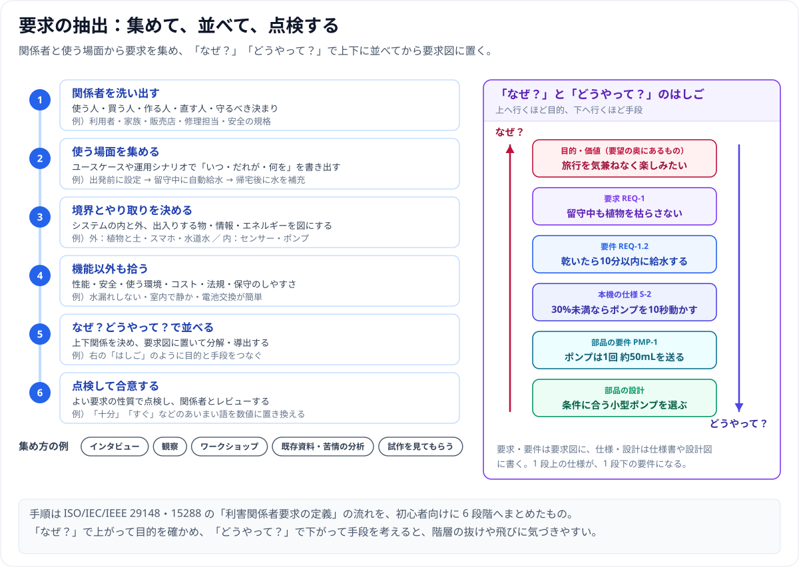

# 02 要求図の書き方 — 親子関係・中身・粒度・抽出

SysML の**要求図（req）**は、「何を満たすべきか」を箱と線で整理する図です。この章では、**自動水やり機**（留守中に鉢植えへ自動で水をあげる小さな装置）を例に、要求の箱の中身、上位要求から下位要求への分け方、粒度の揃え方、要求の集め方までを順に見ていきます。

> [!IMPORTANT]
> 「要望・要求・要件・仕様・設計」の違いは [00 言葉の定義](00_what-is-a-requirement.md) にまとめています。この章では、利用者が求める成果を**要求**、本機や部品が守る条件を**要件**と呼び、どちらも要求図の «requirement» として描きます。先に 00 を読むと、図がぐっと読みやすくなります。

> **30 秒でわかる要点**
> 1. 要求図は「**要求の箱**（id と text）」と「**7 種類の関係線**」でできています。点線矢印の先は、いつも**根拠になる側・満たされる側の要求**です。
> 2. 要求 1 件は「**条件・主語・性能・能力**」を 1 文に書き、「**目的**（なぜ）」と「**確認**（どう確かめる）」を文の外で関係線や注記として結び付けます。
> 3. 親子関係には、同じ目線のまま部分に分ける**分解（⊕ containment）**と、計算・分析して下の階層の要求を生む**導出（deriveReqt）**の 2 種類があります。兄弟の要求は**主語・確認の場・抽象度**を揃えます。

---

## 1. 要求図の部品：要求の箱と 7 種類の関係線

- **要求の箱**には «requirement» の印、**名前**、**id**（一意の番号）、**text**（要求の本文）を書きます。SysML の標準で要求要素が持つ項目は **id と text** です。
- 図全体は **枠（フレーム）**で囲み、左上に `req [パッケージ] 図の名前` のように図の種類と名前を書きます。
- **関係線の覚え方**

| 関係 | 記法 | 向き（どこからどこへ） | 使う場面 |
|---|---|---|---|
| **分解**（containment） | 実線＋ **⊕** | ⊕ を**親**の側に付ける | 1 つの要求を部分に分ける |
| **導出** «deriveReqt» | 点線＋開いた矢じり | 派生した要求 → 元の要求 | 計算・分析で下位の要求を生む |
| **充足** «satisfy» | 同上 | ブロック（設計要素） → 要求 | 「この部品がこの要求を満たす」と宣言 |
| **検証** «verify» | 同上 | テストケース → 要求 | 「この試験でこの要求を確かめる」 |
| **詳細化** «refine» | 同上 | 詳しくする側（ユースケース・仕様など） → 要求 | 図やモデルで要求をより詳しく説明 |
| **追跡** «trace» | 同上 | 関連要素 → 要求 | 上のどれにも当たらない、ゆるい関係 |
| **複製** «copy» | 同上 | 複製 → 元の要求 | 他の文書の要求を読み取り専用で再利用 |

> [!TIP]
> 点線矢印は「**下位 → 上位**」「**設計・試験 → 要求**」の向きに引きます。作業の順番（上位から下位へ考える）とは**逆向き**なので、最初はよく迷います。「矢印の先 ＝ 根拠になる側」と覚えると間違えません。

---

## 2. 要求・要件 1 件の中身：目的・能力・条件・性能・確認

| 要素 | 問い | 例（自動水やり機） | どこに書くか |
|---|---|---|---|
| **目的**（Why） | なぜ必要か | 留守中も植物を水不足で枯らさない | 上位要求とのつながり、«rationale»（根拠の注記） |
| **能力**（What） | 何ができるか | 鉢への給水を開始する | text（動詞＋対象。1 要求に動作は 1 つ） |
| **条件**（When） | いつ・どんな時か | 土の水分量（体積含水率）が 30% 未満になったとき | text（きっかけ・状態・使う環境。何の量かも書く） |
| **性能・制約**（How well） | どれだけ・どの範囲か | 10 分以内に開始する | text（数値と単位で） |
| **確認**（Verify） | どう確かめるか | 乾いた土で試験し、開始までの時間を計る | «verify» でテストケースを結ぶ、確認方法の属性 |

- 文の型は **ISO/IEC/IEEE 29148** の「［条件］［主語］［動作］［対象］［制約］」を日本語向けに並べ替えたものです（[ISO/IEC/IEEE 29148:2018](https://www.iso.org/standard/72089.html)）。
- 書き出しに迷ったら、**EARS**（Mavin ほか、2009 年に提案された要求文の型）の 5 パターン「いつでも／〜したとき／〜の間／もし〜なら／〜を備える場合」から選びます。
- 書けたら、INCOSE の要求の書き方ガイドが挙げる性質のうち、まず **必要・明確・単一・実現可能・検証可能・適切な抽象度** を点検します。「十分に」「すぐに」「使いやすい」のような**あいまい語は数値に言い換え**ます。

---

## 3. 上位要求 → 下位要求 → 部品への要求：要求図の例

| 階層 | 言葉（マーク） | 主語と視点 | 例 | 確かめる場 |
|---|---|---|---|---|
| **① 上位要求** | ［要求］ | 本機。利用者から見た成果 | REQ-1 本機は、利用者が最大 7 日間留守にしても、植物を水不足で枯らさないこと | 受入れ確認（実際の使い方で） |
| **② 下位要求** | ［要件］（本機） | 本機。本機が守る条件 | REQ-1.2 本機は、土の水分量が 30% 未満になってから 10 分以内に給水を始めること | システム試験 |
| **③ 部品への要求** | ［要件］（部品） | 部品。部品が守る条件 | PMP-1 ポンプは、1 回の給水で約 50mL を送ること | 部品試験 |

- 文は**必ず主語から**書きます（本機は／ポンプは／電源部は）。主語がそろっていれば、どの段の文なのかがひと目で分かります。

- **① → ②は分解（⊕）**：REQ-1 を「検知する・給水する・知らせる・動き続ける」の 4 つに分けました。4 つを全部満たすと REQ-1 を満たす、という関係です。①②には部品や方式を書きません。
- **② と ③ の間で、本機の作り方（仕様と設計）が決まります**：「制御部・水分センサー・ポンプ・通知部・電源部で作る」と部品の構成を決め、「30% 未満ならポンプを 10 秒動かす（S-2）」のような振る舞いを決め、性能をどう配分するか（待機電力をどこまで抑えるか）を**計算・分析して**決めます。この仕様と設計は要求図の外（仕様書・ブロック定義図）に書きます。
- **③はその結果を、部品を主語にして書き直したもの**です。例：S-2 の「10 秒 × 約 5mL/s」から、PMP-1「ポンプは 1 回に約 50mL を送ること」が生まれます。②から**導出（deriveReqt）**で結び、根拠を «rationale» に残します。本機にとっては仕様、部品にとっては要件という二面性があります（[00 の「どの箱を主語にするか」](00_what-is-a-requirement.md#3-要件か仕様かはどの箱を主語にするかで変わる)）。
- **設計要素と試験も結ぶ**：部品のブロックは «satisfy» で、テストケースは «verify» で要件に結びます。部品は «satisfy» から生まれるのではなく、本機の設計で選んだ部品を「この要件はこの部品が満たす」と**割り当てる線**です。
- 図中の数値はすべて**説明用の想定値**です。

---

## 4. 全体マップ：要求図の外とのつながり

要求図に描くのは**要求と要件（«requirement»）だけ**です。それ以外は別の場所に書き、関係線で要件に結びます。

| 書くもの | 置き場所 | 要件との関係線 | 図の例 |
|---|---|---|---|
| 要望 | 要望の記録 | 要求 → 要望へ **«trace»**（出どころ） | 「旅行中も植物に水をあげたい」 |
| 仕様 | 仕様書の表・文章、アクティビティ図・ステートマシン図など | 仕様 → 要件へ **«refine»**（詳しくする） | S-1〜S-5 給水の制御仕様 → REQ-1.2 |
| 設計（部品） | ブロック定義図 | ブロック → 要件へ **«satisfy»**（満たす） | ポンプ → PMP-1、制御部 → REQ-1.2 |
| 確認 | テストケース | テスト → 要件へ **«verify»**（確かめる） | TC-2 給水開始時間の試験 → REQ-1.2 |

- **制御部**は本機全体の動き（S-1〜S-5）を受け持つので、部品の要件ではなく本機の要件 REQ-1.2 に直接 «satisfy» で結んでいます。制御部の中身（制御ソフト）は、[03 章](03_requirements-to-design.md)で仕様 S-1〜S-5 をもとにクラス図・シーケンス図として設計します。
- SysML では仕様を «requirement» として要求図に描き込む流儀もありますが、このガイドでは「要求・要件 ＝ 何を」「仕様 ＝ どうやって」を分けるため、仕様は要求図の外に置いて «refine» で結びます。

---

## 5. 「分解」と「導出」の違い

| | 分解（containment ⊕） | 導出（«deriveReqt»） |
|---|---|---|
| **主語** | 親と同じ（本機のまま） | 変わる（本機 → タンク・ポンプ） |
| **親子の関係** | 子を全部満たす ＝ 親を満たす | 子は親を実現するための「手段の側」の要求 |
| **親の数** | 1 つだけ（入れ子・木の形） | 複数の元から導いてよい |
| **根拠** | 文を分けるだけなので不要 | 計算・分析の根拠を **«rationale»** に残す |

- 例：**TNK-1「タンクは 1L 以上ためる」**は、REQ-1（最大 7 日間）と REQ-1.2（給水する）の 2 つから導いた要求です。根拠は「50mL × 1 日 2 回 × 7 日 ＝ 700mL に余裕を加える」と注記に残します。根拠があれば、あとで給水量が変わったときに**どの要求を見直すべきか**がすぐ分かります。

---

## 6. 下位要求の粒度を揃える

兄弟の要求（同じ親を持つ要求）の「大きさ」がバラバラだと、抜け漏れが見えにくくなり、試験の計画も立てにくくなります。次の **4 つの物差し**で揃えます。

1. **主語を揃える**：兄弟はすべて同じ対象（例：すべて「本機は〜」）。「ポンプは DC5V で動く」のような部品の話が混ざったら、**部品への要求の階層か仕様**へ下ろします。
2. **確認の場を揃える**：兄弟はすべて同じ試験段階（例：システム試験）で合否を判定できる大きさにします。
3. **1 文 1 要求**：「給水し、水切れも通知する」のように動作が 2 つあれば、2 つの要求に分けます。
4. **抜け漏れなく**：子を全部満たしたら親を満たせるか、を確かめます。満たせないなら子が足りません。

> [!NOTE]
> 粒度に唯一の正解はありません。ただ、**上の階層ほど「何を」、下の階層ほど「どうやって（どの部品が、どれだけ）」**に寄せ、型番や電圧などの解決策は上の階層に書かない、と決めておくとチーム内でぶれにくくなります。

---

## 7. 要求の階層と確認の対応（V 字モデル）

- **左側で要求を上から詳しくし、右側で作った物を下から確かめます。** 同じ高さの要求と試験が «verify» で対応するように階層を作ると、「どの要求をどの試験で確かめるか」が抜けなくなります。
- 確かめ方は一般に **検査（Inspection）・分析（Analysis）・実演（Demonstration）・試験（Test）** の 4 種類です。たとえば「7 日間動く」は、電池容量と消費電力からの**分析**で確かめ、最後に受入れ確認で実際に動かします。
- 要求を書く時点で「**どれで確かめるか**」まで決めておくと、確かめられない要求（＝あいまいな要求）に早く気づけます。

---

## 8. 要求の抽出：集めて、並べて、点検する

1. **関係者を洗い出す**：使う人だけでなく、買う人・作る人・直す人・守るべき決まり（安全の規格など）も関係者です。
2. **使う場面を集める**：ユースケースや運用シナリオ（出発前に設定 → 留守中に自動給水 → 帰宅後に補充）で、「いつ・だれが・何を」を書き出します。
3. **境界とやり取りを決める**：システムの内と外、出入りする物・情報・エネルギーを図にします。外とのやり取りは要求の漏れが出やすい場所です。
4. **機能以外も拾う**：性能・安全・使う環境・コスト・法規・保守のしやすさ。「水漏れしない」「室内で静か」も立派な要求です。
5. **「なぜ？」「どうやって？」で並べる**：「なぜ？」と問うと上（目的）へ、「どうやって？」と問うと下（手段）へ進みます。間が飛んでいたら、そこに階層が足りません。
6. **点検して合意する**：前の節の性質で点検し、関係者とレビューして合意します。

集め方には、インタビュー・観察・ワークショップ・既存資料や苦情の分析・試作を見てもらう、などがあります。手順は ISO/IEC/IEEE 29148 と 15288 の「利害関係者要求の定義」の流れを、初心者向けに 6 段階へまとめたものです。

---

## 9. よくあるつまずき

| つまずき | どう直すか |
|---|---|
| 矢印の向きが毎回逆になる | 「点線矢印の先 ＝ 根拠になる側（上位の要求・満たされる要求）」と覚える |
| 上位要求に型番や電圧が書いてある | 解決策は下の階層か仕様へ。上位は「何を」まで |
| 何でも ⊕ でつないでしまう | 主語が変わる・計算が入るなら導出（deriveReqt）にして、根拠を残す |
| 要求が多すぎて図が読めない | 図は観点ごとに分けて描き、全体は表（トレーサビリティ表）で管理する |
| 「すぐに」「十分に」が残っている | 数値と単位に言い換え、確かめ方（検査・分析・実演・試験）を決める |
| 要求と要件が混ざって区別できない | 利用者が得る成果なら［要求］、本機や部品が守る条件なら［要件］。文は必ず主語から書く |
| 仕様（5 分ごとに測る など）を要求図に書いてしまう | 仕様は仕様書や振る舞いの図に書き、«refine» で要件に結ぶ（4 節の全体マップ） |

---

基礎へ ← [00 言葉の定義](00_what-is-a-requirement.md)　｜　前へ ← [01 UML と SysML](01_uml-vs-sysml.md)　｜　次は → [03 要求から設計図まで](03_requirements-to-design.md)
