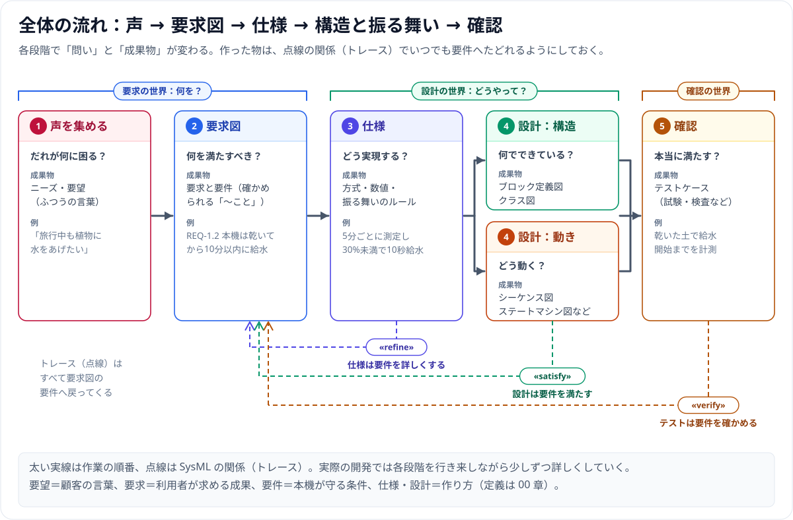
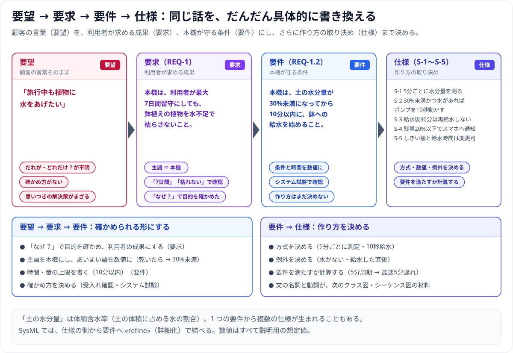
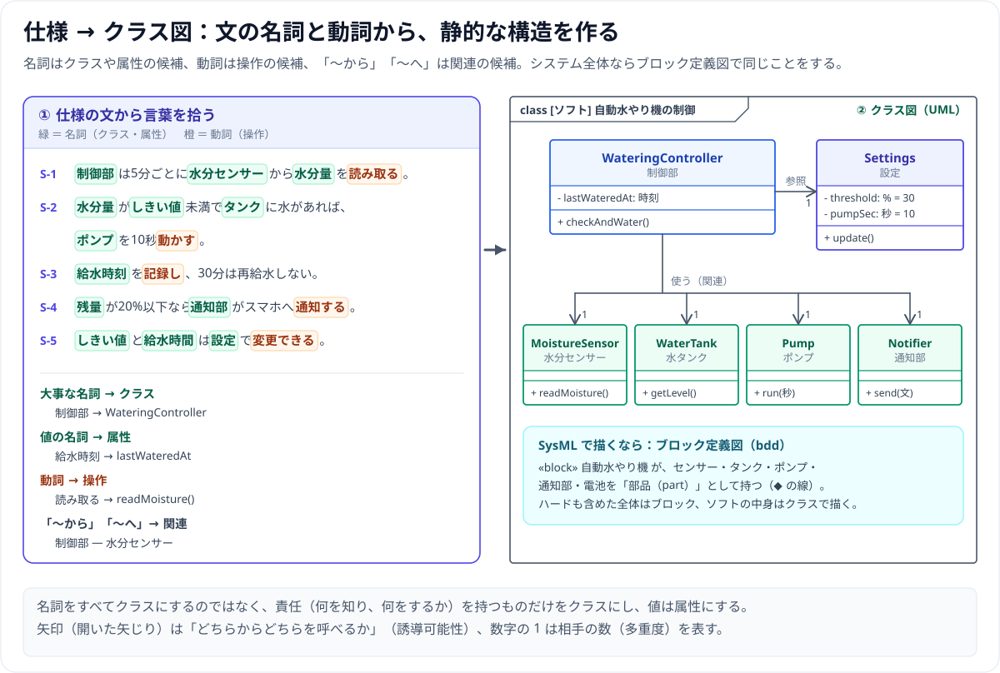
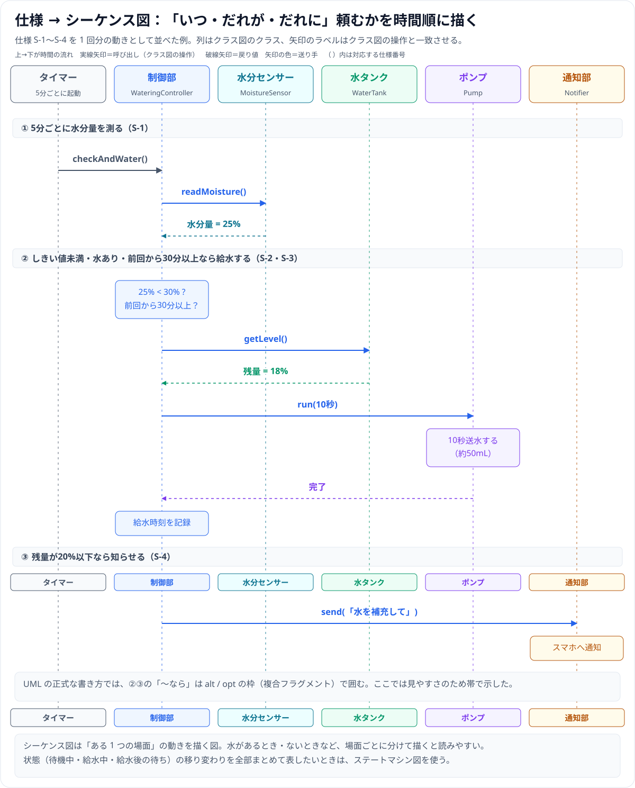
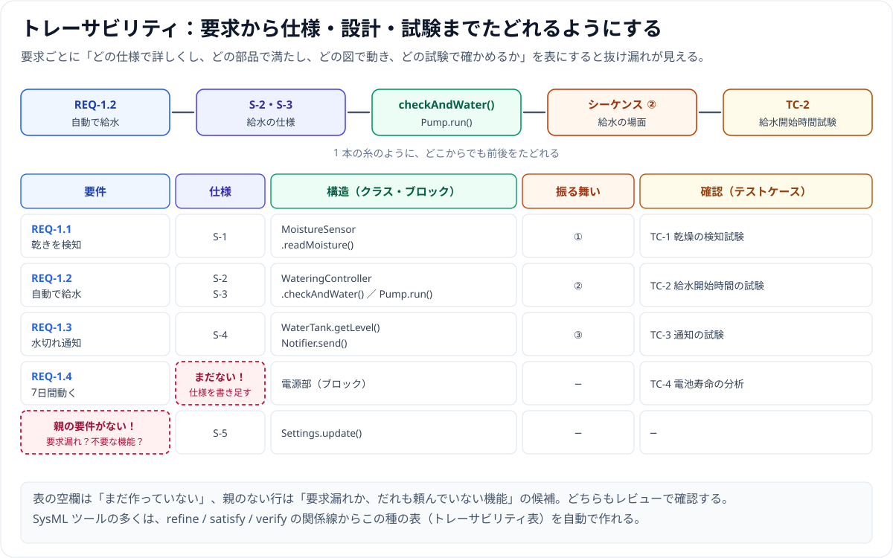

# 03 要求から設計図まで — 要望 → 要求 → 要件 → 仕様 → 設計

顧客の要望を**要求**（利用者が求める成果）と**要件**（本機が守る条件）にして要求図で整理し、**仕様**（作り方の取り決め）を決め、そこから**設計**として静的な構造（クラス図・ブロック定義図）と動的な振る舞い（シーケンス図）へ落とし込む流れを、自動水やり機の例で 1 本につなげて説明します。

> **30 秒でわかる要点**
> 1. 段階ごとに「問い」が変わります：**だれが何に困る？ → 何を満たすべき？ → どう実現する？ → 何でできている？／どう動く？ → 本当に満たす？**
> 2. 仕様の文の**名詞はクラス・属性の候補、動詞は操作の候補**です。その操作が、シーケンス図の矢印のラベルになります。
> 3. 作った物は **«refine» «satisfy» «verify»** で要件へ結び、表にして**空欄（抜け）と親のない行（余計な機能）**を見つけます。

---

## 0. 言葉の使い分け：要望・要求・要件・仕様・設計

| マーク | 言葉 | このガイドでの意味 | 例 |
|---|---|---|---|
| 赤 | **要望** | 顧客・利用者の言葉そのまま（「〜したい」） | 「旅行中も植物に水をあげたい」 |
| 紫 | **要求** | 利用者から見て、システムに求める**成果** | REQ-1 本機は、利用者が最大 7 日間留守にしても、植物を水不足で枯らさないこと |
| 青 | **要件** | 要求を満たすために、本機や部品が守る**条件** | REQ-1.2 本機は、土の水分量が 30% 未満になってから 10 分以内に、鉢への給水を始めること |
| 藍 | **仕様** | 要件を満たすために決めた、振る舞い・値・例外の**取り決め** | S-1・S-2 5 分ごとに水分量を測り、30% 未満ならポンプを 10 秒動かす |
| 緑 | **設計** | 仕様を実現する、中の**構造**と処理の流れ | クラス図・シーケンス図・ブロック定義図 |

> [!NOTE]
> 定義の根拠と見分け方は [00 言葉の定義](00_what-is-a-requirement.md) にまとめています。同じ *requirement* が資料によって「要求」とも「要件」とも訳されるため、このガイドでは ISO/IEC/IEEE 29148 の利害関係者要求を「要求」、システム要求を「要件」と呼び分けます。また、要件か仕様かは「どの箱を主語にするか」で変わります（本機の仕様が、部品にとっては要件になる）。「土の水分量」は体積含水率（土の体積に占める水の割合）を指します。

---

## 1. 全体の流れ

| 段階 | 問い | 成果物 | 主な図 |
|---|---|---|---|
| ① 声を集める | だれが何に困る？ | 要望 | ユースケース図、運用シナリオ |
| ② 要求図 | 何を満たすべき？ | 要求と要件（確かめられる「〜こと」の文） | **要求図** |
| ③ 仕様 | どう実現する？ | 方式・数値・振る舞いの取り決め | 仕様書・表（要件を «refine»） |
| ④ 設計：構造 | 何でできている？ | 部品・クラスと、その関係 | **ブロック定義図・クラス図**（要件を «satisfy»） |
| ④ 設計：動き | どう動く？ | やり取りの順番・状態の変化 | **シーケンス図**・ステートマシン図・アクティビティ図 |
| ⑤ 確認 | 本当に満たす？ | テストケース | 試験計画（要件を «verify»） |

実際の開発では、一方通行ではなく**行き来しながら少しずつ詳しく**していきます。たとえば仕様を考えていて「水がないときはどうする？」と気づいたら、要求図に戻って要件を足します。

> [!NOTE]
> **00・02 章との対応**：③④は「本機の作り方」を決める段階です。ここで部品の構成（ブロック）と振る舞いの取り決め（仕様 S-1〜S-5）が決まり、それを部品を主語にして書き直した**部品の要件**（PMP-1 など）が要求図に加わります（[02 の全体マップ](02_requirement-diagram.md#4-全体マップ要求図の外とのつながり)）。この章の 3・4 節で描くクラス図とシーケンス図は、そのうち**制御部（制御ソフト）の中身**の設計です。

---

## 2. 要望 → 要求 → 要件 → 仕様：だんだん具体的に書き換える

**要望 → 要求：利用者の成果にする**

- 「なぜ？」で目的を確かめる（水をあげたいのは、植物を枯らしたくないから）。
- 主語を本機にし、確かめられる言葉にする（最大 7 日間・水不足で枯らさない）。

**要求 → 要件：本機が守る条件にする**

- 要求を満たすために本機が何をすべきかに分解する（検知する・給水する・知らせる・動き続ける）。
- あいまい語を数値にし、**何の量か**も書く（「乾いたら」→「土の水分量が 30% 未満」）。
- 時間や量の上限を書く（10 分以内）。
- 確かめ方を決める（システム試験で、給水が始まるまでの時間を計る）。

**要件 → 仕様：作り方を決める**

| 番号 | 仕様 | 決めたこと |
|---|---|---|
| S-1 | 5 分ごとに水分量を測る | 方式（定期的に測る） |
| S-2 | 30% 未満かつタンクに水があれば、ポンプを 10 秒動かす（約 50mL） | 方式・数値・例外（水がない） |
| S-3 | 給水後 30 分は再び給水しない | 例外（水がしみ込むまで待つ） |
| S-4 | タンク残量が 20% 以下になったらスマホへ通知する | 別の要件（REQ-1.3）の実現方法 |
| S-5 | しきい値と給水時間はアプリで変更できる | 設定（※ 後で「親のない仕様」と分かる） |

- **仕様が要件を満たすか、計算で確かめます。** 5 分周期で測るなら、乾いてから気づくまで最大 5 分。すぐにポンプを動かせば、要件の「10 分以内」に収まります。
- **「5 分周期」が仕様である理由**：1 分周期にしても、10 分以内に給水が始まるなら顧客は困りません。作る側が選べる値は仕様、変えると顧客が困る値（10 分以内）は要件です。
- 1 つの要件から複数の仕様が生まれ、1 つの仕様が複数の要件に関わることもあります。SysML では仕様の側から要件へ **«refine»** で結べます。

---

## 3. 仕様 → クラス図（静的な構造）

ここで設計するのは、全体マップの「制御部」の中身（制御ソフト）です。水分センサーやポンプなどの部品は、ソフトの中では「その部品を操作する窓口のクラス」として現れます。

**手順**

1. **名詞に印を付ける**：制御部・水分センサー・水分量・タンク・ポンプ・給水時刻・通知部・しきい値・設定。
2. **クラスにするか、属性にするかを決める**：「何かを知っていて、何かをする」責任を持つものは**クラス**（制御部 → `WateringController`、ポンプ → `Pump`）。値にすぎないものは**属性**（給水時刻 → `lastWateredAt`、しきい値 → `Settings.threshold`）。
3. **動詞を操作にする**：読み取る → `readMoisture()`、動かす → `run(秒)`、通知する → `send(文)`。
4. **「〜から」「〜へ」を関連にする**：制御部はセンサー**から**読み、ポンプ**を**動かす → 制御部と各クラスを関連の線で結び、呼べる向きに開いた矢じり、相手の数（多重度）を書きます。

**クラス図の読み方**

- 箱は 3 段で、上から**クラス名・属性・操作**です。`-` は外から見えない（private）、`+` は外から使える（public）という印です。
- 線は**関連**です。開いた矢じりは「どちらからどちらを呼べるか」（誘導可能性）、`1` は相手の数（多重度）を表します。

> [!TIP]
> **システム全体（ハードを含む）を描くなら SysML のブロック定義図**を使います。「«block» 自動水やり機」がセンサー・タンク・ポンプ・通知部・電池を部品（part）として持つ、という形で、ひし形（◆）の線で結びます。ハードも含めた全体はブロック、ソフトの中身はクラス、と描き分けると整理しやすくなります。

---

## 4. 仕様 → シーケンス図（動的な振る舞い）

**手順**

1. **列（ライフライン）を決める**：クラス図のクラス（と、きっかけを作るタイマー）を横に並べます。
2. **場面を 1 つ選ぶ**：「乾いていて、水があり、残量が少ない」のように、条件を決めた**1 回分の動き**を描きます。
3. **仕様の文を上から順に矢印にする**：「制御部がセンサーから読み取る」→ 制御部からセンサーへ `readMoisture()` の矢印。戻り値（水分量 = 25%）は破線で返します。
4. **ラベルをクラス図の操作と一致させる**：シーケンス図に出てきた矢印のラベルが、クラス図に無ければ操作が足りません。逆に、クラス図にあってどの場面にも出てこない操作は、不要か、描いていない場面があるかのどちらかです。

**知っておくと便利な記法**

- 「〜なら」「〜の間くり返す」は、UML では **alt / opt / loop の枠（複合フラグメント）**で囲みます。図では見やすさのため帯で示しています。
- 待機中 → 給水中 → 給水後の待ち、のような**状態の移り変わりをまとめて表す**ときは**ステートマシン図**、処理の流れを分岐込みで描くときは**アクティビティ図**を使います。

---

## 5. トレーサビリティ：要求から設計・試験までたどる

- 要件ごとに「**どの仕様で詳しくし（refine）、どの部品で満たし（satisfy）、どの図で動き、どの試験で確かめるか（verify）**」を表にします。
- **空欄**は「まだ作っていない」印です。例：REQ-1.4（7 日間動く）にはまだ仕様がない → 省電力の方式を仕様に書き足します。
- **親のない行**は「要求漏れか、だれも頼んでいない機能」の候補です。例：S-5（設定変更）には親の要件がない → 関係者に必要か確認し、必要なら要求図に要件を足し、不要なら仕様から外します。
- SysML ツールの多くは、関係線からこうした表（トレーサビリティ表）を自動で作れます。

---

## 6. 一連の流れのチェックリスト

- [ ] 関係者と使う場面から要求を集め、「なぜ？」「どうやって？」で上下に並べた
- [ ] 要望を仕分けし、解決策の提案は「なぜ？」で目的に戻してから要求・要件にした
- [ ] 要求図で上位 → 下位 → 部品への要求を **分解 ⊕ / 導出 deriveReqt** で結び、導出には設計判断の根拠を残した
- [ ] 兄弟の要求の **主語・確認の場・抽象度** が揃っている
- [ ] 各要件に **主語・条件（何の量か）・性能（数値と単位）・確認方法** がある
- [ ] 仕様は方式・数値・**例外**まで決め、要件を満たすか計算で確かめた
- [ ] クラス図の操作と、シーケンス図の矢印のラベルが一致している
- [ ] トレーサビリティ表に **空欄と親のない行** がない（あれば理由を説明できる）

---

## 7. 参考にした一次情報

確認日：**2026-11-17**

- [OMG SysML 仕様一覧](https://www.omg.org/spec/SysML/)（SysML 1.7：2024 年 6 月、SysML 2.0：2025 年 9 月）
- [OMG UML 2.5.1](https://www.omg.org/spec/UML/2.5.1/)（2017 年 12 月）
- [OMG による SysML v2 承認の発表（2025-07-21）](https://www.omg.org/news/releases/pr2025/07-21-25.htm)
- [ISO/IEC/IEEE 29148:2018](https://www.iso.org/standard/72089.html)（要求エンジニアリング：要求文の構成・よい要求の性質）
- INCOSE *Guide to Writing Requirements*（よい要求の性質）、Mavin ほか *Easy Approach to Requirements Syntax (EARS)*（2009 年）、NASA *Systems Engineering Handbook*（検証方法の 4 分類）

---

前へ ← [02 要求図の書き方](02_requirement-diagram.md)　｜　案内へ戻る → [README](README.md)
