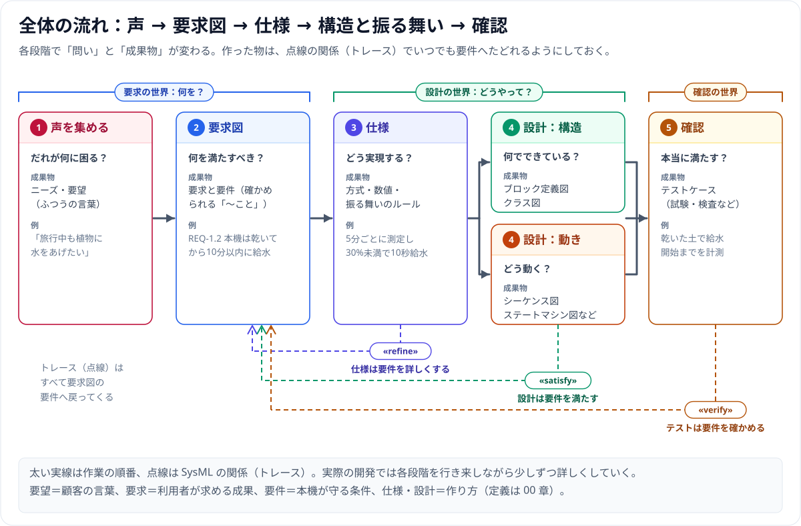

# UML・SysML と要求図 — 図で学ぶ「要望 → 要求 → 要件 → 仕様 → 設計」

「要望・要求・要件・仕様・設計」の言葉の定義から始めて、UML と SysML の違い、**SysML の要求図**の書き方（上位要求・下位要求・部品への要求、目的・能力・条件・性能・確認、粒度の揃え方、要求の抽出）、そして**要望 → 要求 → 要件 → 仕様 → 設計（クラス図・シーケンス図）**へ落とし込む一連の流れまでを、ベクター図（SVG）中心に整理した初心者向けガイドです。例題は全章を通して同じ**自動水やり機**です。



## ガイド一覧

| 順番 | ガイド | 主に分かること |
|---|---|---|
| **0** | [言葉の定義](00_what-is-a-requirement.md) | 要望・要求・要件・仕様・設計の違い（同じ話の書き分け）、雑多な要望の仕分け方、要件か仕様かは「どの箱を主語にするか」で変わること |
| **1** | [UML と SysML](01_uml-vs-sysml.md) | 14 図と 9 図の関係、違いと使い分け、SysML v2 の位置づけ |
| **2** | [要求図の書き方](02_requirement-diagram.md) | 要求の箱と 7 種類の関係線、要求・要件 1 件の中身、要求図と仕様・設計・試験の全体マップ、分解と導出、粒度の揃え方、確認との対応、要求の抽出 |
| **3** | [要求から設計図まで](03_requirements-to-design.md) | 要望・要求・要件・仕様の書き換え、仕様からクラス図とシーケンス図へ、トレーサビリティ |

## 図の一覧（19 枚）

| 図 | 内容 | 載っている章 |
|---|---|---|
| [req-00a](assets/req-00a-need-requirement-spec.svg) | 言葉の定義：要望・要求・要件・仕様・設計と、迷ったときの 4 つの質問 | 0 |
| [req-00b](assets/req-00b-wishes-to-requirements.svg) | 雑多な要望を、要求・要件にまとめる | 0 |
| [req-00c](assets/req-00c-what-how-by-level.svg) | 要件か仕様かは「どの箱を主語にするか」で変わる | 0 |
| [req-00d](assets/req-00d-levels-explained.svg) | 答え合わせ：各段は何か、どこに書くか、設計判断はどこで入るか | 0 |
| [req-01](assets/req-01-uml-sysml-family.svg) | UML の 14 図と SysML 1.x の 9 図の関係 | 1 |
| [req-02](assets/req-02-uml-sysml-compare.svg) | UML と SysML の違い・使い分け | 1 |
| [req-03](assets/req-03-req-diagram-parts.svg) | 要求図の部品と 7 種類の関係線 | 2 |
| [req-04](assets/req-04-requirement-anatomy.svg) | 要求・要件 1 件の中身（目的・能力・条件・性能・確認） | 2 |
| [req-05](assets/req-05-requirement-tree.svg) | 上位要求 → 下位要求 → 部品への要求 の要求図 | 2 |
| [req-05b](assets/req-05b-model-map.svg) | 全体マップ：要求図の外にある要望・仕様・設計・試験とのつながり | 2 |
| [req-06](assets/req-06-containment-vs-derive.svg) | 分解（containment）と導出（deriveReqt）の違い | 2 |
| [req-07](assets/req-07-granularity.svg) | 下位要求の粒度を揃える（NG / OK） | 2 |
| [req-08](assets/req-08-levels-and-verification.svg) | 要求の階層と確認の対応（V 字） | 2 |
| [req-09](assets/req-09-elicitation.svg) | 要求の抽出と「なぜ？/どうやって？」のはしご | 2 |
| [req-10](assets/req-10-flow-overview.svg) | 声 → 要求図 → 仕様 → 設計（構造・動き） → 確認 | 3 |
| [req-11](assets/req-11-need-requirement-spec.svg) | 要望 → 要求 → 要件 → 仕様 の書き換え | 3 |
| [req-12](assets/req-12-spec-to-class.svg) | 仕様 → クラス図 | 3 |
| [req-13](assets/req-13-spec-to-sequence.svg) | 仕様 → シーケンス図 | 3 |
| [req-14](assets/req-14-traceability.svg) | トレーサビリティ表 | 3 |

## 図の色分けルール

| 色 | 意味 |
|---|---|
| 紫 | 要求（上位要求：利用者が求める成果） |
| 青 | 要件（下位要求：本機が守る条件） |
| 水色 | 部品への要求（部品が守る要件・派生要求）・SysML |
| 藍 | 仕様 |
| 緑 | 設計要素（ブロック・クラス）・静的な構造 |
| 橙 | UML・動的な振る舞い |
| 黄土 | 確認（試験・テストケース） |
| 赤 | 要望・目的（根拠）・NG 例 |

**言葉のマーク**：図中の色付きタグ［要望］赤・［要求］紫・［要件］青・［仕様］藍・［設計］緑は、全図で同じ意味です。定義は [00 言葉の定義](00_what-is-a-requirement.md) を参照してください。

## 図の再生成

```text
uml-guide/req/
├─ README.md                      ← この案内
├─ 00_what-is-a-requirement.md
├─ 01_uml-vs-sysml.md
├─ 02_requirement-diagram.md
├─ 03_requirements-to-design.md
├─ assets/                        ← SVG 図 19 枚
└─ scripts/generate-diagrams.js   ← Node.js 標準機能と共通キットだけで図を再生成
```

```powershell
node uml-guide/req/scripts/generate-diagrams.js
```

文字が枠からはみ出しそうな箇所があると、再生成時に `[幅チェック]` として警告が出ます。描画には共通キット [scripts/svg-diagram-kit.js](../../scripts/svg-diagram-kit.js) を使っています。

- **確認時点**：2026-11-17 に OMG の仕様ページ（UML 2.5.1・SysML 1.7・SysML 2.0）を確認しています。出典は [03 の参考資料](03_requirements-to-design.md#7-参考にした一次情報) にまとめています。
- **数値について**：自動水やり機の数値（30%・10 分・50mL など）は説明用の想定値です。
